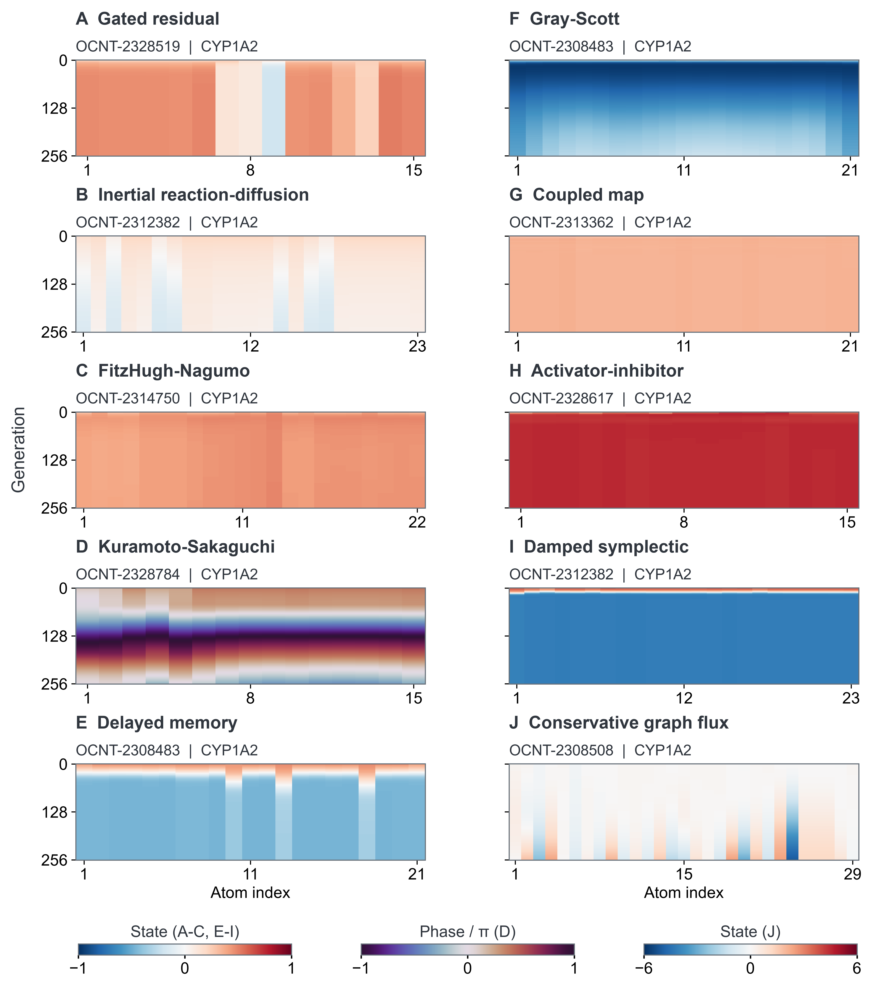

# Molecular Space-Time: Emergent Prediction from Local Interactions in an Evolved Graph Cellular Automaton

**Anthony Nash, PhD**

**Independent Researcher, Warwickshire, United Kingdom**

**info@acnash.co.uk**

## Abstract

This study investigates how local interactions between atomic cells generate predictive information and complex dynamical behaviour. Molecular graphs form cellular automata whose numerical atom states evolve through interactions along chemical bonds. Their molecular space-time trajectories provide fingerprints for predicting enzyme inhibition. Genetic programming evolves the cellular automaton transition rule, while backpropagation trains numerical weights and ridge regression fits predictions. In the OpenADMET CYP Inhibition Challenge, genetic programming modestly reduced blind prediction error from 1.0092 to 0.9946 on the official metric. Separate dynamical analyses identified convergence, possible periodic behaviour and persistent complex variation. Two systems exhibited bounded hyperchaotic dynamics, with small initial differences growing in multiple independent directions. Discontinuities in the phase-based rule and unresolved fractal dimension leave their classification as strange attractors provisional. These findings support molecular space-time as a framework for studying how local interactions generate predictive information and dynamical complexity.

**Keywords:** cellular automata; complex systems; emergence; genetic programming; graph dynamics; molecular representation; nonlinear dynamics

## 1. Introduction

Cellular automata demonstrate how repeated local interactions produce organised behaviour, including fixed configurations, oscillators, propagating structures, long transients, computational universality and transitions between order and disorder [1–3]. Reaction–diffusion systems provide a related physical example: local chemical reactions change species concentrations, while diffusion redistributes those species through space, together generating larger-scale patterns [4]. This principle motivates our computational investigation: atoms carry numerical states, bonds define communication routes, and training adjusts their local interactions so that trajectory summaries predict enzyme inhibition.

Three related approaches motivate our use of repeated local interactions to learn a molecular representation. Learned graph cellular automata extend shared cellular automaton transition rules to irregular networks, providing a framework that accommodates atoms connected by chemical bonds [5]. Neural cellular automata demonstrate how training can adjust local interactions so that numerical state channels collectively support a desired behaviour; each channel acquires its role through training [6]. Molecular message-passing networks show how exchanging information between bonded atoms can support molecular-property prediction [7]. Together, these approaches motivate a model that learns local interactions on molecular graphs and retains the resulting atom-state trajectories as predictive features.

We call the retained atom-state trajectory **molecular space-time**. At generation *t*, each atom carries a vector of learned numerical values. Their possible combinations across the molecule define its computational *state space*: one point records all atom-state values at one generation, and a direction describes a particular combination of changes to them. A shared nonlinear cellular automaton transition rule uses messages along typed bonds to advance the graph to generation *t* + 1. Summaries of early changes, intermediate states and final states form a molecular fingerprint, a numerical feature vector for predicting pIC50.

We compared three approaches to learning this representation: backpropagation trained numerical weights within fixed transition-rule families; a genetic algorithm additionally selected model configurations; and genetic programming evolved the mathematical transition rule itself. All three used ridge regression to combine trajectory features into predictions, with prediction errors guiding the weights through the differentiable fit. Configuration choices included the rule family, number of generations and channels, chemical descriptors and trajectory summaries, as explained in Sections 2.2–2.4 and Appendix A. Genetic algorithms search encoded design vectors, while genetic programming applies selection, crossover and mutation to executable symbolic structures [8, 9]. Section 2.4 also describes an evolutionary-strategy comparator that trained numerical weights without backpropagation.

The 2026 OpenADMET CYP Inhibition Challenge provided an external validation task. Cytochrome P450 (CYP) enzymes influence the metabolism and clearance of many medicines, and inhibition can contribute to clinically important drug interactions [10]. The challenge examined four CYP isoforms, CYP1A2, CYP2C9, CYP2D6, and CYP3A4, which are distinct enzyme members of this family with different substrate preferences. Each isoform defined a separate prediction task: using the compound’s molecular structure to predict how potently it inhibits that enzyme. The organisers compared the resulting direct-inhibition pIC50 predictions with concealed experimental measurements. This independent evaluation tests the predictive usefulness of the molecular space-time fingerprints.

We also examined the trained trajectories for convergence, repeating oscillations, persistent complex variation and chaos [1–3, 11–13]. With model parameters fixed, we followed atom states for thousands of generations and measured recurrence, frequency spectra, perturbation growth, Lyapunov exponents and attraction basins. Introducing small initial differences tests whether nearby computational states progressively separate, providing evidence relevant to chaos. We also examined whether trajectories approach a bounded set with fractal geometry, whose dimension describes how its detail changes with measurement scale. Reliable estimates require excluding states close together in generation number and checking consistency across representations with different numbers of coordinates [14–16].

Genetic programming modestly improved blind prediction. The dynamical analyses identified convergence, possible periodic behaviour and persistent complex variation, including two bounded hyperchaotic systems. Phase-boundary discontinuities and unresolved fractal dimension leave their classification as strange attractors provisional.

## 2. Materials and Methods

### 2.1. Dataset and Prediction Task

The study used the primary direct-inhibition dataset released for the 2026 OpenADMET CYP Inhibition Blind Challenge (https://openadmet.org/blindchallenges/). It comprised 4,905 unique compounds represented by a molecule identifier and a Simplified Molecular Input Line Entry System (SMILES) string. The dataset provided experimental direct-inhibition pIC50 values for four drug-metabolising cytochrome P450 enzyme isoforms: CYP1A2, CYP2C9, CYP2D6, and CYP3A4. Each value described inhibition of one specific isoform by one compound. Here, pIC50 denotes the negative base-10 logarithm of the half-maximal inhibitory concentration expressed in molar units. Each reported measurement included lower and upper uncertainty bounds and an estimated standard deviation from the fitted concentration–response experiment.

The experiments did not necessarily measure each compound against every CYP isoform. The dataset contained 6,525 observed compound–CYP pairs, distributed as summarised in Table 1.

**Table 1. Number of observed direct-inhibition pIC50 measurements for each CYP isoform.**

| CYP isoform | Compounds with an observed direct-inhibition pIC50 |
|---|---:|
| CYP1A2 | 1,412 |
| CYP2C9 | 1,285 |
| CYP2D6 | 1,493 |
| CYP3A4 | 2,335 |
| **Total** | **6,525** |

Each observed compound–CYP pair formed a training case, with molecular structure and isoform identity as inputs and experimental pIC50 as the target. An *endpoint* denotes the direct-inhibition prediction task for one isoform. The CYP-specific systems used observations for their assigned endpoint throughout fitting and selection (Section 2.4). Unmeasured compound–CYP pairs remained missing and contributed neither targets nor loss terms.

We grouped compounds by their standardised Bemis–Murcko scaffold, the structural skeleton comprising rings and their connecting chains after removal of side branches. Reserving 20% of scaffold groups as a sealed holdout left 5,216 observed compound–CYP pairs for fitting and internal selection and 1,309 for final validation. Scaffold groups were exclusive to each partition, allowing evaluation beyond closely related chemistry. Hyperparameter selection used the fitting pool alone.

The challenge test set contained 750 additional compounds for which the organisers withheld all direct-inhibition labels. The challenge required the four trained CYP-specific graph cellular automaton models to generate one finite pIC50 prediction per isoform for each compound, giving 3,000 blinded compound–CYP predictions. We excluded blinded compounds and their unreleased outcomes from parameter estimation, hyperparameter selection, early stopping, and dynamical candidate selection. Predictive evaluation followed the challenge formulation: the primary measure was the macro-averaged soft-threshold relative absolute error (MA-ST-RAE) across the four CYP isoforms, with equal weight for each isoform and zero error for predictions falling within the reported experimental uncertainty interval. Lower MA-ST-RAE indicates better prediction under this uncertainty-aware measure. We retained conventional regression statistics as complementary measures of predictive agreement, including root mean squared error (RMSE), which summarises prediction-error magnitude, and rank correlations, which assess how well predictions preserve the ordering of experimental values.

### 2.2. Molecular Graph Representation

We used RDKit to standardise SMILES structures, including common groups of bonded atoms and their formal atomic charges (integer charges assigned to individual atoms, such as +1 or −1). We then retained the largest organic fragment and applied RDKit's sanitisation procedure to check the consistency of the molecular representation, including whether each atom's number and types of bonds were compatible with its assigned chemical state. We converted the resulting structure to canonical isomeric SMILES. We represented each standardised molecule as a graph G=(V,E), where every heavy atom (an atom other than hydrogen) i ∈  V was a cellular-automata cell and every covalent bond defined two directed message-passing edges, j →  i and i →  j. The predictive input, meaning the model inputs for predicting pIC50, comprised the standardized two-dimensional graph connectivity, atom and bond descriptors, and CYP context; it contained no molecular geometry.

The standard set of atomic descriptors contained one-hot element identity for H, C, N, O, F, P, S, Cl, Br, I, and other elements; for example, with this ordering the encoding represented carbon as (0,1,0,0,0,0,0,0,0,0,0) and oxygen as (0,0,0,1,0,0,0,0,0,0,0). Further descriptors comprised formal charge; aromaticity; sp, sp2, sp3 (types of atomic orbital hybridisation), and other hybridisation states; degree; total attached hydrogens; ring membership; hydrogen-bond donor and acceptor status; and tetrahedral chirality. We also tested additional atomic descriptors, organised into the five groups in Table 2. To choose which groups to include, we compared their predictive performance using training and validation subsets drawn entirely from the fitting data. The sealed holdout and blinded challenge set played no part in that selection.

**Table 2. Chemically organised atom-feature groups considered during training-only model selection.** A feature group is a named collection of related atom-level descriptors that we added to the baseline encoding as one candidate block.

| Feature group | Atom-level quantities |
|---|---|
| Periodic | Atomic number, atomic mass, covalent radius, van der Waals radius, outer electrons, period, group, and approximate atomic volume. |
| Valence | Total and implicit valence, heavy-atom degree, radical electrons, and absolute formal charge. |
| Electronic | Pauling electronegativity, approximate polarizability, heteroatom and halogen indicators, conjugated-bond fraction, first ionization energy, electron affinity, and missing-property indicator. |
| Ring geometry | Number of rings containing the atom and indicators for ring sizes 3, 4, 5, 6, 7, and 8 or greater. |
| Local environment | Mean neighbouring electronegativity, electronegativity difference from the neighbourhood, mean neighbouring atomic number, and mean neighbouring formal charge. |

The *feature profile* specifies which chemical descriptors form each atom's input vector: the baseline encoding together with the selected additional feature groups in Table 2. We stored the selected feature profile with every frozen checkpoint, meaning the saved model whose parameters we held fixed for evaluation. This preserved the exact feature names and order required to predict new molecules. We scaled continuous quantities by fixed chemically meaningful constants during graph construction. The bond vector 𝑒ⱼᵢ contained one-hot indicators for single, double, triple, or aromatic bonds, together with indicators for conjugation, ring membership, and three stereochemical properties. We attached the same bond vector to both directed representations of an undirected bond.

A four-entry context vector, 𝒄, identified the target CYP isoform: its entry was 1 and the remaining entries were 0. This one-hot encoding supplied target identity to the cellular automaton and prediction readout, allowing one molecular graph to generate isoform-specific trajectories and predictions.

Each atom carries H numerical state values, called channels, which change over generations. They are latent because training determines how they combine the chemical descriptors to support prediction. Figure 1 illustrates the graph encoding and formation of these initial values.


**Figure 1. Molecular graph encoding and formation of the initial dynamical state.** **A**, N-methylacetamide illustrates the molecular graph: each heavy atom (an atom other than hydrogen) forms a cell, and each bond allows information to pass in both directions. The vector xᵢ records the atom's chemical properties, including its attached hydrogen count, while 𝑒ⱼᵢ records the bond's properties. **B**, the model combines each atom's F input descriptors into H numerical state values, called channels. Learned weights determine how strongly each descriptor contributes to each channel; scaling and the hyperbolic tangent then keep the initial values between −1 and 1. The same transformation applies to every atom. The example of 20 descriptors producing 8 channels is illustrative. These initial values subsequently change through interactions with bonded neighbours, forming the molecular space-time trajectory.

### 2.3. Nonlinear Graph Cellular Automaton

The Graph Cellular Automaton (Graph-CA) advances the initial atom states defined in Section 2.2 through repeated local interactions. Each state's role depends on its effects on neighbours, subsequent generations and prediction.

We screened ten Graph-CA transition-rule families: gated residual, inertial reaction–diffusion, FitzHugh–Nagumo, Kuramoto–Sakaguchi, delayed memory, Gray–Scott, coupled map, activator–inhibitor, damped symplectic and conservative graph flux. A rule family specifies how an atom calculates its next numerical state. All ten use atomic cells connected by chemical bonds, with one local rule shared across atoms and repeated at every generation. They differ in how they use the atom states, bonded-neighbour information and any retained earlier states. Chemical descriptors set the initial states; most rules also use chemical descriptors and CYP context during subsequent updates. The conservative graph flux rule subsequently exchanges state values directly along bonds. Repeated updates allow information to spread through the molecular graph. Appendix A describes the shared calculations and the implementation of all ten rules.

Figure 2 illustrates all ten rules; Section 2.4.1 identifies those selected for prediction, and Table 5 reports their dynamical screening results.

**Gated residual.** This rule forms a bounded mixture of the current state and a proposed value calculated from local inputs [17] (Figure 2A). A learned gate controls the mixture separately for each atom, channel and generation, providing adaptive memory through selective retention or change. The approach relates to gated recurrent neural networks [18] and neural cellular automata [19].

**Inertial reaction–diffusion.** This rule combines locally generated change, numerical exchange with bonded neighbours and restoration towards a central state [4] (Figure 2B). A velocity-like variable carries earlier change into the next generation [20], allowing overshoot, damping and propagation of disturbances. Here, diffusion describes numerical information exchanged across bonds; physical reaction–diffusion supplies the mathematical analogy.

**FitzHugh–Nagumo.** This rule divides each atom's state into faster excitation and slower recovery components [21, 22] (Figure 2C). Local input can move excitation away from rest, with recovery regulating or reversing the change later. Chemical information and bonded-neighbour exchange shape both components, allowing threshold responses, pulses and oscillatory return.

**Kuramoto–Sakaguchi.** Each channel represents a phase within a repeating cycle [23, 24] (Figure 2D). Bonded atoms interact through phase differences, while chemical information and CYP context determine their preferred rates of advance. Neighbours may synchronise, retain an offset or resist alignment. Phases repeat after a complete turn, creating a circular state space whose numerical boundary requires care in the dynamical analyses (Sections 2.5 and 3.3).

**Delayed memory.** Each atom accesses a retained earlier state [25] (Figure 2E). The next state combines current local inputs with a learned response to that earlier state and the difference between past and present. The delay controls when information returns, allowing feedback to reinforce or oppose recent changes after several rounds of neighbour communication.

**Gray–Scott.** This rule (Figure 2F) divides each atom's channels into two interacting groups. A nonlinear term transfers numerical activity from one group to the other, while replenishment, removal and exchange with bonded neighbours shape their evolution. The chemical descriptors and CYP context also contribute to the updates.

**Coupled map.** This rule (Figure 2G) applies a curved, nonlinear function to each current state value and combines the result with a corresponding calculation from the mean neighbour state. Repeating this simple calculation can generate steady, repeating or irregular patterns, depending on the settings. This rule supplies the candidate period-two oscillator shown later in Figures 4 and 6.

**Activator–inhibitor.** This rule (Figure 2H) divides the channels into an activating group and a regulating group. The first can amplify local changes, while the second feeds back on that activity; both groups also exchange information with bonded neighbours. It is closely related to the FitzHugh–Nagumo implementation, with different settings for the strengths of feedback, neighbour exchange and local inputs.

**Damped symplectic.** This rule (Figure 2I) divides the state into position-like and momentum-like channel groups. It first updates the momentum-like values from local inputs, neighbour differences and a restoring term, then uses them to update the position-like values. Damping reduces retained momentum, and bounding functions limit both channel groups; these are numerical analogues of motion used to organise information on the molecular graph.

**Conservative graph flux.** This rule (Figure 2J) transfers numerical state between bonded atoms. Each transfer adds to one atom what it subtracts from the other, preserving the molecule-wide sum in each channel up to numerical rounding. The atom-state differences, learned weights and bond descriptors determine the transfers.

The rule names identify their mathematical inspirations; all generate learned numerical trajectories on molecular graphs.

The ten families share graph construction, available descriptors, bond information and the prediction task, with selected features and use of CYP context depending on the configuration. Their different local calculations allow us to investigate how the transition rule influences prediction and dynamical behaviour. Section 4.4 describes the descriptor-only control still needed to establish the additional predictive value of repeated interactions.

Each Graph-CA transition rule produces a trajectory containing the state of every atom at every generation. Molecules contain different numbers of atoms, so the complete trajectories cannot be passed directly to one fixed-size prediction model. We therefore summarised each trajectory across atoms and across selected generations. These summaries captured final state, variation between atoms, change through time and behaviour at several temporal scales. The resulting fixed-length molecular fingerprint was supplied to ridge regression. Optional summaries allowed the genetic search to test whether persistence, correlation, transition energy or the direction of change added useful information. Appendix A defines these quantities and explains the CYP-specific fingerprint construction.

Figure 2 illustrates these trajectories using separately trained systems and different example molecules, with some molecules appearing under multiple rules. Its caption specifies the display scales and comparison limits.



**Figure 2. Recorded molecular cellular evolution under ten transition-rule families.** Panels A-E run down the left column and F-J down the right. Each title identifies the rule and the example compound's OCNT identifier from the OpenADMET dataset. All examples use CYP1A2 context. Columns show heavy atoms in stored graph order; rows show every generation from 0 to 256. Interactions follow molecular bonds. Colour shows the first state channel. Panels A-C and E-I share a scale from −1 to 1; panel J uses −6 to 6 because its recorded values extend beyond that range. Panel D shows the first phase angle divided by π, with −1 and 1 representing the same phase. Values retain their original amplitudes. The panels illustrate separately trained systems and are not a matched comparison on one molecule. Rule families C, E, F, I and J contributed to the BP-Graph-CA submission across its four CYP targets; these example trajectories are illustrations, not the submission predictions.

### 2.4. Learning the Molecular Space-Time Representation

All four learning methods used ridge regression to convert molecular trajectory fingerprints into pIC50 predictions (Figure 3). Pooling supplied the fixed-length fingerprints described in Section 2.3. Ridge regression combined their values using coefficients calculated from training observations, with a penalty discouraging very large coefficients to help control overfitting. The methods differed in how they trained or selected the Graph-CA producing these fingerprints.

Backpropagation works backwards from prediction error to calculate how trainable numerical weights should change. Here, it passed through the ridge fit and every retained Graph-CA generation. The four methods used this calculation or an evolutionary alternative as follows:

- **Fixed-rule Graph-CA (BP-Graph-CA):** backpropagation trained numerical weights within a chosen cellular automaton transition rule and the other Graph-CA components; the rule's mathematical form stayed fixed.
- **Evolutionary strategy (ES-Graph-CA):** small random changes to the weights produced candidate models. Their prediction errors indicated useful directions of change, guiding updates without backpropagation.
- **Hybrid genetic search (GA-Graph-CA):** a genetic algorithm selected and recombined model *configurations*: choices of rule family, number of generations and channels, chemical descriptors and trajectory summaries. Backpropagation trained each candidate's numerical weights.
- **Genetic programming (GP-Graph-CA):** genetic search changed the mathematical transition rule, including how addition, multiplication or averaging combined local inputs and neighbour-state differences. Backpropagation trained each candidate's numerical weights, and validation error guided selection. Each candidate rule remained fixed throughout its molecular trajectories.

All training and model selection used the fitting data and its internal scaffold-separated validation folds, keeping structurally related molecular frameworks together. The sealed holdout and blind challenge labels were excluded from these decisions. Sections 2.4.1–2.4.5 describe the training procedures; Section 2.4.6 describes final evaluation and blinded inference.

#### 2.4.1. Fixed-rule Graph-CA with backpropagation

The fixed-rule reference, BP-Graph-CA, combined several individual Graph-CA models for each CYP isoform. Each was trained separately with a particular transition rule and configuration, such as its channel count and number of generations. Training used backpropagation through time (Figure 3A), credible-interval alignment, endpoint-aligned observations and cross-validation, as detailed below.

The Adam optimiser used these gradients to adjust the numerical weights that set the initial atom states, pass information along bonds, combine each atom's state with neighbour information, chemical descriptors and CYP context, and calculate the next state using the selected cellular automaton transition rule. We gradually reduced the learning rate, which controls the size of the adjustments to the model's weights, along a smooth curve defined by the cosine function. This allowed progressively finer adjustments as training continued. Gradient clipping limited exceptionally large updates, and an L2 penalty discouraged large cellular automaton weights. Using only the training data and its internal validation folds, we selected the number of generations and dynamical channels, atom-feature profile, learning rate, ridge penalty, update scale, proportion assigned to the support subset, batch size, bond temperature, initialisation scale and noise, pooling design, and constants specific to each transition rule.

BP-Graph-CA trained four independent nonlinear prediction systems, one for each CYP isoform. A CYP-specific system used only measurements for its target isoform when fitting the ridge readout, calculating prediction error, deciding when to stop training and choosing which saved checkpoint to retain. Mean squared error measured the average squared prediction error. We supplemented it with a smooth credible-interval penalty, which added a cost when a prediction fell outside the experimental uncertainty interval reported for that measurement.

For each CYP prediction target, we first screened all ten transition-rule families described in Section 2.3 using two scaffold-separated folds. The three strongest combinations of rule and model configuration then advanced to confirmation using five scaffold folds and two independent training seeds. Each out-of-fold prediction came from a model that had not used the corresponding validation fold for fitting. We used these predictions to choose a subset of individual Graph-CA models and fit the ridge combination that joined their predictions. Only after completing this selection did we evaluate the sealed holdout.

The final CYP1A2 system combined individual Graph-CA models using FitzHugh–Nagumo, Gray–Scott and conservative graph flux. CYP2C9 combined Gray–Scott and damped symplectic; CYP2D6 used delayed memory and FitzHugh–Nagumo; and CYP3A4 used damped symplectic, FitzHugh–Nagumo and delayed memory. Internal validation selected these five families from the ten-rule search illustrated in Figure 2.


#### 2.4.2. Shared ridge readout and its role in training

For every training batch, we divided molecules into a *support subset* and a *query subset*. Support fingerprints and measured pIC50 values supplied the observations for fitting the ridge coefficients. We then predicted the query molecules, whose exclusion from that fit tested whether the fingerprints transferred beyond the support examples.

BP-Graph-CA, GA-Graph-CA and GP-Graph-CA differentiated through this fit when training numerical weights. ES-Graph-CA used query error as evolutionary fitness and estimated updates by comparing perturbed candidates. The outer genetic searches assessed trained candidates on internal validation folds.

The support fingerprints formed the matrix Fₛ: each row represented a support molecule and each column represented one fingerprint feature. We standardised every column by subtracting its support-set mean and dividing by its support-set scale, producing Zₛ. We also centred the measured support targets by subtracting their mean, giving yₛ−ȳₛ. The following closed-form calculation then produced the ridge coefficients β [26]:

```math
\beta=\left(Z_s^{\mathsf T}Z_s+\lambda I\right)^{-1}
Z_s^{\mathsf T}(y_s-\bar y_s).
```

In this expression, ZₛᵀZₛ describes relationships among the standardised fingerprint features. The ridge term λI adds the non-negative penalty λ to the diagonal through the identity matrix I, reducing sensitivity to large or highly correlated coefficients. The inverse matrix then gives the coefficient vector that balances fit to the centred support targets against this penalty.

For a query molecule with fingerprint f[q], the predicted pIC50 was

```math
\widehat y_q=\bar y_s+
\left(\frac{f_q-\bar F_s}{s_F}\right)^{\mathsf T}\beta,
```

Here, F̄ₛ and s[F] are the support-set mean and scale for each fingerprint feature. Subtracting F̄ₛ and dividing by s[F] applies the same standardisation to the query fingerprint that was applied to the support fingerprints. The dot product with β produces the centred prediction, and adding ȳₛ restores the mean pIC50. The ridge penalty did not apply to this intercept.

Automatic differentiation retained the dependence of β on the support fingerprints. Query prediction errors could therefore update the Graph-CA through two connected routes: through the ridge fit and through the successive atom-state generations that produced the fingerprints. When highly correlated trajectory statistics made the matrix equations numerically singular, a Hermitian pseudoinverse supplied a numerically stable solution to the same ridge objective.

After Graph-CA training, we refitted the ridge readout using all observations permitted for fitting and stored it with the selected checkpoint. MA-ST-RAE on the internal scaffold-separated validation fold determined early stopping and checkpoint selection; RMSE provided a secondary diagnostic.

#### 2.4.3. Evolutionary-strategy comparator

We constructed ES-Graph-CA as a derivative-free comparison method (Figure 3B). *Derivative-free* means that it updated parameters without calculating gradients. To isolate this difference in training, it retained the same molecular graphs, chemical encodings, recurrent transition rules, stored trajectories, scaffold partitions and ridge-regression prediction step as the backpropagation system.

The evolutionary strategy created paired candidates by adding and subtracting the same random change from the current weights. These opposite, or *antithetic*, perturbations allowed a direct comparison of directions. Each candidate underwent the support/query ridge procedure in Section 2.4.2. Lower query error identified the more useful direction, and the optimiser combined evidence across pairs using Adam-style running averages to update the weights.

The backpropagation-trained system remained the primary submitted method during this comparison.

The evolutionary-strategy campaign used the canonical damped-symplectic CYP3A4 individual Graph-CA model throughout. It had 16 hidden channels, 32 recurrent generations, periodic-electronic atom features, typed-bond messages, multiscale trajectory pooling, an update scale of 0.25, a support fraction of 0.6 and a ridge penalty of 0.1. We tested 32 evolutionary configurations. Population size ranged from 32 to 128 candidates; the standard deviation of the Gaussian parameter perturbation ranged from 0.005 to 0.08; the evolutionary learning rate ranged from 0.0005 to 0.01; and batch size ranged from 256 to 1,600 molecules. We also compared random with activity-stratified batch composition and tested four stopping policies.

Each evolutionary configuration was screened on two scaffold folds, producing 64 runs. The five strongest settings advanced to five-fold confirmation with two independent seeds, producing 50 more runs. Five CUDA workers executed the resulting 114 runs. The corresponding backpropagation-trained model's original two-fold result supplied the matched reference; confirmation measured the reproducibility of evolutionary performance. This comparator remained confined to internal validation.

#### 2.4.4. Hybrid genetic Graph-CA structure search

We next used a genetic algorithm to search the discrete architecture of the CYP3A4 specialist while retaining backpropagation for its continuous numerical parameters (Figure 3C). *Discrete architecture* refers to design choices selected from a defined list rather than numerical weights that vary continuously. Each candidate design was represented by a *genome*: a list containing its transition-rule family, trajectory depth, state width, atom-feature profile, trajectory-pooling design, degree normalisation, chemical-feature gating, initial-state anchoring, channel-specific timescales and optional trajectory summaries.

Trajectory depth and state width were defined in Section 2.3. The atom-feature profile selected descriptors from Section 2.2, while the pooling and temporal-observable choices selected which trajectory summaries entered ridge regression. The available transition rules were damped symplectic, FitzHugh-Nagumo and delayed memory. The search tested 16, 32, 64 or 128 recurrent generations and 8, 16 or 24 hidden channels. Atom encodings ranged from the periodic-electronic set to the comprehensive chemical profile. Numerical optimiser settings remained fixed at the previously established values for each rule.

We evolved four populations, called genetic generations, each containing 24 unique model structures. Tournament selection compared groups of three candidates when choosing parents. Uniform crossover formed a child by selecting individual design choices from either parent. Mutation independently changed each design choice with probability 0.25. Backpropagation trained every candidate using two internal cross-validation folds, with molecular scaffolds kept separate between training and validation, for at most 35 epochs, producing 192 screening runs.

The four strongest Graph-CA structures from the hybrid genetic search and the canonical reference advanced to confirmation using five scaffold folds, two training seeds and at most 80 epochs. These 50 additional runs brought the total to 242. Development MA-ST-RAE supplied the genetic fitness used for model selection, while RMSE was the secondary diagnostic. Five CUDA workers evaluated independent candidates at the same time.

The selected configuration used a FitzHugh-Nagumo rule, 128 generations, 24 channels, comprehensive atom features, multiscale trajectory pooling, unit degree normalisation, dynamic observables and multiscale transition-energy summaries. Chemical-feature gating, initial-state anchoring, channel-specific timescales, recurrence at multiple generation lags, temporal extrema and directional-flux summaries were disabled.

#### 2.4.5. Genetic programming of the cellular automaton transition rule

GP-Graph-CA evolved executable mathematical expressions for the CYP3A4 transition rule (Figure 3D), retaining the selected configuration in Section 2.4.4 for the other model components. This isolated changes to the rule from changes in graph encoding, channel count and training procedure.

Each candidate program could combine four inputs, called *terminals*: the vector rᵢ⁽ᵗ⁾ calculated from the atom's state, neighbour information, chemical descriptors and CYP context, current state hᵢ⁽ᵗ⁾, difference between the bonded-neighbour mean and current state h̄ᵢ⁽ᵗ⁾−hᵢ⁽ᵗ⁾, and difference between a delayed state and current state hᵢ⁽ᵗ⁻ᵈ⁾−hᵢ⁽ᵗ⁾. The permitted mathematical operations, called *primitives*, were addition, subtraction, multiplication, averaging, negation, hyperbolic tangent, sine and multiplication by a fixed scale. These operations were bounded and differentiable where required for training.

Candidate programs were expression trees, in which operations form branches and inputs form terminal leaves. We limited trees to depth four. Tournament selection chose parents. Subtree crossover exchanged complete parts of two parent expressions; subtree mutation replaced one part with a newly generated expression; and point mutation changed an individual operation or input. A small penalty for expression size discouraged additional complexity unless it improved prediction error. We screened four genetic generations of 24 programs on two scaffold folds. Five finalists then underwent five-fold confirmation with two seeds, producing 242 CUDA training runs.

Each candidate rule remained fixed throughout its training and validation trajectories. Backpropagation trained the weights for bond messages, local-input combinations and numerical transformations through the ridge fit described in Section 2.4.2. Scaffold-validation MA-ST-RAE supplied candidate fitness, with RMSE as a secondary diagnostic.

The cellular automaton transition rule selected by genetic programming used the depth-one expression

```math
u_i^{(t)}=\frac{1}{2}\left(r_i^{(t)}+\bar h_i^{(t)}-h_i^{(t)}\right),
```

The expression averages two H-channel vectors: rᵢ⁽ᵗ⁾, which combines the atom's local inputs, and h̄ᵢ⁽ᵗ⁾−hᵢ⁽ᵗ⁾, the bonded neighbours' mean state minus the atom's own state. Selection and recombination of executable expressions followed the genetic-programming approach introduced above.


**Figure 3. Four strategies for learning molecular space-time representations.** Encoded molecular graphs generate trajectories, pooling produces fingerprints, and ridge regression fitted on support observations predicts query pIC50 values. **A**, backpropagation carries query error through the ridge fit and recurrent generations; Adam updates numerical weights. **B**, evolutionary strategy compares equal and opposite weight perturbations, using query errors and Adam-style running averages. **C**, hybrid genetic search evolves design choices, including rule family, generation and channel counts, descriptors and pooling. **D**, genetic programming evolves symbolic transition-rule trees. Both genetic methods train candidate weights by backpropagation and use internal scaffold-validation MA-ST-RAE for selection. Solid blue arrows show forward calculation, dashed purple arrows show backpropagation, and green arrows show evolutionary updates or genetic search. Rules remain fixed within trajectories; genetic changes occur between candidates. Training and selection exclude sealed-holdout and blind labels.

#### 2.4.6. Final validation and blinded inference

Model development used five scaffold-grouped folds drawn from the fitting pool. Structurally related molecular frameworks were therefore kept within the same fold. We opened the previously defined sealed holdout only once, after selecting the individual Graph-CA models and the sparse endpoint-specific ridge combinations. The hybrid genetic CYP3A4 structure and genetic-programming rule were fixed after five-fold development confirmation with two seeds. Each was then evaluated once on the sealed holdout. We used the primary and complementary metrics defined in Section 2.1 and estimated final uncertainty with 1,000 bootstrap resamples.

After all model parameters had been fixed, checkpoints trained across five scaffold folds and two seeds generated predictions for every blinded molecule-CYP pair under each selected rule. We first averaged the predictions from checkpoints using the same rule. The saved endpoint-specific ridge combination then produced the final pIC50 prediction.

GA-Graph-CA retained the frozen fixed-rule predictions for CYP1A2, CYP2C9 and CYP2D6, but replaced CYP3A4 with the ten-checkpoint specialist selected by the hybrid genetic search. GP-Graph-CA used the same three frozen fixed-rule endpoint ensembles and replaced CYP3A4 with the ten-checkpoint genetic-programming ensemble. Concealed challenge labels were never loaded during development or local validation.

### 2.5. Long-Horizon Dynamical Analysis

#### 2.5.1. Selecting trajectories for tests of convergence, oscillation and chaos

We analysed trajectories after training, holding model parameters and molecular graphs fixed. These experiments repeatedly applied the trained rules and recorded atom states without changing predictions or validation scores.

We used several broad descriptions of behaviour. *Convergence* means that a trajectory approaches a fixed state. *Periodic behaviour* means that it repeats a sequence of states. *Persistent complex variation* means that change continues without an immediately established classification. A *bounded* trajectory remains within a finite numerical range. A positive Lyapunov exponent indicates that an initially small difference between two states grows exponentially on average. More than one positive exponent indicates expansion along several independent directions, termed hyperchaotic dynamics over the measured interval.

Dynamical tests used the complete atom-by-channel state, including auxiliary variables such as velocity and retained earlier states whenever the rule required them to calculate the next generation.

We prioritised continued motion, recurrence, broad frequency content and sensitivity to small initial changes when selecting trajectories for detailed analysis.

The initial screen used complete atom-by-channel validation trajectories. For each trajectory Hₜ, we first calculated the mean state across all atoms at every generation. *Late-time motion* was the mean Euclidean distance moved between successive states during the second half of the observed trajectory. We then assessed *recurrence*, meaning return near an earlier state, over separations of 2 to 64 generations. For each separation, we compared the mean distance between lagged states with the distance expected by accumulating the average step length. The smallest normalised lagged distance was the recurrence ratio; a smaller value indicated a closer return relative to ordinary movement.

We also calculated spectral entropy. A Fourier transform separates a changing signal into frequencies. Spectral entropy measures how broadly the signal's power is distributed across its non-zero frequencies: low values indicate concentration in a small number of frequencies, whereas higher values indicate a broader frequency distribution. We calculated it for every state channel and then averaged across channels. The screening score combined continued motion, frequency diversity and recurrence:

```math
S = \frac{v_{\mathrm{late}}\left(1 + H_{\mathrm{spectral}}\right)}{R_{\mathrm{recurrence}}},
```

Here, v[late] is late-time motion, H[spectral] is normalised spectral entropy, and R[recurrence] is the recurrence ratio. The score ranked trajectories for detailed testing. The population screen covered all ten families; detailed analyses included gated residual, delayed memory, inertial reaction–diffusion, Kuramoto–Sakaguchi and FitzHugh–Nagumo, together with the coupled-map oscillator example.

We propagated 20 complete molecular states for 5,000 generations using frozen Graph-CA parameters. Every channel of every atom was retained at every generation. The first 1,000 generations were treated as *burn-in* and excluded from late-time measurements, allowing initial transient behaviour to pass before analysis. We examined ten representative cases in greater detail using principal-component projections, recurrence plots, frequency spectra, estimates of correlation dimension and curves describing the separation of neighbouring trajectories.

Principal-component analysis provides lower-dimensional coordinates that capture major patterns of variation. We used these coordinates only to display the trajectories. All perturbation and Lyapunov calculations used the complete atom-by-channel state, so dimensional reduction did not remove information from the quantitative dynamical tests.

#### 2.5.2. Direct perturbation screen

For each detailed case, we created eight companion states by making small changes in eight independently chosen directions through the complete state space. Every change had Euclidean magnitude 10⁻⁵. We then advanced the unchanged reference state and each perturbed companion under exactly the same frozen transition rule, molecular graph, bond features, atom features and CYP context. At every generation, we recorded the distance between the reference and companion states.

Candidates were prioritised when companions repeatedly moved away from the reference across several perturbation directions. We then tested whether this separation continued after repeatedly returning the companion to a small distance from the reference. Trajectories 7 and 8 showed the clearest reproducible expansion and advanced to the confirmatory tests. These trajectories represented `OCNT-0494110` with CYP2C9 context and `OCNT-2328784` with CYP1A2 context, respectively.

#### 2.5.3. Circular state-space distance

The Kuramoto-Sakaguchi rule represents a phase within the interval [−1,1]. The two ends of this interval correspond to the same point in the repeating cycle, just as −π and π represent the same direction on a circle. An ordinary numerical subtraction would incorrectly treat states close to opposite ends as far apart. We therefore measured their shortest separation around the circle. For reference state h and companion state h', the circular difference in each channel was

```math
\Delta(h',h) = \frac{1}{\pi}\mathrm{atan2}\!\left[
\sin\!\left(\pi(h'-h)\right),
\cos\!\left(\pi(h'-h)\right)
\right],
```

The sine and cosine convert the numerical difference into a circular direction, and atan2 returns its signed shortest angle. Dividing by π returns the result to the model's state scale. The full-state separation d=‖Δ(h',h)‖₂ is the Euclidean length of all these elementwise circular differences. It treats states near opposite ends of the interval as nearby phases and avoids an artificial distance caused only by the wrapped numerical representation. The extended analysis below separately tested whether the learned update itself remained continuous across this boundary.

#### 2.5.4. Confirmatory protocols

The table below summarises the numerical settings for the confirmatory and population experiments. A *repeat* used either an independently oriented initial perturbation or an independently constructed orthogonal perturbation basis, depending on the calculation.

| Analysis | Burn-in generations | Measured generations | Renormalization or sampling interval | Perturbation scale | Repeats |
|---|---:|---:|---|---|---:|
| Largest Lyapunov exponent | 1,000 | 4,000 | 10 | 10⁻⁴, 10⁻⁵, and 10⁻⁶ | 8 per scale and molecule |
| Float64 Lyapunov spectrum | 1,000 | 4,000 | 5, 10, and 20 | 10⁻⁷ | 2 per interval and molecule |
| Attraction basin | 1,000 | 6,000 | Sampled every 10 | Displacement radii 0.1, 0.5, 1.0, and 2.0 | 8 per radius and molecule |
| Population and structural interventions | 1,000 | 2,000 | 10 | 10⁻⁷ | 2 per system |

#### 2.5.5. Renormalized largest Lyapunov exponent

The direct perturbation screen could show that two nearby states separated once, but sustained chaos requires repeated local expansion. We therefore used a Benettin-style renormalisation calculation. After burn-in, we placed a companion state at a small distance ε from the reference state. Both states advanced for τ generations. We then measured their circular separation dₖ and recorded how much it had grown relative to ε. Before the next interval, we moved the companion back to distance ε while preserving the direction in which the separation had grown. Repeating this procedure tested whether local expansion was continually regenerated rather than caused by a single transient event.

The largest Lyapunov exponent was estimated as

```math
\lambda_1 = \frac{1}{K\tau}
\sum_{k=1}^{K}\log\!\left(\frac{d_k}{\varepsilon}\right).
```

Here, K is the number of measured intervals, τ is the number of generations in each interval, dₖ is the separation at the end of interval k, and ε is the separation imposed at its start. The logarithm converts multiplicative growth into an additive rate, and division by Kτ gives the mean rate per generation. The complete design produced 48 estimates. A positive value indicates that nearby states separated exponentially on average over the measured interval.

#### 2.5.6. Float64 Lyapunov spectrum

A single largest Lyapunov exponent measures the fastest average expansion. A *Lyapunov spectrum* extends this idea by measuring growth or contraction along several independent directions through state space. We calculated the eight leading exponents using double-precision float64 arithmetic and eight simultaneous perturbation vectors that began mutually perpendicular.

After each propagation block, the perturbations were no longer guaranteed to remain perpendicular. We assembled their full-state circular differences into a matrix and applied reduced QR decomposition. This standard matrix factorisation separates the matrix into an orthonormal basis Q and an upper-triangular matrix R. Q supplied a renewed set of perpendicular perturbation directions. The logarithms of the absolute diagonal elements of R measured local expansion or contraction along those directions. We compared results across the renormalisation intervals and repeats listed above. Stability across these settings helped distinguish persistent expansion in several directions from numerical precision effects or one isolated unstable direction.

#### 2.5.7. Boundedness and attraction-basin test

An attracting region should draw in trajectories that start from different nearby states. We tested this property by displacing the complete post-burn-in state by each radius listed above and propagating the resulting float64 trajectories. The full experiment contained 64 displaced trajectories.

We checked boundedness from the largest absolute state value reached by each trajectory. Because phases wrap around, we represented every phase by its sine and cosine. This circular embedding removes the artificial boundary between the two ends of the phase interval. We then compared how often the displaced and reference trajectories visited different parts of this embedded state space.

Direct comparison in the full high-dimensional space is difficult. We therefore projected the states onto 32 random one-dimensional directions and compared their sampled distributions along each direction. We calculated the distance from the displaced distribution to the reference distribution during both early and late portions of the trajectory. A late-to-early ratio below one indicated that the displaced trajectory had moved closer to the reference distribution. We also measured the distance from each displaced state to its nearest sampled reference state. This supplied a complementary test of whether the displaced trajectory approached the region visited by the reference.

#### 2.5.8. Population-level structure–dynamics analysis

We next tested whether molecular structure was associated with the strength of the learned instability across a broader population. We sampled 256 molecule-CYP cases that were held out by molecular scaffold: 64 cases for each of CYP1A2, CYP2C9, CYP2D6 and CYP3A4. To cover the range of observed dynamics, we sampled equally from the four quarters of the initial screening-score distribution. We then added the two leading candidates explicitly, producing 258 evaluated cases under the population protocol above.

We described each molecule using chemical, graph and three-dimensional structural measurements. The chemical measurements included molecular weight; calculated logP, an estimate of preference for oily rather than aqueous environments; topological polar surface area, a two-dimensional estimate of the surface associated with polar atoms; counts of hydrogen-bond donors and acceptors; rotatable bonds; ring composition; the proportions of aromatic atoms and atoms other than carbon or hydrogen; formal charge; the proportion of carbon atoms with sp3 hybridisation; and counts of each bond type.

The graph measurements described molecular connectivity without using three-dimensional coordinates. They included atom and bond counts; cyclomatic number, which counts independent cycles; graph density; summaries of the number of neighbours per atom; adjacency spectral radius; algebraic connectivity; the largest Laplacian eigenvalue; graph diameter, which is the longest shortest path between any two atoms; and mean shortest-path length. The spectral quantities summarise connectivity using eigenvalues of matrices constructed from the molecular graph.

We also generated reproducible three-dimensional conformations using the ETKDG procedure with random seed 260830, followed by relaxation with the Merck Molecular Force Field (MMFF). From these conformations we calculated radius of gyration, asphericity, eccentricity, inertial shape factor and spherocity, which describe molecular size and shape. Cartesian coordinates were not supplied to the Graph-CA. We therefore treated these three-dimensional measurements as structural correlates, not as direct inputs capable of determining its dynamics.

For each descriptor separately, we measured association with the largest Lyapunov exponent using Spearman rank correlation. The Benjamini-Hochberg procedure corrected for testing many descriptors within the same analysis. We obtained confidence intervals from 2,000 bootstrap resamples in which complete Bemis-Murcko scaffold groups, rather than individual molecules, were resampled together. This preserved dependence among molecules sharing the same central ring-and-linker framework.

We then tested whether combinations of descriptors gave reproducible predictions using Elastic Net and Extra Trees regression with five-fold scaffold-grouped cross-validation. Elastic Net is a penalised linear model, whereas Extra Trees combines many randomly varied decision trees. For each descriptor, we shuffled its held-out values and measured the resulting change in predictive performance. A larger decrease indicated a larger contribution. Scaffold separation was preserved between every training and evaluation fold.

#### 2.5.9. Frozen-model structural interventions

We performed controlled computational interventions on trajectories 7 and 8 to test whether particular structural inputs caused changes in the learned instability. All trained weights, the transition rule, CYP context and Lyapunov-calculation settings remained fixed. Because messages travel in both directions across a chemical bond, each undirected bond was represented by two directed message-passing edges. Deleting a bond removed both directions.

For a bond-identity intervention, we retained the connection but replaced its encoding as single, double, triple or aromatic with each alternative type. These categories describe how atoms share electrons and whether the bond belongs to an aromatic electron system. A ring-opening intervention removed one selected connection within a molecular ring and also removed the atom feature stating that the affected atoms belonged to that ring. Atom-feature interventions removed one interpretable group at a time: elemental identity; charge and aromaticity; hybridisation; local valence, which describes an atom's bonding capacity and current bonding pattern; hydrogen-bond donor or acceptor state; chirality; or the chemical properties of neighbouring atoms.

The campaign evaluated 187 baseline and modified systems using the population protocol. Effect size was the change in the mean largest Lyapunov exponent relative to the corresponding unmodified molecule-CYP system. A positive value meant that nearby trajectories separated faster after the intervention; a negative value meant that they separated more slowly. The workflow, numerical tables and publication figures are retained in the [structure-dynamics campaign archive](../results/structure_dynamics_publication_v1/README.md).

#### 2.5.10. Extended analysis of the two strange-attractor candidates

We extended the analysis of the two original candidates, `OCNT-2328784` with CYP1A2 context and `OCNT-0494110` with CYP2C9 context. Both used the frozen Kuramoto-Sakaguchi checkpoint. We made no further changes to its trained parameters or transition rule.

The first extended test used double-precision float64 trajectories with 5,000 burn-in generations followed by 20,000 measured generations. We propagated eight analytic tangent vectors alongside each trajectory. A tangent vector represents an infinitesimally small displacement and the local Jacobian describes how one update transforms that displacement. Every ten generations, QR decomposition restored eight mutually perpendicular directions. We verified this implementation in two ways: its one-step state update agreed with the original model, and its analytic Jacobian-vector product agreed with automatic differentiation to within 10⁻¹² at the checked initial states.

We also estimated the largest exponent using finite rather than infinitesimal separations. The three repeatedly renormalised starting distances were 10⁻⁵, 10⁻⁷ and 10⁻⁹. We examined the estimates in four consecutive windows of 5,000 generations to test whether expansion persisted through time. We then calculated the complete Lyapunov spectrum over a further 10,000 generations, after allowing 1,000 generations for the tangent basis to align with the local dynamics. Unlike the earlier leading spectrum, the complete spectrum included one exponent for every independent state-space direction.

The sum of all Lyapunov exponents measures whether a small volume of nearby states grows or shrinks on average along a trajectory. We also recorded Kaplan-Yorke estimates, which use the ordered exponent spectrum to infer an effective dimension. Interpreting this estimate as a fractal dimension requires additional assumptions about the underlying dynamics.

For each reference trajectory, we also propagated four additional displaced states. Each used an independent direction and one of the radii 0.1, 0.5, 1.0 or 2.0. We represented the full wrapped state using sine and cosine coordinates and compared sampled distributions over 32 random projections. Each late distribution was compared with the distance between two consecutive windows of the reference trajectory. Both reference windows contained 500 states sampled at intervals of ten generations.

The reference's window-to-window distance provided a measure of sampling variation against which to assess displaced trajectories. Wrapped phases are bounded by construction, so the extended boundedness test served as a consistency check.

Finally, we tested the sensitivity of the correlation-dimension analysis. We used 2,001 sampled states and drew 100,000 random pairs before excluding pairs that were too close in time. A *Theiler window* performs this exclusion: windows of 100, 500 and 1,000 generations prevented successive or near-successive states from dominating the geometric estimate. We repeated the calculation in projections containing 6, 12 and 24 components and in the complete circular embedding [14–16].

The correlation integral measures the fraction of state pairs within a given distance. Its scaling with distance can estimate fractal dimension when a stable scaling region exists. We retained local slopes and fitting-radius ranges to test this requirement.

We also examined the phase boundary, where the numerical representation wraps from one end of the phase interval to the other. We placed one state coordinate on opposite sides of this boundary at circular separations ranging from 2 × 10⁻⁴ to 2 × 10⁻¹⁰ and measured the separation after one update. For reproducibility and later figure preparation, we archived every reference atom-by-channel state, displaced trajectories sampled every ten generations, molecular bond connectivity, chemical features and diagnostic curves.

## 3. Results

### 3.1. Internal Predictive Evaluation

Table 3 compares the internal predictive results. For BP-Graph-CA, 1,000 bootstrap resamples of the 1,309 sealed-holdout observations gave a mean MA-ST-RAE of 0.749064 and a 95% interval of 0.710791–0.789424. Individual CYP ST-RAE values were 0.816136 for CYP1A2, 0.713018 for CYP2C9, 0.936774 for CYP2D6 and 0.528032 for CYP3A4.

The evolutionary-strategy campaign completed 114 development runs. In the matched two-fold screen, its strongest configuration achieved an MA-ST-RAE of 0.638768 and an RMSE of 0.803659 pIC50. The fixed Graph-CA trained by backpropagation achieved a lower MA-ST-RAE of 0.626897 on the same screen. We then confirmed the evolutionary configurations using five folds and two random seeds. This stage selected a population of 128 candidate parameter sets, a perturbation scale of 0.02, an evolutionary learning rate of 0.01, batches of 256 molecules balanced by activity, and the patient stopping policy. Its mean confirmation MA-ST-RAE was 0.659505, and its mean RMSE was 0.817985 pIC50. This experiment showed that the recurrent Graph-CA could be trained without derivatives. Its development score, however, was not strong enough to justify evaluation on the sealed or blind data.

The hybrid genetic search selected the configuration specified in Section 2.4.4. Five-fold, two-seed confirmation gave MA-ST-RAE 0.596981 ± 0.042987 and RMSE 0.781116 ± 0.035890 pIC50. GA-Graph-CA achieved the lowest four-endpoint sealed error in Table 3, with CYP3A4 ST-RAE 0.508964.

Genetic programming selected `mean(reaction, neighbour_delta)`, the rule defined in Section 2.4.5. Five-fold, two-seed confirmation gave MA-ST-RAE 0.598075 and RMSE 0.772706 pIC50, the lowest confirmation RMSE among the genetic searches. Its sealed MA-ST-RAE lay between the fixed-rule and genetic-structure results (Table 3), with CYP3A4 ST-RAE 0.517368. Across 1,000 bootstrap samples, mean MA-ST-RAE was 0.746602, with a 95% interval of 0.708890–0.788464.

**Table 3. Internal comparison of Graph-CA learning strategies.** Development values describe scaffold-held-out model selection and are not directly interchangeable across all rows because the fixed-rule and evolutionary-strategy figures use the matched CYP3A4 screen, whereas the genetic searches use five-fold, two-seed confirmation. Sealed values describe the four-endpoint ensemble.

| Method | Local-rule treatment | Development MA-ST-RAE | Sealed MA-ST-RAE | Sealed RMSE, pIC50 |
|---|---|---:|---:|---:|
| BP-Graph-CA | Fixed rule families, continuous weights by backpropagation | 0.626897 on matched CYP3A4 screen | 0.748490 | 0.847738 |
| ES-Graph-CA | Fixed rule and structure, continuous weights by evolution strategy | 0.659505 ± 0.0430 | Not advanced | Not advanced |
| GA-Graph-CA | Genetic algorithm evolves discrete structure | **0.596981 ± 0.0430** | **0.743723** | **0.841572** |
| GP-Graph-CA | Genetic programming evolves the mathematical form of the cellular automaton transition rule | 0.598075 | 0.745824 | 0.848265 |

### 3.2. Blind Challenge Evaluation

The organisers evaluated the fixed submissions against concealed experimental measurements (Table 4). Each submission supplied four CYP predictions for each of 750 blinded molecules.

**Table 4. Official blind OpenADMET CYP Inhibition Challenge results for the three submitted Graph-CA variants.** Lower values are favourable for MA-ST-RAE and macro MAE; higher values are favourable for macro R-squared, Spearman rho, and Kendall tau.

| Official blind metric | Fixed-rule BP-Graph-CA | Genetic algorithm GA-Graph-CA | Genetic programming GP-Graph-CA |
|---|---:|---:|---:|
| MA-ST-RAE | 1.0092 | 1.0020 | **0.9946** |
| Macro MAE, pIC50 | 1.0789 | 1.0745 | **1.0688** |
| Macro R-squared | -0.0744 | -0.0724 | **-0.0656** |
| Macro Spearman rho | 0.5345 | 0.5444 | **0.5498** |
| Macro Kendall tau | 0.3762 | 0.3840 | **0.3878** |

Genetic programming produced the strongest blind result for every reported measure. Compared with the fixed-rule reference, its MA-ST-RAE decreased by 0.0146 and its macro mean absolute error (MAE) decreased by 0.0101 pIC50. Its Spearman rank correlation increased by 0.0153, and its Kendall rank correlation increased by 0.0116. The hybrid genetic structure search lay between the other two systems on all five measures. The improvement was modest but occurred consistently in both the error and rank-correlation measures.

### 3.3. Nonlinear Dynamics in Molecular Space-Time


**Figure 4. Four long-horizon Graph-CA dynamical behaviours.** **A**, the gated-residual trajectory of `OCNT-2328519`, using the CYP1A2 context, contracts towards a point attractor: a state that no longer changes. **B**, the Kuramoto–Sakaguchi hyperchaotic candidate for `OCNT-0494110`, using the CYP2C9 context, continues to explore a bounded region and repeatedly returns near earlier states. **C**, the Kuramoto–Sakaguchi trajectory of `OCNT-0495493`, using the CYP2D6 context, is classified by the initial screen as persistent or complex. It has late motion 0.148, spectral entropy 0.605, a dominant timescale of approximately 572 generations, and positive finite-time divergence. This candidate has not undergone the extended Lyapunov-spectrum and attraction-basin tests applied to panel B. Before projecting the Kuramoto phase channels into the plotted coordinates, we represented each circular phase by its sine and cosine. **D**, the coupled-map trajectory of `OCNT-0495275`, using the CYP3A4 context, is a candidate period-two oscillator with spectral concentration 0.802. It alternates between two states. The panel shows the mature behaviour from generation 1,000 to generation 5,000 using a three-coordinate delay representation of the leading full-state component; magenta and cyan markers identify the alternating states. Panels A–C show generations 0 to 5,000. Colour records computational time using the colourblind-safe Viridis scale. The plotted positions describe computational state space and show how the model's numerical atom states change across generations. Cyberpunk animations show the [point attractor](../results/long_horizon_attractor_campaign_v1/videos/trajectory_01_point_attractor_convergence.mp4), [strange attractor](../results/long_horizon_attractor_campaign_v1/videos/trajectory_07_hyperchaotic_strange_attractor.mp4), [persistent or complex candidate](../results/long_horizon_attractor_campaign_v1/videos/trajectory_kuramoto_persistent_complex_candidate.mp4), and [period-two oscillator candidate](../results/long_horizon_attractor_campaign_v1/videos/trajectory_coupled_map_period2_oscillator_candidate.mp4).


**Figure 5. Independent evidence for the Graph-CA strange-attractor classification.** **A**, we repeatedly introduced a small displacement and returned it to its original size after measuring its growth. This procedure produced positive largest Lyapunov exponents at displacement sizes from 10⁻⁶ to 10⁻⁴; all 48 repeated estimates were positive. **B**, the first eight Lyapunov exponents were positive for both selected trajectories. The states therefore expanded along several independent directions. **C**, the largest exponent remained positive and stable when the displacement was returned to its original size every 5, 10 or 20 generations. **D**, all 64 repeated perturbations of the initial state remained bounded. Ratios below one show that the late distributions were closer than the early distributions across four perturbation radii, consistent with movement towards the same attracting distribution. Error bars in panels A–C show standard deviations across repeated calculations. Horizontal black lines mark zero divergence, and the dashed line in panel D marks equal late and early distance. Together, these measurements support sustained separation along several independent directions while displaced trajectories approach similar sampled distributions. Section 3.3.2 describes the further evidence needed to classify these trajectories as fractal strange attractors. A vector version is available as [PDF](../results/long_horizon_attractor_campaign_v1/figures/18_strange_attractor_evidence_plate.pdf).


**Figure 6. Molecular information cascades generated by the four Graph-CA trajectories in Figure 4.** Each panel shows the complete cascade retained at generation 5,000. The corresponding two-dimensional molecular structure, drawn using RDKit, appears directly below it. At each generation, the rendering rotated the molecule slightly, moved it downwards and retained every earlier atom position. This procedure produced the continuous atom ribbons used in the accompanying molecular space-time videos. Colour from cyan to magenta records the mean state of each atom across the 16 dynamical channels at that generation, after robust normalisation within the trajectory. The cascade therefore shows how the numerical atom states change across the bonded molecular graph. Vertical position marks computational generations. **A**, gated-residual point attractor. **B**, Kuramoto–Sakaguchi hyperchaotic candidate. **C**, Kuramoto–Sakaguchi persistent or complex candidate. **D**, coupled-map period-two oscillator candidate. Bonds are omitted from the cascades so that the accumulated atom-state structure remains visible. A high-resolution PDF version is available [here](../results/long_horizon_attractor_campaign_v1/figures/19_four_graph_ca_terminal_atom_cascades.pdf).

#### 3.3.1. Population-level dynamical screen

Each of the ten production models retained summaries of 1,309 validation trajectories, yielding 13,090 short-horizon screens. Point-attractor candidates required late motion below 10⁻⁴ and a final state change below 10⁻⁵. Oscillator candidates required a recurrence ratio below 0.25 and spectral concentration above 0.5, indicating close returns and power concentrated at a small number of frequencies. Remaining trajectories entered the persistent or complex category. These mutually exclusive screening classes guided the separate long-horizon tests described in Section 2.5.

**Table 5. Population-level classification screen for frozen Graph-CA trajectories across all ten transition-rule families introduced in Section 2.3.** Analysed hyperchaotic candidates form a tested subset of the persistent or complex screen.

| Cellular automaton transition rule | Screened | Point-attractor candidates | Oscillator candidates | Persistent or complex | Analysed hyperchaotic candidates |
|---|---:|---:|---:|---:|---:|
| Gated residual | 1,309 | 0 | 0 | 1,309 | 0 |
| Delayed memory | 1,309 | 0 | 0 | 1,309 | 0 |
| Inertial reaction–diffusion | 1,309 | 0 | 0 | 1,309 | 0 |
| Gray–Scott | 1,309 | 0 | 0 | 1,309 | 0 |
| Coupled map | 1,309 | 0 | 1,309 | 0 | 0 |
| Activator–inhibitor | 1,309 | 0 | 0 | 1,309 | 0 |
| FitzHugh–Nagumo | 1,309 | 0 | 0 | 1,309 | 0 |
| Kuramoto–Sakaguchi | 1,309 | 0 | 0 | 1,309 | 2 |
| Damped symplectic | 1,309 | 0 | 0 | 1,309 | 0 |
| Conservative graph flux | 1,309 | 1,309 | 0 | 0 | 0 |
| **Total** | **13,090** | **1,309** | **1,309** | **10,472** | **2** |

The two tested Kuramoto–Sakaguchi candidates came from the persistent or complex class and showed sustained expansion of small differences (Section 3.3.2). All 1,309 coupled-map trajectories met the screening criteria for oscillation, with longer periodicity tests required for confirmation. The [dynamical population summary](../results/long_horizon_attractor_campaign_v1/validation_dynamics_population_summary.csv) provides the complete machine-readable table.

#### 3.3.2. Extended strange-attractor analysis

Both Kuramoto–Sakaguchi candidates retained eight positive leading tangent exponents during 20,000 measured generations following 5,000 burn-in generations. Largest-exponent estimates in successive 5,000-generation windows ranged from 0.011870 to 0.012341 per generation for `OCNT-2328784` and from 0.012169 to 0.013314 for `OCNT-0494110`. Finite-separation tests at 10⁻⁷ and 10⁻⁹ gave estimates of 0.012109 and 0.012704 for the respective systems, supporting persistence beyond the original analysis.

**Table 6. Extended float64 analysis of the two Kuramoto–Sakaguchi candidates.** Leading exponents use the 20,000-generation analysis; complete Lyapunov-spectrum quantities use a subsequent 10,000-generation interval. Positive counts and Kaplan–Yorke estimates are finite-time numerical quantities.

| Quantity | OCNT-2328784, CYP1A2 | OCNT-0494110, CYP2C9 |
|---|---:|---:|
| Atom-by-channel state dimension | 240 | 320 |
| Largest leading exponent, per generation | 0.012115 | 0.012641 |
| Eighth leading exponent, per generation | 0.004376 | 0.004421 |
| Positive exponents in complete spectrum | 29 | 30 |
| Sum of complete spectrum, per generation | −3.606412 | −5.144542 |
| Kaplan–Yorke heuristic | 68.19 | 73.91 |

The sum of each complete spectrum was negative. A small volume formed by nearby states therefore shrank on average as it moved along the sampled trajectory. At the same time, the individual positive exponents show that the states separated along several directions within that shrinking volume. The largest exponents in the complete spectra were 0.012118 and 0.012480, respectively. For the second system, the number of positive exponents changed from 28 to 30 between the two halves of the 10,000-generation measurement. This variation shows that some finite-time estimates remained close to zero and were not fully stable. We also followed eight newly displaced trajectories. Their late distribution distances were 0.843–1.036 times the distance between two consecutive windows of the unperturbed reference. At this sampling resolution, the displaced trajectories approached distributions that differed from the reference by about as much as the reference differed from itself between successive time windows.

Two results limit the stronger claim that these systems contain strange attractors. First, we placed two initial states on opposite sides of a phase boundary with a circular separation of approximately 2 × 10⁻¹⁰. After one update, their separations were still 0.005422 and 0.005871. The learned calculation of phase-advance rates uses the raw values after they have been wrapped into the numerical phase interval. Two states can therefore represent almost identical phases on opposite sides of the boundary yet produce substantially different next states.

Second, the estimated correlation dimension did not settle at a stable value. The slopes of the correlation integral increased from approximately 4.6–4.8 when the trajectory was represented by six projected coordinates to approximately 27–29 when the complete circular representation was used. The fitted ranges of distance covered less than 0.3 logarithmic decades. A projection represents the trajectory using fewer coordinates than the full state. Because the estimate continued to change when we changed the representation, the tests did not identify a stable fractal dimension. The results support bounded trajectories in which small differences grow along several independent directions and displaced states later sample similar distributions. A strict strange-attractor classification requires further evidence of a robust fractal dimension [14–16]. We retained the complete states and diagnostic arrays in the [extended analysis archive](../results/strange_attractor_audit_20260929/README.md).

## 4. Discussion

### 4.1. Emergence from Local Molecular Interactions

Our operational test of emergence asks whether repeated interactions between bonded atomic cells generate a molecule-wide representation containing useful predictive information [27, 28]. All three submitted systems showed moderate agreement between predicted and experimental rankings on the blind challenge. This supports the usefulness of their trajectory fingerprints; Section 4.4 identifies the controls needed to establish how much predictive information the repeated interactions add to the starting descriptors.

Blind performance improved from fixed-rule backpropagation to genetic structure search and then genetic programming, with GP-Graph-CA achieving the strongest result on all five official measures. This ordering suggests that the choice of local transition rule influences the information available to the molecular readout. The selected expression averages the combined local-input vector with the bonded-neighbour state difference, linking local processing to exchange across the graph. Its modest gain supports further investigation of this coupling under the present prediction task and training procedure.

### 4.2. Molecular Space-Time as a Dynamical Object

The numerical atom states provide coordinates for studying the trained model's behaviour. Their meaning comes from their effects on neighbour messages, subsequent states and predictions, rather than a direct correspondence with physical positions or measured chemical quantities. Such learned coordinates can collectively carry measurable information [29].

The long-horizon experiments identified convergence, candidate period-two oscillation and persistent complex variation. In two frozen Kuramoto–Sakaguchi systems, nearby states separated along several independent directions while small local volumes contracted on average. Displaced trajectories also approached similar sampled distributions. Together, the perturbation, Lyapunov-spectrum and attraction-basin tests support bounded hyperchaotic behaviour over the measured intervals [11–13].

These findings establish molecular space-time as an object of quantitative dynamical analysis. The larger persistent or complex group remains a screening category, whose members require individual testing. Section 3.3.2 reports the evidence for the two detailed candidates, and Section 4.4 addresses the remaining requirements for a fractal strange-attractor classification.

### 4.3. Implications for Complex Systems and Drug Discovery

Molecular graphs provide chemically defined local connections, while measured properties supply an external test of the information generated through those connections. The same framework could be evaluated on solubility, permeability, binding and reactivity, with each task testing whether trajectory summaries capture useful information about the whole molecule.

Treating the representation as a dynamical system also allows comparisons between molecular structure and computational behaviour. Controlled changes to bonds or atomic descriptors, with trained weights held fixed, can test which inputs influence convergence, repetition or sensitivity to initial conditions. Relating these effects to measured chemical properties could provide interpretable trajectory-based descriptors, subject to prospective validation on new datasets and independently trained models.

The optimisation comparisons suggest complementary roles for gradient-based training and genetic search. Backpropagation achieved the stronger score on the matched evolutionary-strategy comparison, and the genetic methods improved blind performance while retaining backpropagation within each candidate. Gradients adjusted numerical weights, while population searches explored model configurations and mathematical transition rules. This division of tasks warrants further testing across datasets.

### 4.4. Limitations and Future Tests

Absolute predictive accuracy remains limited: blind MA-ST-RAE was close to the mean-prediction baseline, and macro R-squared was negative. Further testing must establish whether the modest genetic-programming improvement is statistically reliable. The dataset comprised 4,905 labelled compounds and four related CYP tasks, and transition-rule evolution addressed only CYP3A4; the other targets retained their fixed-rule ensembles. Broader studies should evolve rules independently for each target and test transfer of an evolved rule between tasks.

The question in Section 2.3 also requires a matched descriptor-only baseline. This would summarise the initial atom and bond descriptors directly into a fingerprint and fit the same prediction readout, using identical data partitions, CYP context and comparable model-selection effort. Comparing this baseline with the trajectory models would quantify the additional predictive value of repeated local interactions.

Further causal tests should measure when predictive information appears and accumulates over generations. Controls should shuffle trajectory time points, remove communication across bonds or individual message pathways, and measure the direction of information transfer. These comparisons would help distinguish contributions from computational depth and organised local interactions.

A confirmed fractal-attractor classification requires dimension estimates that remain stable across a sufficiently wide range of measurement scales. The learned phase rule can jump where the numerical interval wraps, even though states on either side represent neighbouring phases. This discontinuity complicates analyses assuming smooth motion on a circle and limits interpretation of Kaplan–Yorke estimates as fractal dimensions.

Longer trajectories, a wider range of initial states and independently trained models are needed to test the persistence and reproducibility of the dynamical findings. These tests should assess finite-precision effects, stability of the sampled distributions, rare transitions and the initial states leading to each long-term behaviour. Entropy-rate estimates, networks constructed from recurrent states and computational-mechanics descriptions offer complementary analyses [13–16].

## 5. Conclusions

Local interactions between chemically encoded atomic cells generated molecular space-time fingerprints with measurable predictive information for CYP inhibition. Blind MA-ST-RAE improved from 1.0092 for fixed-rule backpropagation to 1.0020 for genetic structure search and 0.9946 for genetic programming. The same ordering held across the other official metrics, although absolute accuracy remained limited.

Retained trajectories also supported direct dynamical analysis, revealing convergence, possible periodic behaviour and persistent complex variation. Two systems exhibited bounded hyperchaotic dynamics with expansion in multiple directions and average local-volume contraction. Phase-boundary discontinuities and unresolved fractal dimension keep their classification as strange attractors provisional.

The framework connects chemical graph structure, local computation and molecule-wide behaviour. Matched predictive controls, independently evolved and transferred rules, and reproducible dynamical classifications across molecular classes remain the principal next tests.

## Author Contributions

A.N. conceived the study, developed and implemented the computational methodology, conducted the experiments, analysed and interpreted the results, prepared the figures, and wrote and revised the manuscript. A.N. used AI to prepare the code.

## Funding

This research received no external funding.

## Data Availability

The 2026 OpenADMET CYP Inhibition Challenge provided the dataset that we analysed in this study; the challenge organiser's access conditions govern its availability.

## Code Availability

Source code, trained model configurations and scripts required to reproduce the reported analyses are available at https://github.com/acnash/Strange-Matter-Engine.git

## Appendix A. Mathematical Definition of the Graph Cellular Automaton

This appendix explains the shared Graph-CA calculations and all ten transition rules introduced in Section 2.3. It gives equations for the rules in Figure 2A-E, followed by implementation details for the rules in Figure 2F-J. All descriptions refer to the numerical updates used in this study.

For atom i, xᵢ contains the chemical descriptors defined in Section 2.2. A shared trainable transformation converts them to H initial channel values (Figure 1B):

```math
h_i^{(0)}=\tanh\!\left(s_0 W_{\mathrm{init}}x_i\right),
```

Each row of the trainable matrix Wᵢₙᵢₜ forms a weighted sum of the F descriptors, producing one of the H channels. The superscript (0) denotes generation zero, so hᵢ⁽⁰⁾ ∈ ℝᴴ is the initial H-value state. The initialisation scale s₀ controls the sums before tanh bounds them between −1 and 1. Large inputs approach these limits, where further input changes have progressively less effect, termed saturation.

We applied the shared transition rule T times, with the same parameters for every atom and generation. The *trajectory depth* T sets the number of communication rounds; the *state width* H sets how many numerical values each atom carries.

The first step in an update was to calculate the message sent from a neighbouring atom j to atom i at generation t:

```math
g_{ji}=\sigma\!\left(\frac{W_g e_{ji}}{\theta_b}\right),
\qquad
m_{ji}^{(t)}=g_{ji}\odot W_n h_j^{(t)}+W_e e_{ji},
```

The first expression calculates a *bond gate* gⱼᵢ, which controls how strongly neighbour j contributes to each of atom i's H channels. The vector eⱼᵢ describes the chemical bond connecting the two atoms. W[g] forms learned weighted sums of those bond features, and the positive parameter θ[b], called the *bond temperature*, controls how sharply the gate responds. Dividing by a smaller θ[b] moves gate values towards their extremes, so a contribution is more strongly passed or suppressed. A larger θ[b] moves the values towards one half, making the gate less decisive. The logistic sigmoid σ(z)=1/(1+exp(−z)) converts every gate value to the interval between zero and one.

The second expression calculates the message mⱼᵢ⁽ᵗ⁾. The vector hⱼ⁽ᵗ⁾ is neighbour j's H-channel state at generation t. Wₙ, where n denotes *neighbour*, forms learned weighted sums of this state. The symbol ⊙ means that corresponding elements are multiplied, so each bond-gate value scales the matching channel of the transformed neighbour state. Wₑ forms a further learned contribution directly from the bond features. In this context, a learned *linear map* such as W[g], Wₙ or Wₑ is a matrix of adjustable weights that forms new values by taking weighted sums of its inputs.

An atom may have more than one bonded neighbour. We therefore averaged its incoming messages and neighbouring states over its number of neighbours. This degree normalisation prevented atoms with more bonds from receiving larger totals merely because they had more neighbours:

```math
a_i^{(t)}=\frac{1}{|N(i)|}\sum_{j\in N(i)}m_{ji}^{(t)},
\qquad
\bar h_i^{(t)}=\frac{1}{|N(i)|}\sum_{j\in N(i)}h_j^{(t)}.
```
Here, N(i) is the set of atoms directly bonded to atom i, and |N(i)| is the number of atoms in that set. The vector aᵢ⁽ᵗ⁾ is the mean incoming message. The state hᵢ⁽ᵗ⁾ belongs to atom i itself, whereas h̄ᵢ⁽ᵗ⁾ is the mean state of its directly bonded neighbours.

At every generation, the model combined the atom's present state, its mean incoming message, its fixed chemical features and the identity of the CYP isoform being predicted into a vector rᵢ⁽ᵗ⁾:

```math
r_i^{(t)}=\tanh\!\left(
W_s h_i^{(t)}+a_i^{(t)}+W_x x_i+W_c c+b
\right).
```

The resulting vector rᵢ⁽ᵗ⁾ ∈ ℝᴴ contains one value for each of the H channels, which the selected transition rule uses to calculate the next state. Wₛ forms learned weighted sums of the atom's present state hᵢ⁽ᵗ⁾; Wₓ does the same for its fixed chemical features xᵢ; and W[c] transforms the CYP context vector c. The mean incoming message aᵢ⁽ᵗ⁾ adds information that has already been conditioned by the chemical bonds. The learned bias b ∈ ℝᴴ provides one adjustable offset for each channel. The hyperbolic tangent bounds each resulting value between −1 and 1.

Nine rule families use rᵢ⁽ᵗ⁾ to calculate the next state. Conservative graph flux instead uses bonded-atom state differences directly, as specified below. The following equations define the rules in Figure 2A-E.

**Gated residual.** This rule was inspired by gates in recurrent neural networks [17]. For every atom and channel, it calculates how much of the current value to retain and how much of the calculated vector rᵢ⁽ᵗ⁾ to accept (Figure 2A). The model recalculates this choice from the local molecular state at every generation:

```math
\alpha_i^{(t)}=\sigma\!\left(W_\alpha
[h_i^{(t)},a_i^{(t)},x_i,c]\right),
\qquad
h_i^{(t+1)}=(1-s\alpha_i^{(t)})\odot h_i^{(t)}
+s\alpha_i^{(t)}\odot r_i^{(t)},
```

The acceptance gate αᵢ⁽ᵗ⁾ ∈ (0,1)ᴴ contains one value between zero and one for each channel. To calculate it, square brackets join, or concatenate, four vectors: the current atom state hᵢ⁽ᵗ⁾, mean incoming message aᵢ⁽ᵗ⁾, fixed chemical features xᵢ and CYP context c. W[α] transforms this combined vector into the H gate values. The positive parameter s is the update scale. We capped sαᵢ⁽ᵗ⁾ at one in each channel; the 1 in the equation is therefore an H-component vector of ones. The symbol ⊙ again denotes elementwise multiplication. The second expression then forms each new channel value as a weighted mixture of its previous value and the corresponding value in rᵢ⁽ᵗ⁾.

**Inertial reaction–diffusion.** The numerical reaction and neighbour-exchange terms [4] combine with restoration and a velocity-like memory variable [20] (Figure 2B):

```math
f_i^{(t)}=r_i^{(t)}+D\odot(\bar h_i^{(t)}-h_i^{(t)})-R\odot h_i^{(t)},
```

```math
v_i^{(t+1)}=\eta\gamma\odot v_i^{(t)}+\delta\odot f_i^{(t)},
\qquad
h_i^{(t+1)}=\tanh\!\left(h_i^{(t)}+\delta\odot v_i^{(t+1)}\right).
```

The vector fᵢ⁽ᵗ⁾ ∈ ℝᴴ determines the change in atom i's velocity-like variable. It has three parts. The vector rᵢ⁽ᵗ⁾ supplies the learned contribution from the atom's local inputs. The difference h̄ᵢ⁽ᵗ⁾−hᵢ⁽ᵗ⁾ compares the mean neighbour state with the atom's own state and therefore provides the numerical difference used for diffusion across bonds. The non-negative H-channel vectors D and R set the strengths of diffusion and restoration, respectively; the restoring term draws the state back towards zero.

The auxiliary velocity vᵢ⁽ᵗ⁾ ∈ ℝᴴ carries change between generations and was set to zero at the start of each trajectory. The H-channel vector γ controls how strongly the previous velocity is damped, while δ gives the step size for each channel. The scalar η sets the overall strength of inertia. Sigmoid or softplus transformations kept these quantities within stable ranges; the softplus transformation was used where a parameter had to remain positive. Finally, tanh bounded the updated state.

**FitzHugh–Nagumo.** Each atom's H channels divide into excitation u and recovery v [21, 22], updated with local inputs and neighbour exchange (Figure 2C):

```math
\Delta u_i^{(t)}=u_i^{(t)}-\frac{(u_i^{(t)})^3}{3}-v_i^{(t)}
+\kappa_s\tanh(W_u r_i^{(t)})+D_u(\bar u_i^{(t)}-u_i^{(t)}),
```

```math
\Delta v_i^{(t)}=\epsilon\left[u_i^{(t)}+q-v_i^{(t)}+0.1\tanh(W_v r_i^{(t)})\right]
+D_v(\bar v_i^{(t)}-v_i^{(t)}),
```
We then updated the two channel groups together:

```math
h_i^{(t+1)}=\tanh\!\left(
[u_i^{(t)}+s\Delta u_i^{(t)},\;v_i^{(t)}+s\Delta v_i^{(t)}]
\right).
```

The vectors uᵢ⁽ᵗ⁾ and vᵢ⁽ᵗ⁾ each contain H/2 values and together form the complete state hᵢ⁽ᵗ⁾. The neighbour means ūᵢ⁽ᵗ⁾ and v̄ᵢ⁽ᵗ⁾ average the corresponding half-states over the atoms in N(i). The quantities Δuᵢ⁽ᵗ⁾ and Δvᵢ⁽ᵗ⁾ are the proposed changes to excitation and recovery. Wᵤ and Wᵥ transform rᵢ⁽ᵗ⁾ from H values into separate inputs of H/2 values for the excitation and recovery channels.

The scalar κₛ controls the strength of chemical stimulation. The non-negative parameters Dᵤ and Dᵥ control graph diffusion for excitation and recovery. The positive parameter ε sets the recovery timescale, q shifts the recovery response, and 0.1 is the fixed coefficient applied to tanh(Wᵥrᵢ⁽ᵗ⁾) in the recovery calculation. The positive parameter s is the numerical integration step that advances both halves. Square brackets concatenate the updated excitation and recovery vectors to reconstruct the H-channel state, and tanh bounds its values.

**Kuramoto–Sakaguchi.** The phase formulation [23, 24] converts each channel using φᵢ⁽ᵗ⁾=πhᵢ⁽ᵗ⁾ and combines local phase-advance rates with neighbour coupling (Figure 2D):

```math
q_i^{(t)}=\frac{1}{|N(i)|}\sum_{j\in N(i)}
g_{ji}\odot\sin\!\left(\phi_j^{(t)}-\phi_i^{(t)}-\psi\right),
```

```math
\phi_i^{(t+1)}=\phi_i^{(t)}+s\left[
\omega_i^{(t)}+Kq_i^{(t)}\right],
\qquad
\omega_i^{(t)}=A\tanh(W_\omega r_i^{(t)}).
```
The vector φᵢ⁽ᵗ⁾ ∈ [−π,π)ᴴ contains the H phases of atom i. For each bonded neighbour j, the sine term measures the phase difference between the two atoms after allowing for the preferred offset ψ, called the *phase lag*. The sine is calculated separately for each channel. The bond gate gⱼᵢ ∈ (0,1)ᴴ controls how strongly that bond contributes in each channel, and ⊙ applies this control element by element. Averaging over the neighbour set N(i) produces the mean coupling signal qᵢ⁽ᵗ⁾ ∈ ℝᴴ.

The parameter K sets the overall coupling strength and s is the integration step. The vector ωᵢ⁽ᵗ⁾ ∈ ℝᴴ is the atom's chemically conditioned *natural frequency*: the rate at which its phases would tend to advance before neighbour coupling is added. The learned weights W[ω] transform rᵢ⁽ᵗ⁾ to calculate these rates, and A sets their scale. After each update, we wrapped every phase modulo 2π into the interval [−π,π), because angles differing by a complete turn are equivalent. Dividing by π converted the phase back to hᵢ⁽ᵗ⁺¹⁾ ∈ [−1,1]. A hyperparameter search conducted only on the training data selected the phase lag, coupling strength and frequency scale.

**Delayed memory.** Following the delayed-feedback construction [25], the rule combines current local inputs with the state retained d generations earlier (Figure 2E):

```math
\tilde r_i^{(t)}=\tanh\!\left(W_d[r_i^{(t)},h_i^{(t-d)}]\right),
```

```math
h_i^{(t+1)}=\tanh\!\left(
(1-\zeta s)h_i^{(t)}+s\left[(1-\mu)r_i^{(t)}
+\mu\tilde r_i^{(t)}+\kappa_d(h_i^{(t-d)}-h_i^{(t)})\right]
\right).
```
The vector hᵢ⁽ᵗ⁻ᵈ⁾ ∈ ℝᴴ is atom i's state d generations earlier. When fewer than d generations were available, the rule used the earliest retained state. To calculate r̃ᵢ⁽ᵗ⁾ ∈ ℝᴴ, square brackets join the current vector rᵢ⁽ᵗ⁾ and the earlier state hᵢ⁽ᵗ⁻ᵈ⁾; the learned weights W[d] then transform this combined vector into H values. The hyperbolic tangent bounds both r̃ᵢ⁽ᵗ⁾ and the final updated state.

The mixing coefficient μ ∈ [0,1] controls the balance between rᵢ⁽ᵗ⁾ and r̃ᵢ⁽ᵗ⁾, which also includes information from the earlier state. The 1 in (1−μ) is the scalar multiplicative identity. The parameter κ[d] controls feedback from the difference hᵢ⁽ᵗ⁻ᵈ⁾−hᵢ⁽ᵗ⁾, which measures how far the earlier state is from the present state. The parameter ζ damps the present state, and the positive parameter s sets the update scale. The rule-specific search selected d and these coefficients from their predefined search ranges.

**Gray–Scott implementation.** The rule splits the H channels into equal groups u and v and rescales their values from [−1,1] to [0,1]. The product uv² decreases u and increases v. Separate neighbour-difference terms exchange each quantity across bonds. A replenishment term increases u towards one, while a removal term reduces v. Learned transformations of rᵢ⁽ᵗ⁾ contribute to both groups with coefficient 0.02. After each update, the rule clips both groups to [0,1] and converts them back to [−1,1].

**Coupled-map implementation.** The rule rescales each state value to q=(h+1)/2 and applies the logistic function aq(1−q), where a is a selected parameter between 2.5 and 4.0. It combines this result with a sigmoid transformation of the learned local-input vector rᵢ⁽ᵗ⁾. It separately applies the same logistic function to the mean neighbour value, then mixes the two results using a coupling weight capped at 0.95. The rule clips the result to [0,1] and converts it back to [−1,1]. Applying the function to the neighbour mean is the specific averaging order used in this implementation.

**Activator–inhibitor implementation.** The rule divides the H channels equally into u and v. Its change in u contains u−u³/3−v, a learned transformation of rᵢ⁽ᵗ⁾ and a neighbour-difference term. Its change in v combines a scaled response to u, an adjustable offset, a term that reduces v, neighbour exchange and a second learned transformation of rᵢ⁽ᵗ⁾. Both groups advance using the selected step size and are bounded by the hyperbolic tangent. The FitzHugh–Nagumo version above uses a related structure with its own parameter ranges and fixed relationships between coefficients.

**Damped-symplectic implementation.** The rule divides the H channels equally into position-like values q and momentum-like values p. A learned transformation of rᵢ⁽ᵗ⁾, the difference between the neighbours' mean q and the atom's own q, and a restoring term towards zero determine the momentum update. The rule multiplies the previous p by a damping factor between 0.8 and 0.999 before adding the scaled change. It then advances q using this new momentum. Hyperbolic tangent bounds both stored channel groups. The name describes the momentum-first order of calculation; the implemented damping and bounding operations modify the corresponding ideal mechanical scheme.

**Conservative graph-flux implementation.** For each directed bond from j to i, the rule applies a learned linear transformation without a bias to hⱼ−hᵢ, takes its hyperbolic tangent and multiplies by the bond gate. Reversing the bond changes the sign of this transfer because the two directions share bond descriptors and the transformation is odd. Summing incoming transfers gives each atom's update. Every atom uses the same divisor, the maximum number of bonded neighbours in the molecular graph, with a minimum divisor of one. The rule then adds the scaled transfers directly to the current state. Equal and opposite transfers preserve the sum across atoms in each channel, up to numerical rounding; this rule applies no final hyperbolic tangent to the updated state.

Pooling converts trajectories of differing atom counts and generation lengths into the fixed-length fingerprints introduced in Section 2.3. The following summaries define those fingerprints.

The basic fingerprint contained five types of summary. The final atom-state mean described the average channel values at the last generation, while the final atom-state variance described how much atoms differed from one another at that point. The time-averaged atom state summarised channel values across the trajectory. The temporal variance of the molecular mean state measured how much the molecule-wide average changed over generations. The mean state-change energy summarised the magnitude of changes between successive states. A multiscale version also retained the molecular mean states at 12.5%, 25%, 50%, 75% and 100% of the trajectory, allowing the prediction step to distinguish early, intermediate and final behaviour.

The model predicted four different CYP isoforms. The one-hot CYP context vector therefore selected the copy of the fingerprint belonging to the target isoform: the relevant block was active and the other three blocks were zero. This produced CYP-specific readout features and allowed ridge regression to associate the same types of trajectory measurement with different isoforms.

The genetic search also tested optional summaries of trajectory change. The *dynamic observables* option added the difference between the initial and final molecular mean states and a normalised correlation between the molecular mean states at successive generations. The correlation measured how strongly one generation resembled the next. *Multiscale transition-energy summaries* added the squared changes between the molecular mean states at consecutive sampling points listed above. The search also tested correlations separated by several generation lags, smooth approximations to the largest and smallest molecular mean states, and separate summaries of increases and decreases in state values. Together, these options allowed the readout to use persistence, variation, direction and scale of change rather than relying only on the final state.


## References

1. Wolfram S. Statistical mechanics of cellular automata. *Reviews of Modern Physics*. 1983;55(3):601–644. doi: [10.1103/RevModPhys.55.601](https://doi.org/10.1103/RevModPhys.55.601).
2. Wolfram S. Universality and complexity in cellular automata. *Physica D: Nonlinear Phenomena*. 1984;10(1–2):1–35. doi: [10.1016/0167-2789(84)90245-8](https://doi.org/10.1016/0167-2789(84)90245-8).
3. Langton CG. Computation at the edge of chaos: phase transitions and emergent computation. *Physica D: Nonlinear Phenomena*. 1990;42(1–3):12–37. doi: [10.1016/0167-2789(90)90064-V](https://doi.org/10.1016/0167-2789(90)90064-V).
4. Turing AM. The chemical basis of morphogenesis. *Philosophical Transactions of the Royal Society B*. 1952;237(641):37–72. doi: [10.1098/rstb.1952.0012](https://doi.org/10.1098/rstb.1952.0012).
5. Grattarola D, Livi L, Alippi C. Learning graph cellular automata. *Advances in Neural Information Processing Systems*. 2021;34:20983–20994. [https://proceedings.neurips.cc/paper/2021/hash/af87f7cdcda223c41c3f3ef05a3aaeea-Abstract.html](https://proceedings.neurips.cc/paper/2021/hash/af87f7cdcda223c41c3f3ef05a3aaeea-Abstract.html).
6. Mordvintsev A, Randazzo E, Niklasson E, Levin M. Growing neural cellular automata. *Distill*. 2020;5(2). doi: [10.23915/distill.00023](https://doi.org/10.23915/distill.00023).
7. Gilmer J, Schoenholz SS, Riley PF, Vinyals O, Dahl GE. Neural message passing for quantum chemistry. *Proceedings of Machine Learning Research*. 2017;70:1263–1272. [https://proceedings.mlr.press/v70/gilmer17a.html](https://proceedings.mlr.press/v70/gilmer17a.html).
8. Goldberg DE. *Genetic Algorithms in Search, Optimization, and Machine Learning*. Reading, MA: Addison-Wesley; 1989.
9. Koza JR. *Genetic Programming: On the Programming of Computers by Means of Natural Selection*. Cambridge, MA: MIT Press; 1992.
10. Zanger UM, Schwab M. Cytochrome P450 enzymes in drug metabolism: regulation of gene expression, enzyme activities, and impact of genetic variation. *Pharmacology & Therapeutics*. 2013;138(1):103–141. doi: [10.1016/j.pharmthera.2012.12.007](https://doi.org/10.1016/j.pharmthera.2012.12.007).
11. Benettin G, Galgani L, Giorgilli A, Strelcyn JM. Lyapunov characteristic exponents for smooth dynamical systems and for Hamiltonian systems; a method for computing all of them. Part 1: theory. *Meccanica*. 1980;15:9–20. doi: [10.1007/BF02128236](https://doi.org/10.1007/BF02128236).
12. Oseledec VI. A multiplicative ergodic theorem: Lyapunov characteristic numbers for dynamical systems. *Transactions of the Moscow Mathematical Society*. 1968;19:197–231.
13. Crutchfield JP, Young K. Inferring statistical complexity. *Physical Review Letters*. 1989;63(2):105–108. doi: [10.1103/PhysRevLett.63.105](https://doi.org/10.1103/PhysRevLett.63.105).
14. Grassberger P, Procaccia I. Measuring the strangeness of strange attractors. *Physica D*. 1983;9:189–208. doi: [10.1016/0167-2789(83)90298-1](https://doi.org/10.1016/0167-2789(83)90298-1).
15. Theiler J. Spurious dimension from correlation algorithms applied to limited time-series data. *Physical Review A*. 1986;34:2427–2432. doi: [10.1103/PhysRevA.34.2427](https://doi.org/10.1103/PhysRevA.34.2427).
16. Eckmann J-P, Ruelle D. Fundamental limitations for estimating dimensions and Lyapunov exponents in dynamical systems. *Physica D*. 1992;56:185–187. doi: [10.1016/0167-2789(92)90023-G](https://doi.org/10.1016/0167-2789(92)90023-G).
17. Cho K, van Merriënboer B, Gulcehre C, et al. Learning phrase representations using RNN encoder-decoder for statistical machine translation. In: *Proceedings of the 2014 Conference on Empirical Methods in Natural Language Processing*. 2014:1724–1734. doi: [10.3115/v1/D14-1179](https://doi.org/10.3115/v1/D14-1179).
18. Hochreiter S, Schmidhuber J. Long short-term memory. *Neural Computation*. 1997;9(8):1735–1780. doi: [10.1162/neco.1997.9.8.1735](https://doi.org/10.1162/neco.1997.9.8.1735).
19. Randazzo E, Mordvintsev A, Niklasson E, Levin M, Greydanus S. Self-classifying MNIST digits. *Distill*. 2020;5(8):e00027.002. doi: [10.23915/distill.00027.002](https://doi.org/10.23915/distill.00027.002).
20. Polyak BT. Some methods of speeding up the convergence of iteration methods. *USSR Computational Mathematics and Mathematical Physics*. 1964;4(5):1–17. doi: [10.1016/0041-5553(64)90137-5](https://doi.org/10.1016/0041-5553(64)90137-5).
21. FitzHugh R. Impulses and physiological states in theoretical models of nerve membrane. *Biophysical Journal*. 1961;1(6):445–466. doi: [10.1016/S0006-3495(61)86902-6](https://doi.org/10.1016/S0006-3495(61)86902-6).
22. Nagumo J, Arimoto S, Yoshizawa S. An active pulse transmission line simulating nerve axon. *Proceedings of the IRE*. 1962;50(10):2061–2070. doi: [10.1109/JRPROC.1962.288235](https://doi.org/10.1109/JRPROC.1962.288235).
23. Kuramoto Y. *Chemical Oscillations, Waves, and Turbulence*. Berlin: Springer; 1984. doi: [10.1007/978-3-642-69689-3](https://doi.org/10.1007/978-3-642-69689-3).
24. Sakaguchi H, Kuramoto Y. A soluble active rotator model showing phase transitions via mutual entrainment. *Progress of Theoretical Physics*. 1986;76(3):576–581. doi: [10.1143/PTP.76.576](https://doi.org/10.1143/PTP.76.576).
25. Hale JK, Verduyn Lunel SM. *Introduction to Functional Differential Equations*. New York: Springer; 1993. doi: [10.1007/978-1-4612-4342-7](https://doi.org/10.1007/978-1-4612-4342-7).
26. Hoerl AE, Kennard RW. Ridge regression: biased estimation for nonorthogonal problems. *Technometrics*. 1970;12(1):55–67. doi: [10.1080/00401706.1970.10488634](https://doi.org/10.1080/00401706.1970.10488634).
27. Gershenson C. Emergence in Artificial Life. *Artificial Life*. 2023;29(2):153–167. doi: [10.1162/artl_a_00397](https://doi.org/10.1162/artl_a_00397).
28. Bedau MA. Artificial life: organization, adaptation and complexity from the bottom up. *Trends in Cognitive Sciences*. 2003;7(11):505–512. doi: [10.1016/j.tics.2003.09.012](https://doi.org/10.1016/j.tics.2003.09.012).
29. Shannon CE. A mathematical theory of communication. *Bell System Technical Journal*. 1948;27:379–423, 623–656. doi: [10.1002/j.1538-7305.1948.tb01338.x](https://doi.org/10.1002/j.1538-7305.1948.tb01338.x); [10.1002/j.1538-7305.1948.tb00917.x](https://doi.org/10.1002/j.1538-7305.1948.tb00917.x).
