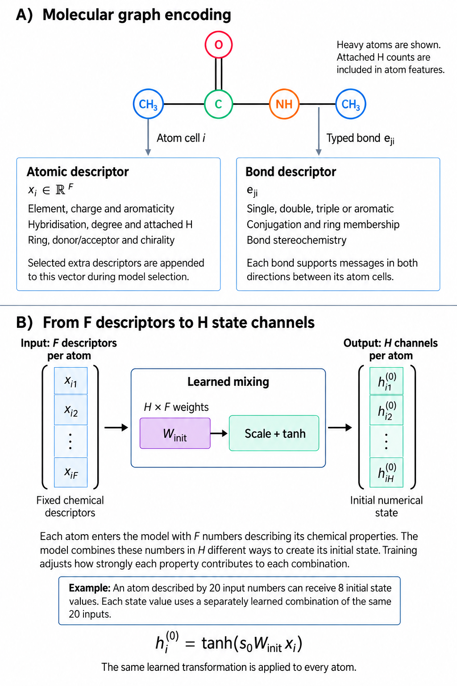
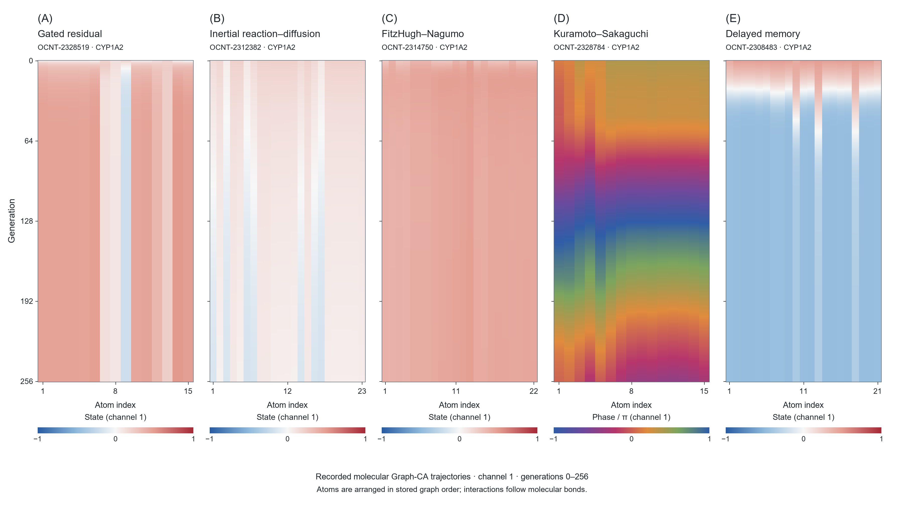
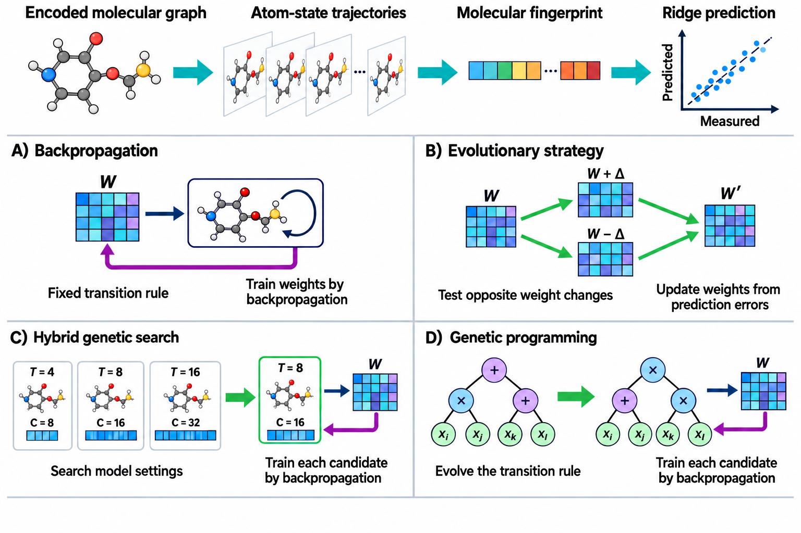

# Molecular Space-Time: Emergent Prediction from Local Interactions in an Evolved Graph Cellular Automaton

**Anthony Nash, PhD**

**Independent Researcher, Warwickshire, United Kingdom**

**info@acnash.co.uk**

## Abstract

This study investigates how local interactions between atomic cells generate predictive information and complex dynamical behaviour. Molecular graphs form cellular automata whose numerical atom states evolve through interactions along chemical bonds. Their molecular space-time trajectories provide fingerprints for predicting enzyme inhibition. Genetic programming evolves the cellular automaton transition rule, while backpropagation trains numerical weights and ridge regression fits predictions. In the OpenADMET CYP Inhibition Challenge, genetic programming modestly reduced blind prediction error from 1.0092 to 0.9946 on the official metric. Separate dynamical analyses identified convergence, possible periodic behaviour and persistent complex variation. Two systems exhibited bounded hyperchaotic dynamics, with small initial differences growing in multiple independent directions. Discontinuities in the phase-based rule and unresolved fractal dimension leave their classification as strange attractors provisional. These findings support molecular space-time as a framework for studying how local interactions generate predictive information and dynamical complexity.

**Keywords:** cellular automata; complex systems; emergence; genetic programming; graph dynamics; molecular representation; nonlinear dynamics

## 1. Introduction

Cellular automata demonstrate how repeated local changes and interactions can produce organised behaviour across a system. Uniform rules on simple cell states can produce fixed configurations, oscillators, propagating structures, long transients, computational universality, and transitions between ordered and disordered behaviour [1–3]. A reaction–diffusion system provides a related physical example: local chemical reactions change species concentrations, while diffusion redistributes those species through space. Together, these processes can generate larger-scale concentration patterns [4]. This shared principle motivates our investigation of whether repeated interactions between atomic cells can generate molecule-wide numerical patterns useful for predicting chemical behaviour. To investigate this possibility, we construct a molecular graph cellular automaton in which each atom carries numerical state values and chemical bonds define which atoms exchange information. Physical reaction–diffusion systems provide the analogy for these local interactions, and training adjusts the cellular automaton so that its trajectory summaries predict enzyme inhibition.

Three related approaches motivate our use of repeated local interactions to learn a molecular representation. Learned graph cellular automata extend shared cellular automaton transition rules to irregular networks, providing a framework that accommodates atoms connected by chemical bonds [5]. Neural cellular automata demonstrate how training can adjust local interactions so that numerical state channels collectively support a desired behaviour; each channel acquires its role through training [6]. Molecular message-passing networks show how exchanging information between bonded atoms can support molecular-property prediction [7]. Together, these approaches motivate a model that learns local interactions on molecular graphs and retains the resulting atom-state trajectories as predictive features.

Our model uses atom and bond descriptors to encode chemical information and retains successive atom states as a trajectory, which we call **molecular space-time**. At generation *t*, a vector of learned numerical values describes each atom's cellular state. The possible combinations of these values across the molecule define its numerical state space. One point in this mathematical space represents all atom-state channel values at one generation, and successive generations trace a trajectory through it. A direction in state space describes a particular combination of changes to those values; the coordinates describe computational states. Typed bonds constrain the messages that can alter that state, and a shared nonlinear cellular automaton transition rule advances the entire molecular graph to generation *t* + 1. We summarise the early changes, states at several generations and final states into a molecular fingerprint, a vector of numerical features for predicting pIC50.

The cellular automaton transition rule determines which trajectories the system can express. We studied three methods that progressively expanded what training could change while preserving the atom-state trajectories as the basis for prediction. The first used fixed cellular automaton transition rule families. Backpropagation through time traced prediction errors backwards through successive generations to train the numerical weights. Ridge regression then combined trajectory features into pIC50 predictions; differentiating through this fit allowed prediction errors to guide the weights that generated those features. The second used a genetic algorithm to choose the Graph-CA configuration, including the rule family, trajectory depth, state width, feature profile, and temporal observables, while retaining backpropagation for continuous weights. Sections 2.2 and 2.3 explain these choices in detail, and Section 2.4.4 specifies the alternatives tested by the genetic search. The third used genetic programming to evolve the mathematical form of the cellular automaton transition rule itself. Genetic algorithms operate over encoded parameter or design vectors, whereas genetic programming applies selection, crossover, and mutation to executable symbolic structures [8, 9].

The 2026 OpenADMET CYP Inhibition Challenge provided an external validation task. Cytochrome P450 (CYP) enzymes influence the metabolism and clearance of many medicines, and inhibition can contribute to clinically important drug interactions [10]. The challenge examined four CYP isoforms, CYP1A2, CYP2C9, CYP2D6, and CYP3A4, which are distinct enzyme members of this family with different substrate preferences. Each isoform defined a separate prediction task: using the compound’s molecular structure to predict how potently it inhibits that enzyme. The organisers compared the resulting direct-inhibition pIC50 predictions with concealed experimental measurements. This independent evaluation tests the predictive usefulness of the molecular space-time fingerprints.

The retained molecular space-time trajectories also allow us to examine how numerical atom states behave over successive generations. Cellular-automaton and nonlinear-dynamics studies distinguish convergence towards a fixed state, repeating oscillations, persistent complex variation and chaos through quantitative measurements [1–3, 11–13]. We held the trained Graph-CA parameters fixed and followed the atom states for thousands of generations to investigate whether molecular structure and the cellular automaton transition rule produce repeatable patterns, such as convergence or oscillation. We analysed recurrence, frequency spectra, perturbation growth, Lyapunov exponents and attraction basins to characterise these patterns. To test sensitivity to initial conditions, we introduced small differences into the numerical atom states and measured whether those differences grew over subsequent generations. Sustained growth indicates that initially similar computational states follow increasingly different trajectories, providing evidence relevant to chaos. We also investigated whether trajectories approach a bounded set with fractal geometry. We estimated its fractal dimension, which describes how the detail of that set changes with the scale at which we examine it. These estimates require care: we excluded pairs of states close together in generation number and checked whether the estimated dimension remained consistent when we represented the trajectory using different numbers of coordinates [14–16].

Genetic programming produced a modest improvement in blind enzyme-inhibition prediction over the fixed-rule model. Separate analyses of the numerical atom states identified convergence, possible periodic behaviour and persistent complex variation. Two systems showed bounded hyperchaotic dynamics, with small initial differences growing in multiple independent directions. Discontinuities at the phase boundary and an unresolved fractal dimension leave their classification as strange attractors provisional.

## 2. Materials and Methods

### 2.1. Dataset and Prediction Task

The study used the primary direct-inhibition dataset released for the 2026 OpenADMET CYP Inhibition Blind Challenge (https://openadmet.org/blindchallenges/). It comprised 4,905 unique compounds represented by a molecule identifier and a Simplified Molecular Input Line Entry System (SMILES) string. The dataset provided experimental direct-inhibition pIC50 values for four drug-metabolising cytochrome P450 enzyme isoforms: CYP1A2, CYP2C9, CYP2D6, and CYP3A4. Each value described inhibition of one specific isoform by one compound. Here, pIC50 denotes the negative base-10 logarithm of the half-maximal inhibitory concentration expressed in molar units. Each reported measurement included lower and upper uncertainty bounds and an estimated standard deviation from the fitted concentration–response experiment.

The experiments did not necessarily measure each compound against every CYP isoform. The dataset contained 6,525 observed compound–CYP pairs, distributed as summarised in Table 1.

**Table 1. Number of observed direct-inhibition pIC50 measurements for each CYP isoform.**

| CYP isoform | Compounds with an observed direct-inhibition pIC50 |
|---|---:|
| CYP1A2 | 1,412 |
| CYP2C9 | 1,285 |
| CYP2D6 | 1,493 |
| CYP3A4 | 2,335 |
| **Total** | **6,525** |

Each available compound–CYP measurement formed one training case: the model received the compound's molecular structure and CYP isoform and was trained to predict the corresponding experimental pIC50 value. The Endpoint-Aligned Cross-Validated CYP-Specialist Graph Cellular Automaton (EA-CV-CYP-GCA; see Section 2.4 for the full training and validation procedure) comprised four separately trained nonlinear graph cellular automaton models, one for each isoform. Each graph cellular automaton model used only observations for its assigned isoform during backpropagation through successive generations, differentiable ridge fitting, validation and selection of the saved model. Here, an endpoint means the single prediction target defined for one CYP isoform: its direct-inhibition pIC50. A missing endpoint was therefore a compound–CYP combination for which the dataset reported no experimental direct-inhibition pIC50 value. We retained these values as missing, so they contributed neither targets nor loss terms.

To assess generalisation beyond closely related chemistry, we grouped compounds by their standardised Bemis–Murcko scaffold before data partitioning. A Bemis–Murcko scaffold is a simplified structural skeleton that retains a molecule's rings and the chains connecting those rings while removing side branches attached to this central framework. Compounds with the same underlying ring-and-connector framework therefore belonged to the same scaffold group. We reserved a fixed 20% subset of scaffold groups as a sealed holdout, leaving 5,216 observed compound–CYP pairs for model fitting and internal selection and 1,309 pairs for final validation. No scaffold group occurred in both partitions. We selected hyperparameters within the fitting pool, while the reserved scaffold holdout remained unused until final evaluation.

The challenge test set contained 750 additional compounds for which the organisers withheld all direct-inhibition labels. The challenge required the four trained CYP-specific graph cellular automaton models to generate one finite pIC50 prediction per isoform for each compound, giving 3,000 blinded compound–CYP predictions. We excluded blinded compounds and their unreleased outcomes from parameter estimation, hyperparameter selection, early stopping, and dynamical candidate selection. Predictive evaluation followed the challenge formulation: the primary measure was the macro-averaged soft-threshold relative absolute error (MA-ST-RAE) across the four CYP isoforms, with equal weight for each isoform and zero error for predictions falling within the reported experimental uncertainty interval. Lower MA-ST-RAE indicates better prediction under this uncertainty-aware measure. We retained conventional regression statistics as complementary measures of predictive agreement, including root mean squared error (RMSE), which summarises prediction-error magnitude, and rank correlations, which assess how well predictions preserve the ordering of experimental values.

### 2.2. Molecular Graph Representation

We used RDKit to standardise SMILES structures, including common groups of bonded atoms and their formal atomic charges (integer charges assigned to individual atoms, such as +1 or −1). We then retained the largest organic fragment and applied RDKit's sanitisation procedure to check the consistency of the molecular representation, including whether each atom's number and types of bonds were compatible with its assigned chemical state. We converted the resulting structure to canonical isomeric SMILES. We represented each standardised molecule as a graph G=(V,E), where every heavy atom (an atom other than hydrogen) i ∈  V was a cellular-automata cell and every covalent bond defined two directed message-passing edges, j →  i and i →  j. The predictive input, meaning the model inputs for predicting pIC50, comprised the standardized two-dimensional graph connectivity, atom and bond descriptors, and CYP context; it contained no molecular geometry.

The standard set of atomic descriptors contained one-hot element identity for H, C, N, O, F, P, S, Cl, Br, I, and other elements; for example, with this ordering the encoding represented carbon as (0,1,0,0,0,0,0,0,0,0,0) and oxygen as (0,0,0,1,0,0,0,0,0,0,0). Further descriptors comprised formal charge; aromaticity; sp, sp2, sp3 (types of atomic orbital hybridisation), and other hybridisation states; degree; total attached hydrogens; ring membership; hydrogen-bond donor and acceptor status; and tetrahedral chirality. We also tested additional atomic descriptors, organised into the five groups in Table 2. To choose which groups to include, we compared their predictive performance using training and validation subsets drawn entirely from the fitting data. The sealed holdout and blinded challenge set played no part in that selection.

**Table 2. Chemically organised atom-feature groups considered during training-only model selection.** A feature group is a named collection of related atom-level descriptors that we added to the baseline encoding as one candidate block.

| Feature group | Atom-level quantities |
|---|---|
| Periodic | Atomic number, atomic mass, covalent radius, van der Waals radius, outer electrons, period, group, and approximate atomic volume |
| Valence | Total and implicit valence, heavy-atom degree, radical electrons, and absolute formal charge |
| Electronic | Pauling electronegativity, approximate polarizability, heteroatom and halogen indicators, conjugated-bond fraction, first ionization energy, electron affinity, and missing-property indicator |
| Ring geometry | Number of rings containing the atom and indicators for ring sizes 3, 4, 5, 6, 7, and 8 or greater |
| Local environment | Mean neighbouring electronegativity, electronegativity difference from the neighbourhood, mean neighbouring atomic number, and mean neighbouring formal charge |

The *feature profile* specifies which chemical descriptors form each atom's input vector: the baseline encoding together with the selected additional feature groups in Table 2. We stored the selected feature profile with every frozen checkpoint, meaning the saved model whose parameters we held fixed for evaluation. This preserved the exact feature names and order required to predict new molecules. We scaled continuous quantities by fixed chemically meaningful constants during graph construction. The bond vector 𝑒ⱼᵢ contained one-hot indicators for single, double, triple, or aromatic bonds, together with indicators for conjugation, ring membership, and three stereochemical properties. We attached the same bond vector to both directed representations of an undirected bond.

Each CYP endpoint defined a distinct prediction task: predicting direct-inhibition pIC50 for one isoform. A context vector, 𝒄, identified which CYP isoform the model was predicting for a given molecule. This vector contained four entries, one for each isoform: the entry for the target isoform was 1, and the other three were 0. This one-hot encoding supplied the target identity to the cellular automaton and its prediction readout, allowing the same molecular graph to generate a trajectory and prediction specific to CYP1A2, CYP2C9, CYP2D6, or CYP3A4.

Within this molecular graph, each atom carries H numerical state values, called channels, which change over successive generations. These channels are latent because training determines how they combine the atomic descriptors to support prediction. Figure 1A illustrates the atomic descriptors and typed bonds that define this connected molecular Graph-CA, with any additional feature groups selected from Table 2 forming part of the atomic input vector and retained in the frozen feature profile.



**Figure 1. Molecular graph encoding and formation of the initial dynamical state.** **A**, N-methylacetamide illustrates the molecular graph: each heavy atom (an atom other than hydrogen) forms a cell, and each bond allows information to pass in both directions. The vector xᵢ records the atom's chemical properties, including its attached hydrogen count, while 𝑒ⱼᵢ records the bond's properties. **B**, the model combines each atom's F input descriptors into H numerical state values, called channels. Learned weights determine how strongly each descriptor contributes to each channel; scaling and the hyperbolic tangent then keep the initial values between −1 and 1. The same transformation applies to every atom. The example of 20 descriptors producing 8 channels is illustrative. These initial values subsequently change through interactions with bonded neighbours, forming the molecular space-time trajectory.

### 2.3. Nonlinear Graph Cellular Automaton

For atom i, the chemical input vector xᵢ contained its fixed descriptors; for example, the vector could represent an aromatic sp2 carbon through a carbon element indicator, zero formal charge, an aromaticity indicator, an sp2-hybridization indicator, its degree, and its other listed atom properties. The initialisation map transformed this input into an initial state with H dynamical channels. These channels are H learned real-valued coordinates that evolve at every generation and may combine information from several chemical descriptors rather than corresponding one-to-one with named chemical properties:

```math
h_i^{(0)}=\tanh\!\left(s_0 W_{\mathrm{init}}x_i\right),
```

Here, Wᵢₙᵢₜ maps the fixed descriptor vector xᵢ into H values, so hᵢ⁽⁰⁾ ∈ ℝᴴ is atom i's complete H-channel dynamical state at generation zero. The superscript (0) denotes the initial generation and is distinct from the channel count H. The scalar s₀ is the initialization scale: it multiplies the projected input before the hyperbolic tangent and therefore controls the initial state magnitude and degree of saturation. We then applied a shared cellular automaton transition rule recurrently for T generations. The *trajectory depth* is this number of successive updates; the *state width* is the number of numerical channels H carried by each atom. Greater depth allows more rounds of information exchange, while greater width gives each atom more numerical values with which to represent that information. We used the same rule parameters for all atoms and generations. Each update combined an atom's state with information from its bonded neighbours, giving the recurrent neural network the local interactions of a graph cellular automaton.

Figure 1B shows how learned weighted sums, scaling and the hyperbolic tangent form the initial channels. Each row of Wᵢₙᵢₜ forms a learned combination of the F input descriptors, establishing the H initial coordinates before the first recurrent generation.

At generation t, the message from neighbour j to atom i was

```math
g_{ji}=\sigma\!\left(\frac{W_g e_{ji}}{\theta_b}\right),
\qquad
m_{ji}^{(t)}=g_{ji}\odot W_n h_j^{(t)}+W_e e_{ji},
```

Here, σ(z)=1/(1+exp(−z)) is the logistic sigmoid, which acts elementwise. The subscript n in Wₙ denotes *neighbour*: Wₙ is a learned linear map that transforms the neighbouring state hⱼ⁽ᵗ⁾ ∈ ℝᴴ, which is atom j's dynamical state at generation t. The learned maps Wₑ and W[g] respectively transform the bond description and generate a channel-wise bond gate. The positive bond temperature θ[b] controls gate sharpness: smaller values move the gates towards their extremes, strengthening or suppressing neighbour contributions, whereas larger values move them towards one half. The symbol ⊙ denotes elementwise multiplication. We degree-normalized incoming messages and neighbouring states by averaging over the number of neighbours, preventing atoms with more bonds from acquiring larger aggregate values merely because of their degree:

```math
a_i^{(t)}=\frac{1}{|N(i)|}\sum_{j\in N(i)}m_{ji}^{(t)},
\qquad
\bar h_i^{(t)}=\frac{1}{|N(i)|}\sum_{j\in N(i)}h_j^{(t)}.
```
Here, N(i) is the set of atoms directly bonded to atom i, and |N(i)| is the number of those neighbours. The state hᵢ⁽ᵗ⁾ belongs to atom i itself, whereas h̄ᵢ⁽ᵗ⁾ is the mean state of its directly bonded neighbours. At every generation, a common reaction drive combined the current atom state, incoming neighbour messages, chemical descriptors and target CYP identity to guide the next state update:

```math
r_i^{(t)}=\tanh\!\left(
W_s h_i^{(t)}+a_i^{(t)}+W_x x_i+W_c c+b
\right).
```

The common reaction drive rᵢ⁽ᵗ⁾ ∈ ℝᴴ is the candidate state change that each rule calculates for every atom from the atom's present state hᵢ⁽ᵗ⁾, its aggregated bond-conditioned neighbour message aᵢ⁽ᵗ⁾, its fixed chemical input xᵢ, and the CYP context c. The learned maps Wₛ, Wₓ, and W[c] project their respective inputs into H channels, and b ∈ ℝᴴ is a learned bias. A *rule family* specifies the mathematical form of the cellular automaton transition rule, such as gated residual or delayed memory; training learns numerical weights within that form. The five families below share the bonded-message and reaction calculations but combine current states, neighbour information and any auxiliary variables differently.

**Gated residual.** Inspired by gating in recurrent neural networks [17], this rule allows every atom and channel to retain its current value or accept a learned fraction of the newly proposed reaction (Figure 2A). The rule recalculates the gate from the local molecular state at every generation:

```math
\alpha_i^{(t)}=\sigma\!\left(W_\alpha
[h_i^{(t)},a_i^{(t)},x_i,c]\right),
\qquad
h_i^{(t+1)}=(1-s\alpha_i^{(t)})\odot h_i^{(t)}
+s\alpha_i^{(t)}\odot r_i^{(t)},
```

Here, αᵢ⁽ᵗ⁾ ∈ (0,1)ᴴ is atom i's channel-wise acceptance gate; W[α] is a learned map from the concatenated vector [hᵢ⁽ᵗ⁾,aᵢ⁽ᵗ⁾,xᵢ,c] to H gate values; square brackets denote concatenation; and s>0 is the update scale. We capped the product sαᵢ⁽ᵗ⁾ at one in each channel; 1 denotes the H-component all-ones vector, and ⊙ denotes elementwise multiplication. Thus, each new channel value is a weighted mixture of its previous value hᵢ⁽ᵗ⁾ and proposed reaction rᵢ⁽ᵗ⁾.

**Inertial reaction–diffusion.** This rule combines local reaction–diffusion, whose classical formulation couples reaction kinetics to spatial exchange [4], with a momentum-like velocity state [18] (Figure 2B). The reaction term drives local change, the graph-diffusion term exchanges state with bonded neighbours, and restoring and damping terms control growth:

```math
f_i^{(t)}=r_i^{(t)}+D\odot(\bar h_i^{(t)}-h_i^{(t)})-R\odot h_i^{(t)},
```

```math
v_i^{(t+1)}=\eta\gamma\odot v_i^{(t)}+\delta\odot f_i^{(t)},
\qquad
h_i^{(t+1)}=\tanh\!\left(h_i^{(t)}+\delta\odot v_i^{(t+1)}\right).
```

Here, fᵢ⁽ᵗ⁾ ∈ ℝᴴ is the total force-like drive; rᵢ⁽ᵗ⁾ is the common reaction drive; h̄ᵢ⁽ᵗ⁾−hᵢ⁽ᵗ⁾ is the graph-diffusion gradient between the neighbour mean and atom i; and D,R ∈ ℝ[≥0]ᴴ are channel-wise diffusion and restoring strengths. We initialized the auxiliary velocity vᵢ⁽ᵗ⁾ ∈ ℝᴴ to zero; it carries change between generations. The vectors γ,δ ∈ ℝᴴ are channel-wise damping and step size, while the scalar η is the inertial multiplier. Sigmoid or softplus transformations constrained these quantities to stable ranges, and tanh bounded the updated state.

**FitzHugh–Nagumo.** Adapted from the classical excitable-system model [19, 20], this rule divides the state into a fast excitation subsystem and a slower recovery subsystem (Figure 2C). Their interaction can create threshold responses, pulses, and oscillatory relaxation, while learned chemical drive and graph diffusion condition those behaviours on the molecule:

```math
\Delta u_i^{(t)}=u_i^{(t)}-\frac{(u_i^{(t)})^3}{3}-v_i^{(t)}
+\kappa_s\tanh(W_u r_i^{(t)})+D_u(\bar u_i^{(t)}-u_i^{(t)}),
```

```math
\Delta v_i^{(t)}=\epsilon\left[u_i^{(t)}+q-v_i^{(t)}+0.1\tanh(W_v r_i^{(t)})\right]
+D_v(\bar v_i^{(t)}-v_i^{(t)}),
```
We then advanced the two channel groups together:

```math
h_i^{(t+1)}=\tanh\!\left(
[u_i^{(t)}+s\Delta u_i^{(t)},\;v_i^{(t)}+s\Delta v_i^{(t)}]
\right).
```

Here, uᵢ⁽ᵗ⁾,vᵢ⁽ᵗ⁾ ∈ ℝ⁽ᴴ/²⁾ are the excitation and recovery halves of hᵢ⁽ᵗ⁾; ūᵢ⁽ᵗ⁾ and v̄ᵢ⁽ᵗ⁾ are their respective means over N(i); and Δ uᵢ⁽ᵗ⁾ and Δ vᵢ⁽ᵗ⁾ are their proposed increments. The learned maps Wᵤ and Wᵥ project the H-channel reaction drive into the corresponding half-state. The scalar κₛ scales chemical stimulation, Dᵤ,Dᵥ≥0 control graph diffusion, ε>0 sets the recovery timescale, q offsets recovery, 0.1 is the fixed recovery-drive coefficient, and s>0 is the integration step. Square brackets concatenate the two updated half-states, and tanh bounds the resulting H-channel state.

**Kuramoto–Sakaguchi.** Adapted from coupled phase-oscillator theory [21, 22], this rule treats every dynamical channel as a wrapped phase φᵢ⁽ᵗ⁾=π hᵢ⁽ᵗ⁾ (Figure 2D). Bond-gated coupling encourages neighbouring phases to coordinate, while chemical and CYP information determine each atom's intrinsic phase velocity:

```math
q_i^{(t)}=\frac{1}{|N(i)|}\sum_{j\in N(i)}
g_{ji}\odot\sin\!\left(\phi_j^{(t)}-\phi_i^{(t)}-\psi\right),
```

```math
\phi_i^{(t+1)}=\phi_i^{(t)}+s\left[
\omega_i^{(t)}+Kq_i^{(t)}\right],
\qquad
\omega_i^{(t)}=A\tanh(W_\omega r_i^{(t)}).
```
Here, φᵢ⁽ᵗ⁾ ∈ [−π,π)ᴴ is atom i's phase vector; qᵢ⁽ᵗ⁾ ∈ ℝᴴ is its mean bond-gated phase-coupling signal; N(i) and |N(i)| denote its bonded-neighbour set and size; gⱼᵢ ∈ (0,1)ᴴ is the bond gate; and sin and ⊙ act elementwise. The phase lag ψ shifts the preferred phase relationship, K is the coupling strength, and s is the integration step. The chemically conditioned natural-frequency vector is ωᵢ⁽ᵗ⁾ ∈ ℝᴴ, where training learns W[ω], rᵢ⁽ᵗ⁾ is the common reaction drive, and A sets the frequency scale. We wrapped the updated phase modulo 2π into [−π,π) and divided it by π to return hᵢ⁽ᵗ⁺¹⁾ to [−1,1]. Training-only hyperparameter search selected the phase lag, coupling strength, and frequency scale.

**Delayed memory.** Drawing upon delay-differential dynamical systems [23], this rule makes the next state depend upon both the present calculation and an earlier point in the retained trajectory (Figure 2E). It can therefore represent lagged feedback and history-dependent responses that a present-state-only rule cannot express. A rule-specific delay d selected the preceding state, and the new drive combined the current reaction, a learned transformation of the current and delayed states, and explicit delayed-state feedback:

```math
\tilde r_i^{(t)}=\tanh\!\left(W_d[r_i^{(t)},h_i^{(t-d)}]\right),
```

```math
h_i^{(t+1)}=\tanh\!\left(
(1-\zeta s)h_i^{(t)}+s\left[(1-\mu)r_i^{(t)}
+\mu\tilde r_i^{(t)}+\kappa_d(h_i^{(t-d)}-h_i^{(t)})\right]
\right).
```
Here, hᵢ⁽ᵗ⁻ᵈ⁾ ∈ ℝᴴ is atom i's state d generations earlier, with the rule using the earliest available retained state when t<d; r̃ᵢ⁽ᵗ⁾ ∈ ℝᴴ is the delay-conditioned reaction; W[d] is a learned map from the concatenation [rᵢ⁽ᵗ⁾,hᵢ⁽ᵗ⁻ᵈ⁾] to H values; and tanh bounds both the delayed reaction and updated state. The scalar μ ∈ [0,1] mixes the present reaction rᵢ⁽ᵗ⁾ with the delayed reaction, κ[d] controls feedback from the difference hᵢ⁽ᵗ⁻ᵈ⁾−hᵢ⁽ᵗ⁾, ζ controls damping of the present state, s>0 is the update scale, and 1 in (1−μ) is the scalar multiplicative identity. The search determined the delay and these coefficients from the rule-specific search space.

*Temporal observables* are numerical summaries of how atom states change across generations. We summarised, or pooled, each trajectory into a fixed-length molecular fingerprint for ridge regression. The fingerprint contained the final atom-state mean and variance, the time-averaged atom state, the temporal variance of the molecular mean state, and mean state-change energy. The multiscale variant appended molecular mean states at 12.5%, 25%, 50%, 75%, and 100% of the trajectory. We formed CYP-specific readout features by combining the endpoint one-hot vector with copies of the dynamical fingerprint that the vector activated for the relevant CYP. This allowed the ridge readout to associate trajectory features with the target isoform.

The genetic search also tested optional temporal observables. The *dynamic observables* option added the change from initial to final molecular mean state and a normalised measure of correlation between successive molecular mean states. *Multiscale transition-energy summaries* added squared changes between molecular mean states at consecutive sampling points listed above. These quantities describe numerical state changes. The search also tested correlations at several generation lags, smooth approximations to the largest and smallest molecular mean states, and separate summaries of positive and negative state changes. These options allowed the readout to use information about persistence, variation and direction of change as well as the final state.



**Figure 2. One-dimensional displays of molecular cellular evolution under five cellular automaton transition rules.** **A**, gated residual (`OCNT-2328519`); **B**, inertial reaction–diffusion (`OCNT-2312382`); **C**, FitzHugh–Nagumo (`OCNT-2314750`); **D**, Kuramoto–Sakaguchi (`OCNT-2328784`); and **E**, delayed memory (`OCNT-2308483`). CYP1A2 supplies the context for all five recorded trajectories. Columns represent heavy atoms in their stored graph order, and rows show successive generations from 0 at the top to 256 at the bottom. Local interactions follow the molecular bonds; the horizontal arrangement is a display of the graph cells. Panels A, B, C, and E show the first dynamical channel, hᵢ₁⁽ᵗ⁾, on a common blue–white–red scale from −1 to 1. Panel D shows the first wrapped phase divided by π, φᵢ₁⁽ᵗ⁾/π, using a cyclic scale whose endpoints represent the same phase. The display retains every generation and draws colours from the recorded states without per-panel amplitude rescaling. These examples come from distinct molecules and trained systems and illustrate their observed evolution; they are not a matched comparison of rule effects on a single molecule. Each panel displays one channel of the full atom-by-channel trajectory.

### 2.4. Learning the Molecular Space-Time Representation

All four methods follow the same prediction pathway. The Graph-CA generates a trajectory for each molecule, and summaries of that trajectory form a molecular fingerprint. The ridge readout is the model's final prediction step: ridge regression fits a weighted combination of the fingerprint values to predict pIC50, with a penalty that limits coefficient magnitudes. A linear-equation solve calculates the ridge coefficients from molecular fingerprints and measured training pIC50 values. **All four methods use this fitted ridge readout.** They differ in how they learn the Graph-CA parameters or choose the system that generates the trajectories (Figure 3).

Backpropagation uses prediction error to calculate how each trainable parameter should change. Here, the calculation passes through the ridge fit and backwards through the successive Graph-CA generations. The fixed-rule, hybrid genetic, and genetic-programming methods use backpropagation to train continuous parameters, such as the weights that control how neighbouring atoms influence one another. The evolutionary strategy uses prediction errors from deliberately perturbed parameter values to estimate updates, without backpropagation.

- **Fixed-rule Graph-CA:** a chosen mathematical rule describes how atom states change between generations. Backpropagation learns the numerical weights within that rule and the other Graph-CA components; ridge regression fits the final prediction. The mathematical form of the chosen rule stays fixed during training.
- **Evolutionary strategy:** the optimiser makes small random changes to the current Graph-CA parameter values, producing a population of candidate models. Each candidate generates trajectories and receives a fitted ridge readout; the optimiser then assesses it on query molecules, which do not contribute to that candidate's ridge fit. Differences in prediction error indicate which directions of parameter change are useful, and these guide the next update. This method uses ridge regression and does not use backpropagation.
- **Hybrid genetic search:** a genetic algorithm chooses the model's *configuration*, meaning design choices such as the cellular automaton transition rule family, number of generations, number of dynamical channels, chemical descriptors, and trajectory summaries. Backpropagation and a fitted ridge readout train each candidate configuration. The genetic algorithm selects better-performing configurations and recombines or changes their design choices to produce new candidates.
- **Genetic programming:** genetic search changes the mathematical form of the cellular automaton transition rule used to update each atom. For example, it can change how operations such as addition, multiplication, or averaging combine the current atom state, the reaction signal, and differences from neighbouring states. Backpropagation learns the numerical weights for each candidate cellular automaton transition rule, and ridge regression fits its prediction readout. Validation error then guides the choice of cellular automaton transition rules for the next population. The candidate cellular automaton transition rule remains fixed throughout each molecular trajectory.

The following subsections describe these methods and the shared ridge readout in detail. The searches select candidate configurations and cellular automaton transition rules using scaffold-held-out development data; sealed-holdout and blind labels remain excluded from training and selection.

#### 2.4.1. Fixed-rule Graph-CA with backpropagation

The fixed-rule reference was the Credible-Interval-Aligned Endpoint-Aligned Cross-Validated CYP-Specialist Graph Cellular Automaton, abbreviated CIA-EA-CV-CYP-GCA. Backpropagation through time optimized each nonlinear Graph-CA expert. Adam updated the initialization, bonded-message, reaction, and cellular automaton transition rule parameters with a cosine learning-rate schedule, gradient clipping, and an L2 penalty on cellular-automata weights. Backpropagation traced prediction error through every retained generation, calculating how changes to the parameters of earlier local updates would affect the final pIC50 prediction. We used labelled development data alone to select generation count, dynamical-channel count, atom-feature profile, learning rate, ridge penalty, update scale, support fraction, batch size, bond temperature, initialization scale and noise, pooling design, and rule-specific dynamical constants.

CIA-EA-CV-CYP-GCA trained four independent nonlinear systems, one for each CYP isoform. Each system used observations from its target CYP for ridge fitting, prediction-error calculation, deciding when to stop training and choosing which saved model to retain. A smooth credible-interval penalty complemented mean squared error by penalizing predictions lying outside the reported experimental interval. We screened all ten cellular automaton transition rule families for each endpoint using two scaffold folds. The three leading rule-configuration pairs per endpoint advanced to five-fold scaffold confirmation with two training seeds. We used out-of-fold predictions, each from a model that had excluded the relevant validation fold during fitting, to select a subset of experts and fit their ridge combination before evaluating the sealed holdout. The final CYP1A2 system combined FitzHugh-Nagumo, Gray-Scott, and conservative graph flux; CYP2C9 combined Gray-Scott and damped symplectic; CYP2D6 combined delayed memory and FitzHugh-Nagumo; and CYP3A4 combined damped symplectic, FitzHugh-Nagumo, and delayed memory.

Figure 3A summarises how query-loss gradients train the molecular space-time representation through the differentiable ridge readout and recurrent Graph-CA updates.


#### 2.4.2. Shared ridge readout and its role in training

All four learning strategies described in Sections 2.4.1 and 2.4.3–2.4.5 shared the analytic ridge readout. Each strategy fitted ridge coefficients from molecular trajectory fingerprints in the support subset, then used those coefficients to predict the query subset. For the fixed-rule backpropagation system (Section 2.4.1), gradients of the query loss passed through this differentiable solve and the recurrent trajectories to update continuous Graph-CA parameters, as illustrated in Figure 3A. The genetic algorithm (Section 2.4.4) and genetic programming (Section 2.4.5) used the same gradient-based fitting within each candidate configuration or cellular automaton transition rule, while their outer searches selected candidates using development performance. The evolutionary strategy (Section 2.4.3) instead fitted ridge coefficients for each perturbed parameter candidate and used query error as evolutionary fitness; it estimated parameter updates from those fitness evaluations without differentiating through the ridge solve. Thus, analytic ridge fitting provided the common prediction mechanism, while the strategies differed in how they trained or selected the Graph-CA that generated its input features.

We divided training batches by molecule into support and query subsets. The support molecules supplied the fingerprints and measured pIC50 values for fitting the ridge coefficients; the query molecules supplied the prediction errors for training the Graph-CA. The Graph-CA generated the fingerprint matrix Fₛ for the support molecules, and we standardized its columns to obtain Zₛ. With centered targets yₛ−ȳₛ, the closed-form differentiable solve gave the ridge coefficients [24]

```math
\beta=\left(Z_s^{\mathsf T}Z_s+\lambda I\right)^{-1}
Z_s^{\mathsf T}(y_s-\bar y_s).
```

For the query fingerprint f[q], the prediction was

```math
\widehat y_q=\bar y_s+
\left(\frac{f_q-\bar F_s}{s_F}\right)^{\mathsf T}\beta,
```

where F̄ₛ and s[F] were the support feature mean and scale. The ridge penalty excluded the intercept. Automatic differentiation tracked the dependence of β on the support fingerprints. It therefore allowed query prediction errors to update the Graph-CA parameters through both the ridge fit and the successive atom-state generations. A Hermitian pseudoinverse implemented the same ridge objective when highly correlated trajectory statistics made the normal equations numerically singular.

This support–query construction trained the cellular automaton to produce fingerprints that predicted pIC50 for molecules outside the current ridge-fitting subset. After training, we fitted a final ridge state from all permitted fitting observations and stored it with the selected Graph-CA checkpoint. Early stopping and checkpoint promotion used MA-ST-RAE on the relevant scaffold-held-out development fold. We recorded RMSE as a secondary optimization diagnostic.

#### 2.4.3. Evolutionary-strategy comparator

We also specified a derivative-free comparator, ES-EA-CV-CYP-GCA (Figure 3B), that preserved the molecular graph, chemical encodings, recurrent cellular automaton transition rules, retained trajectories, scaffold partitions, and analytic ridge readout used by EA-CV-CYP-GCA. We evaluated mirrored parameter perturbations on the GPU in antithetic pairs, applying the same random change with opposite signs to create paired candidates. For each candidate, the Graph-CA generated support and query fingerprints, an analytic solve fitted ridge coefficients from support observations, and query error supplied the evolutionary fitness. Differences between the paired prediction errors indicated which parameter changes improved predictions. The optimiser combined these estimates across candidates and used Adam-style running statistics to update the Graph-CA parameters without calculating gradients. This design isolated the effect of nonlinear-parameter training because the representation, readout, and data-separation protocol remained fixed. Evolutionary fitness and checkpoint selection excluded the sealed holdout and blind labels. The backpropagation-through-time version of EA-CV-CYP-GCA remained the primary submitted method while we assessed the evolutionary comparator.

The optimizer campaign fixed the Graph-CA to the canonical CYP3A4 damped-symplectic expert with 16 hidden channels, 32 recurrent generations, periodic-electronic atom features, typed-bond messages, multiscale trajectory pooling, update scale 0.25, support fraction 0.6, and ridge penalty 0.1. Thirty-two evolutionary configurations varied population size from 32 to 128, Gaussian perturbation scale from 0.005 to 0.08, evolutionary learning rate from 0.0005 to 0.01, batch size from 256 to 1,600 molecules, random or activity-stratified batch composition, and four stopping policies. We screened each configuration on two scaffold folds. The five leading settings advanced to five-fold confirmation with two independent seeds, giving 64 screening runs and 50 confirmation runs. Five CUDA workers executed the 114 runs. The fixed backpropagation-trained expert's original two-fold screening result supplied the matched development reference; evolutionary confirmation quantified performance across the broader fold and seed set. We evaluated evolutionary configurations exclusively on development data, leaving the sealed holdout and blind challenge set unused.

#### 2.4.4. Hybrid genetic Graph-CA structure search

We next applied a genetic algorithm to the discrete architecture of the CYP3A4 specialist while retaining backpropagation through time for continuous parameter estimation (Figure 3C). Each genome was a list of model design choices encoding the cellular automaton transition rule family, recurrent depth, hidden-state width, atom-feature profile, trajectory-pooling design, degree normalization, chemical-feature gating, initial-state anchoring, channel-adaptive timescales, and optional trajectory observables. Here, recurrent depth and hidden-state width are the trajectory depth and state width defined in Section 2.3. The atom-feature profile selects the descriptors in Section 2.2, while trajectory pooling and optional temporal observables select the summaries passed to ridge regression, as described at the end of Section 2.3. The rule families available to the search were damped symplectic, FitzHugh-Nagumo, and delayed memory. Recurrent depth took values of 16, 32, 64, or 128 generations, hidden width took values of 8, 16, or 24 channels, and atom encodings ranged from periodic-electronic features to the comprehensive chemical profile. Numerical optimizer settings remained fixed at their established rule-specific values.

Four genetic generations each contained 24 unique structures. Uniform crossover, tournament selection with groups of three, and an independent per-gene mutation probability of 0.25 generated successive populations. Backpropagation trained every structure on two scaffold development folds with a maximum of 35 epochs, giving 192 screening runs. The four leading evolved structures and the canonical reference advanced to five-fold, two-seed confirmation with a maximum of 80 epochs, giving 50 additional runs and 242 runs overall. Development MA-ST-RAE was the genetic fitness and RMSE was the secondary diagnostic. Five CUDA workers evaluated independent candidates concurrently.

The selected genome used a FitzHugh-Nagumo cellular automaton transition rule, 128 recurrent generations, 24 hidden channels, comprehensive atom features, multiscale trajectory pooling, unit degree normalization, dynamic observables, and multiscale transition-energy summaries. Chemical-feature gating, initial-state anchoring, channel-adaptive timescales, multi-lag recurrence, temporal extrema, and directional-flux summaries were inactive. Backpropagation trained its continuous Graph-CA weights, and its analytic ridge readout remained differentiable. Genetic fitness, parent selection, crossover, mutation, early stopping, and confirmation excluded the sealed holdout and blind labels.

#### 2.4.5. Genetic programming of the cellular automaton transition rule

The leading GP-CIA-EA-CV-CYP-GCA method evolved executable symbolic programs for the CYP3A4 cellular automaton transition rule while retaining the selected hybrid-search Graph-CA configuration (Figure 3D). The fixed configuration used 128 recurrent generations, 24 hidden channels, comprehensive atom features, multiscale trajectory pooling, dynamic observables, and multiscale transition-energy summaries. Genetic programming therefore isolated changes to the cellular automaton transition rule from changes to graph encoding, state dimension, or training protocol.

The program terminals, the inputs that candidate cellular automaton transition rules could combine, were the learned reaction signal rᵢ⁽ᵗ⁾, the current state hᵢ⁽ᵗ⁾, the bonded-neighbour difference h̄ᵢ⁽ᵗ⁾−hᵢ⁽ᵗ⁾, and the delayed-state difference hᵢ⁽ᵗ⁻ᵈ⁾−hᵢ⁽ᵗ⁾. Bounded differentiable primitives comprised addition, subtraction, multiplication, averaging, negation, hyperbolic tangent, sine, and fixed scaling. We limited candidate expression trees to depth four. Tournament selection, subtree crossover, subtree mutation, and point mutation generated successive populations, while a small penalty for expression size discouraged more complex cellular automaton transition rules that offered insufficient improvement in prediction error. We screened four generations of 24 programs on two scaffold folds. Five finalists then underwent five-fold, two-seed confirmation, producing 242 CUDA training runs.

Every symbolic candidate defined one shared cellular automaton transition rule for a complete model evaluation. We held that rule fixed while it generated trajectories for all molecules in the candidate's training and validation folds. Within each candidate evaluation, backpropagation through time fitted continuous message, reaction, and projection weights, and the differentiable ridge solve fitted the readout from support observations. The candidate fitness was scaffold-validation MA-ST-RAE, with RMSE as a secondary diagnostic. Selection changed the rule between candidate programs and genetic generations; a rule did not mutate during the trajectory of an individual ligand. Genetic programming chose how the cellular automaton transition rule combined local inputs, while backpropagation learned the numerical weights within the resulting model.

The selected program was the depth-one expression

```math
u_i^{(t)}=\frac{1}{2}\left(r_i^{(t)}+\bar h_i^{(t)}-h_i^{(t)}\right),
```

which averages the learned reaction drive with the bonded-neighbour state difference. The update therefore combines the atom's learned reaction signal with the mean state of its bonded neighbours minus its own state. Recurrent application of this evolved expression generated the molecular space-time trajectory that multiscale pooling subsequently summarised for the differentiable ridge readout. Genetic programming follows the established principle of evolving executable symbolic structures through selection and recombination [8].



**Figure 3. Four strategies for learning molecular space-time representations.** The shared pipeline converts encoded molecular graphs into retained recurrent trajectories, pools these into molecular fingerprints, and fits an analytic ridge readout on support observations to predict query pIC50 values. **A**, backpropagation through time differentiates query loss through the ridge solve and all recurrent generations; Adam updates continuous Graph-CA parameters within the selected cellular automaton transition rule family. **B**, the evolutionary strategy evaluates mirrored parameter perturbations, fits a ridge readout for each candidate, and estimates parameter updates from differences in query-error fitness, using Adam-style moments. **C**, hybrid genetic architecture search evolves discrete configuration genomes, including rule family, recurrent depth, channel count, feature profile, and pooling design. Backpropagation fits each candidate's continuous parameters through the differentiable ridge solve before scaffold-held-out development performance determines genetic selection. **D**, genetic programming applies the same inner gradient-based fitting while evolving symbolic cellular automaton transition rule trees through selection, crossover, and mutation. Development MA-ST-RAE supplies the primary outer fitness for the genetic searches. Solid blue arrows indicate forward computation, dashed purple arrows indicate gradient-based learning, and green arrows indicate evolutionary updates or genetic search. The candidate cellular automaton transition rule remains shared across atoms and generations within each trajectory; genetic changes occur between candidates. Learning and model selection exclude sealed-holdout and blind labels.

#### 2.4.6. Final validation and blinded inference

Model development used five scaffold-grouped folds within the fitting pool. We opened the sealed holdout defined above once after expert and endpoint-specific sparse ridge selection. We froze the hybrid genetic CYP3A4 structure and genetic-programming rule after five-fold, two-seed development confirmation before evaluating each once on the sealed holdout. Evaluation used the primary and complementary metrics specified in Section 2.1, with 1,000 bootstrap resamples providing final uncertainty estimates.

After we fixed the model parameters, the checkpoints trained on five scaffold folds and two seeds generated predictions under each selected rule for every blinded molecule–CYP pair. We averaged predictions within each rule before the saved endpoint-specific ridge combination generated the final pIC50 values. HGS-CIA-EA-CV-CYP-GCA retained the frozen CIA-EA-CV-CYP-GCA predictions for CYP1A2, CYP2C9, and CYP2D6 and replaced CYP3A4 with the ten-checkpoint genetically selected specialist. GP-CIA-EA-CV-CYP-GCA used the same three frozen CIA endpoint ensembles and replaced CYP3A4 with the ten-checkpoint genetic-programming ensemble. Development and local validation operated without loading concealed challenge labels.

### 2.5. Long-Horizon Dynamical Analysis

#### 2.5.1. Selecting trajectories for tests of convergence, oscillation and chaos

We performed dynamical analysis after predictive training, using frozen model parameters and fixed molecular graphs. These tests examined how numerical atom states evolved when we repeatedly applied the trained cellular automaton transition rule. Convergence means approaching a fixed state; periodic behaviour means repeating a sequence of states; and persistent complex variation means continued change that requires further testing to classify. Bounded trajectories keep their numerical values within a finite range. Positive Lyapunov exponents measure sustained growth of initially small differences, and multiple positive exponents indicate hyperchaotic dynamics over the measured interval. Here, a state-space comparison measures differences between the numerical channel values of all atoms in two computational states. For cellular automaton transition rules with auxiliary variables or delayed memory, a complete description of the evolving system also includes those variables or the retained states needed for the next update. Candidate selection therefore changed neither the regression model nor its validation score. We prioritised trajectories whose numerical states continued to change, revisited similar regions of state space, varied across a broad range of frequencies and responded sensitively to small changes in initial state.

We calculated an initial screen from the complete atom-by-channel validation trajectories. For the trajectory Hₜ, we calculated the molecular mean state at each generation and measured late-time motion from the mean Euclidean step length over the second half of the observed sequence. We assessed recurrence over lags from 2 to 64 generations by comparing the mean lagged state distance with the distance expected from the accumulated mean step length. The smallest normalized lagged distance defined the recurrence ratio. We calculated spectral entropy from the non-zero-frequency Fourier power of each state channel and averaged it across channels. A screening score combined these quantities:

```math
S = \frac{v_{\mathrm{late}}\left(1 + H_{\mathrm{spectral}}\right)}{R_{\mathrm{recurrence}}},
```

where v[late] is late-time motion, H[spectral] is normalized spectral entropy, and R[recurrence] is the recurrence ratio. This score ranked trajectories for the more detailed tests of chaos described below. We drew candidates from gated residual, delayed memory, inertial reaction–diffusion, Kuramoto–Sakaguchi, and FitzHugh–Nagumo cellular automaton transition rule families so that the long-horizon analysis included trajectories showing convergence, oscillation, repeated visits to similar states, and separation of nearby states.

We propagated twenty complete molecular states through 5,000 frozen cellular-automata generations. We retained every atom and every dynamical channel at every generation. We excluded the first 1,000 generations as burn-in so that late-time diagnostics examined behaviour after the initial transient. We performed detailed state-space analysis on ten representative cases, including principal-component projections, recurrence plots, frequency spectra, correlation-dimension estimates, and nearest-neighbour divergence curves. We used principal-component coordinates exclusively for visualization; all perturbation and Lyapunov calculations operated in the full atom-by-channel state space, retaining the numerical channels for every atom in the calculation.

#### 2.5.2. Direct perturbation screen

We paired each detailed case with eight independently oriented full-state perturbations of Euclidean magnitude 10⁻⁵. We advanced reference and companion states under the same frozen cellular automaton transition rule, molecular graph, bond features, atom features, and CYP context, recording their separation across the trajectory. We prioritised candidates whose perturbed trajectories repeatedly separated from the reference trajectory across different perturbation directions. We then tested whether that separation continued when we repeatedly reset its magnitude to a small value. Trajectories 7 and 8, corresponding to `OCNT-0494110` conditioned on CYP2C9 and `OCNT-2328784` conditioned on CYP1A2, showed the clearest replicated expanding response and advanced to the confirmatory tests below.

#### 2.5.3. Circular state-space distance

The Kuramoto–Sakaguchi update wraps its phase-like state to the interval [−1,1]. We consequently measured differences on the circular state space, treating the ends of each phase interval as connected, as they are on a circle. For the reference state h and the companion state h', the elementwise circular difference was

```math
\Delta(h',h) = \frac{1}{\pi}\mathrm{atan2}\!\left[
\sin\!\left(\pi(h'-h)\right),
\cos\!\left(\pi(h'-h)\right)
\right],
```

and the full-state separation was d=‖Δ(h',h)‖₂. This distance treats states near opposite ends of the wrapping interval as nearby phases, avoiding an artificial jump caused solely by the numerical representation. We assessed continuity of the learned update across that boundary separately in the extended analysis below.

#### 2.5.4. Confirmatory protocols

The table below summarises the numerical settings for the confirmatory and population experiments. A repeat denotes an independently oriented initial perturbation or orthogonal perturbation basis, as appropriate to the calculation.

| Analysis | Burn-in generations | Measured generations | Renormalization or sampling interval | Perturbation scale | Repeats |
|---|---:|---:|---|---|---:|
| Largest Lyapunov exponent | 1,000 | 4,000 | 10 | 10⁻⁴, 10⁻⁵, and 10⁻⁶ | 8 per scale and molecule |
| Float64 Lyapunov spectrum | 1,000 | 4,000 | 5, 10, and 20 | 10⁻⁷ | 2 per interval and molecule |
| Attraction basin | 1,000 | 6,000 | Sampled every 10 | Displacement radii 0.1, 0.5, 1.0, and 2.0 | 8 per radius and molecule |
| Population and structural interventions | 1,000 | 2,000 | 10 | 10⁻⁷ | 2 per system |

#### 2.5.5. Renormalized largest Lyapunov exponent

We tested whether nearby states continued to separate with a Benettin-style repeated-renormalization calculation, which repeatedly resets their separation to a small value. We placed a companion state at distance ε from the post-burn-in reference state and advanced both states for each interval τ. We measured the circular separation dₖ, recorded its logarithmic expansion, and returned the companion to distance ε along the observed separation direction. We estimated the largest Lyapunov exponent as

```math
\lambda_1 = \frac{1}{K\tau}
\sum_{k=1}^{K}\log\!\left(\frac{d_k}{\varepsilon}\right).
```

The complete design produced 48 estimates. A positive exponent indicates that nearby states separate exponentially on average over the measured interval. Repeated renormalization tested whether this separation continued to grow after each reset to the same small scale.

#### 2.5.6. Float64 Lyapunov spectrum

A Lyapunov spectrum lists the average rates at which small differences grow or shrink along independent combinations of state values. We calculated its leading exponents in double precision, using float64 arithmetic and eight simultaneous orthogonal perturbation vectors. After each propagation block, we assembled the full-state circular difference vectors into a matrix and performed reduced QR decomposition to recover perpendicular perturbation directions. The logarithms of the absolute diagonal elements of the resulting upper-triangular matrix supplied the local expansion rates, while the orthonormal basis supplied the renormalized companion directions. We used stability across the intervals and repeats listed above to distinguish persistent multidirectional expansion from numerical precision effects or a single unstable direction.

#### 2.5.7. Boundedness and attraction-basin test

We tested whether trajectories starting at different nearby states approached the same region of state space by initiating float64 trajectories at the full-state displacement radii listed above. The complete design contained 64 displaced trajectories.

We monitored boundedness directly from the maximum absolute state. We represented every phase state by its sine and cosine coordinates, then compared how frequently the trajectories visited different regions of this embedded state space. We estimated distances between early and late trajectory distributions and the sampled reference distribution over 32 random one-dimensional projections. These projections allowed us to compare the high-dimensional distributions through one-dimensional summaries. A late-to-early distance ratio below one indicated approach towards the reference distribution. We also measured the distance to the nearest sampled reference state, providing a complementary check on whether displaced trajectories approached the reference trajectory's sampled region.

#### 2.5.8. Population-level structure–dynamics analysis

We followed the candidate analysis with a broader test of how molecular structure relates to the strength of the learned instability. We sampled a scaffold-held-out population of 256 molecule–CYP cases evenly across CYP1A2, CYP2C9, CYP2D6, and CYP3A4, with 64 cases per endpoint. We stratified sampling across quartiles of the initial dynamical screening score and added the two established leading candidates explicitly, producing 258 evaluated cases under the population protocol above.

Molecular descriptors comprised molecular weight, calculated logP, topological polar surface area, hydrogen-bond donors and acceptors, rotatable bonds, ring composition, aromatic and heteroatom fractions, formal charge, fraction sp3, and bond-type counts. Graph descriptors comprised atom and bond counts, cyclomatic number, density, degree moments, adjacency spectral radius, algebraic connectivity, largest Laplacian eigenvalue, graph diameter, and mean shortest-path length. We generated reproducible ETKDG conformers with seed 260830 and MMFF relaxation to calculate radius of gyration, asphericity, eccentricity, inertial shape factor, and spherocity. Cartesian coordinates were absent from the Graph-CA input, so we interpreted three-dimensional descriptors as structural correlates rather than direct dynamical inputs.

We measured univariate associations with the largest Lyapunov exponent using Spearman correlation and Benjamini–Hochberg correction within each analysis scope. We calculated confidence intervals from 2,000 bootstrap resamples of complete Bemis–Murcko scaffold clusters and assessed multivariate reproducibility with five-fold scaffold-grouped cross-validation using Elastic Net and Extra Trees regression. We shuffled each descriptor in the held-out data and measured the change in predictive performance to estimate its contribution, while preserving scaffold separation between training and evaluation folds.

#### 2.5.9. Frozen-model structural interventions

We performed causal computational tests on trajectories 7 and 8 while retaining all learned weights, the cellular automaton transition rule, the CYP context, and all parameters of the Lyapunov calculation. Two directed message-passing edges represented each undirected molecular bond. Bond deletion removed both directions of a selected connection. Bond-identity interventions replaced its single, double, triple, or aromatic edge encoding with each alternative identity. Ring-opening interventions removed a selected ring connection and suppressed the ring-membership atom encoding. Atom-feature interventions ablated one chemically interpretable group at a time: elemental identity, charge and aromaticity, hybridization, local valence, donor–acceptor state, chirality, or neighbouring-atom chemistry.

The intervention campaign comprised 187 modified and baseline systems evaluated with the population protocol. We defined effect size as the change in the mean largest Lyapunov exponent relative to the corresponding unmodified molecule–CYP baseline. Positive values indicated faster exponential divergence, while negative values indicated slower divergence. The workflow, retained numerical tables, and publication figures are available in the [structure–dynamics campaign archive](../results/structure_dynamics_publication_v1/README.md).

#### 2.5.10. Extended analysis of the two strange-attractor candidates

We analysed the frozen Kuramoto–Sakaguchi checkpoint and the original candidates `OCNT-2328784` (CYP1A2) and `OCNT-0494110` (CYP2C9) without further training or changes to the cellular automaton transition rule. We propagated float64 trajectories through 5,000 burn-in and 20,000 measured generations, advanced eight analytic tangent vectors through the local Jacobian, and orthonormalized them by QR every ten generations. The implementation agreed with the original one-step update and an automatic-differentiation Jacobian–vector product to within 10⁻¹² at the checked initial states. We also calculated largest-exponent estimates with three renormalized finite separations, 10⁻⁵, 10⁻⁷ and 10⁻⁹, and examined them in four consecutive 5,000-generation windows. We subsequently evaluated the complete Lyapunov spectra over a further 10,000 generations after 1,000 generations of tangent-basis alignment. Each complete spectrum included an exponent for every independent state-space direction, extending the analysis beyond the leading exponents. The sum of the Lyapunov exponents describes how a small volume of nearby states grows or shrinks on average along a trajectory. We also recorded Kaplan–Yorke estimates, which infer a dimension from the exponent spectrum; their interpretation as fractal dimensions requires additional assumptions about the dynamics.

We propagated four additional initial displacements, one independent direction at each radius 0.1, 0.5, 1.0 and 2.0, alongside each reference trajectory. We calculated late distribution distances using 32 random projections of the full sine–cosine embedding and compared them with the distance between two consecutive reference windows, each containing 500 states sampled ten generations apart. The distance between consecutive reference windows measures how much the estimated distribution varies within the reference trajectory itself. Comparing displaced trajectories against that variation helps us interpret the earlier basin test. Boundedness follows from the wrapped-state construction, so we treated it as a consistency check.

We assessed correlation-integral sensitivity using 2,001 sampled states, 100,000 randomly drawn index pairs before temporal exclusion, Theiler windows of 100, 500 and 1,000 generations, and six-, twelve- and twenty-four-component projections together with the complete circular embedding [14–16]. Fractal dimension describes how the number of regions needed to cover a set changes at finer measurement scales. We estimated this geometric property through the correlation integral, which measures how the fraction of nearby state pairs changes with their separation. Theiler windows exclude pairs that lie close together in generation number, reducing the influence of successive states on the dimension estimate. We retained local slopes and fitted radius ranges to test whether a stable scaling region supported a fractal-dimension estimate. The phase boundary is the point where the numerical representation wraps from one end of the phase interval to the other. We tested continuity by placing one state coordinate on opposite sides of the phase boundary at separations from 2 × 10⁻⁴ to 2 × 10⁻¹⁰ and measuring the next-step circular separation. We archived every reference atom-by-channel state, displaced trajectories sampled every ten generations, bond connectivity, chemical features and diagnostic curves for subsequent trajectory figures.

## 3. Results

### 3.1. Internal Predictive Evaluation

We evaluated the fixed-rule CIA-EA-CV-CYP-GCA reference once on the sealed scaffold holdout containing 1,309 molecule-CYP observations. Its point MA-ST-RAE was 0.748490 and its RMSE was 0.847738 pIC50. Across 1,000 bootstrap resamples, the mean MA-ST-RAE was 0.749064 with a 95% interval from 0.710791 to 0.789424. Endpoint ST-RAE values were 0.816136 for CYP1A2, 0.713018 for CYP2C9, 0.936774 for CYP2D6, and 0.528032 for CYP3A4.

The evolutionary-strategy campaign completed 114 development runs. On the matched two-fold screen, its strongest configuration achieved MA-ST-RAE 0.638768 and RMSE 0.803659 pIC50, while the backpropagation-trained fixed Graph-CA achieved MA-ST-RAE 0.626897. Five-fold, two-seed confirmation selected an evolutionary configuration with a population size of 128, a perturbation scale of 0.02, an evolutionary learning rate of 0.01, activity-stratified batches of 256 molecules, and the patient stopping policy. Its mean confirmation MA-ST-RAE was 0.659505 and its mean RMSE was 0.817985 pIC50. The evolutionary strategy demonstrated derivative-free training of the recurrent Graph-CA, while its development score did not warrant sealed or blind evaluation.

The hybrid genetic campaign completed 242 runs. The selected genome used a FitzHugh-Nagumo rule, 128 generations, 24 hidden channels, comprehensive atom features, multiscale pooling, dynamic observables, and multiscale transition-energy summaries. Across five folds and two seeds, it achieved development MA-ST-RAE 0.596981 ± 0.042987 and RMSE 0.781116 ± 0.035890 pIC50. On the sealed holdout, HGS-CIA-EA-CV-CYP-GCA achieved point MA-ST-RAE 0.743723 and RMSE 0.841572 pIC50. Its CYP3A4 ST-RAE was 0.508964.

The genetic-programming campaign also completed 242 runs. The selected cellular automaton transition rule, mean(reaction,neighbour_delta), achieved development MA-ST-RAE 0.598075 and RMSE 0.772706 pIC50 across five folds and two seeds. Its sealed point MA-ST-RAE was 0.745824 and RMSE was 0.848265 pIC50, with CYP3A4 ST-RAE 0.517368. The 1,000-resample bootstrap mean MA-ST-RAE was 0.746602 with a 95% interval from 0.708890 to 0.788464. The cellular automaton transition rule therefore finished between the fixed-rule and genetic-structure systems on sealed MA-ST-RAE while providing the lowest development RMSE among the compared genetic searches.

**Table 3. Internal comparison of Graph-CA learning strategies.** Development values describe scaffold-held-out model selection and are not directly interchangeable across all rows because the fixed-rule and evolutionary-strategy figures use the matched CYP3A4 screen, whereas the genetic searches use five-fold, two-seed confirmation. Sealed values describe the four-endpoint ensemble.

| Method | Local-rule treatment | Development MA-ST-RAE | Sealed MA-ST-RAE | Sealed RMSE, pIC50 |
|---|---|---:|---:|---:|
| CIA-EA-CV-CYP-GCA | Fixed rule families, continuous weights by backpropagation | 0.626897 on matched CYP3A4 screen | 0.748490 | 0.847738 |
| ES-EA-CV-CYP-GCA | Fixed rule and structure, continuous weights by evolution strategy | 0.659505 ± 0.0430 | Not advanced | Not advanced |
| HGS-CIA-EA-CV-CYP-GCA | Genetic algorithm evolves discrete structure | **0.596981 ± 0.0430** | **0.743723** | **0.841572** |
| GP-CIA-EA-CV-CYP-GCA | Genetic programming evolves the mathematical form of the cellular automaton transition rule | 0.598075 | 0.745824 | 0.848265 |

### 3.2. Blind Challenge Evaluation

After each submission, the challenge organisers compared its fixed predictions with experimental labels that remained inaccessible to us throughout training, selection, sealed evaluation and prediction. Table 4 reports the official results without leaderboard positions, which vary as the field changes. All three submissions contained predictions for the same 750 blinded molecules and four CYP endpoints.

**Table 4. Official blind OpenADMET CYP Inhibition Challenge results for the three submitted Graph-CA variants.** Lower values are favourable for MA-ST-RAE and macro MAE; higher values are favourable for macro R-squared, Spearman rho, and Kendall tau.

| Official blind metric | Fixed-rule CIA-EA-CV-CYP-GCA | Genetic algorithm HGS-CIA-EA-CV-CYP-GCA | Genetic programming GP-CIA-EA-CV-CYP-GCA |
|---|---:|---:|---:|
| MA-ST-RAE | 1.0092 | 1.0020 | **0.9946** |
| Macro MAE, pIC50 | 1.0789 | 1.0745 | **1.0688** |
| Macro R-squared | -0.0744 | -0.0724 | **-0.0656** |
| Macro Spearman rho | 0.5345 | 0.5444 | **0.5498** |
| Macro Kendall tau | 0.3762 | 0.3840 | **0.3878** |

Genetic programming produced the strongest blind value for every reported metric. Relative to the fixed-rule reference, its MA-ST-RAE decreased by 0.0146, macro MAE decreased by 0.0101 pIC50, Spearman rho increased by 0.0153, and Kendall tau increased by 0.0116. The hybrid genetic structure search occupied an intermediate position on all five blind measures. The improvement is modest and consistent across error and rank-association metrics.

### 3.3. Nonlinear Dynamics in Molecular Space-Time


**Figure 4. Four long-horizon Graph-CA dynamical behaviours.** **A**, the gated-residual trajectory of `OCNT-2328519` conditioned on CYP1A2 contracts towards a point attractor. **B**, the Kuramoto–Sakaguchi hyperchaotic candidate for `OCNT-0494110` conditioned on CYP2C9 continues to explore a bounded recurrent region. **C**, the Kuramoto–Sakaguchi trajectory of `OCNT-0495493` conditioned on CYP2D6 forms a persistent or complex candidate with late motion 0.148, spectral entropy 0.605, a dominant timescale of approximately 572 generations, and positive finite-time divergence. This candidate has not undergone the extended Lyapunov-spectrum and basin-replication tests applied to panel B. We circularly embedded Kuramoto phase channels before projection. **D**, the coupled-map trajectory of `OCNT-0495275` conditioned on CYP3A4 forms a period-two oscillator candidate with spectral concentration 0.802. The panel shows the mature oscillator from generation 1,000 through generation 5,000 using a three-coordinate delay embedding of its leading full-state component; magenta and cyan markers identify its alternating states. Panels A–C contain generations 0 through 5,000. Colour records computational time using the colourblind-safe Viridis scale. These coordinates show how the model's numerical atom states change across generations; the plotted positions describe computational state space. Cyberpunk animations show the [point attractor](../results/long_horizon_attractor_campaign_v1/videos/trajectory_01_point_attractor_convergence.mp4), [strange attractor](../results/long_horizon_attractor_campaign_v1/videos/trajectory_07_hyperchaotic_strange_attractor.mp4), [persistent or complex candidate](../results/long_horizon_attractor_campaign_v1/videos/trajectory_kuramoto_persistent_complex_candidate.mp4), and [period-two oscillator candidate](../results/long_horizon_attractor_campaign_v1/videos/trajectory_coupled_map_period2_oscillator_candidate.mp4).


**Figure 5. Independent evidence for the Graph-CA strange-attractor classification.** **A**, repeated perturbation and renormalization continually regenerated positive largest Lyapunov exponents at perturbation magnitudes from 10⁻⁶ to 10⁻⁴; all 48 replicated estimates were positive. **B**, the first eight Lyapunov exponents were positive for both selected trajectories, indicating expansion along several independent state-space directions. **C**, the largest exponent remained positive and stable when we changed the renormalization interval from 5 to 10 and 20 generations. **D**, all 64 replicated initial-condition perturbations remained bounded, while late-to-early distribution-distance ratios below one showed approach towards the attracting distribution across four perturbation radii. Error bars in panels A–C show standard deviations across repeated calculations; horizontal black lines mark zero divergence, and the dashed line in panel D marks equal late and early distance. These measurements support sustained separation along multiple independent state-space directions and show that displaced trajectories approach similar sampled distributions. The extended analysis in Section 3.3.2 qualifies the fractal-attractor interpretation. A vector version is available as [PDF](../results/long_horizon_attractor_campaign_v1/figures/18_strange_attractor_evidence_plate.pdf).


**Figure 6. Molecular information cascades generated by the four Graph-CA trajectories in Figure 4.** Each panel shows the complete retained cascade at generation 5,000, with the corresponding RDKit 2D molecular structure directly beneath it. At every generation, the rendering rotated the molecule slightly and displaced it downwards while retaining all earlier atom positions, producing the continuous atom ribbons used in the accompanying molecular space-time videos. Cyan-to-magenta colour records the contemporaneous mean atom state across the 16 dynamical channels after robust normalization within each trajectory. The cascade therefore shows how numerical atom states evolve across the bonded molecular graph, with vertical position marking computational generations. **A**, gated-residual point attractor. **B**, Kuramoto–Sakaguchi hyperchaotic candidate. **C**, Kuramoto–Sakaguchi persistent or complex candidate. **D**, coupled-map period-two oscillator candidate. The cascades omit bonds to reveal the accumulated atom-state structure. A high-resolution PDF version is available [here](../results/long_horizon_attractor_campaign_v1/figures/19_four_graph_ca_terminal_atom_cascades.pdf).

#### 3.3.1. Population-level dynamical screen

The final production model for each cellular automaton transition rule retained dynamical summaries for 1,309 validation trajectories, giving 13,090 short-horizon screens. Point-attractor candidates satisfied late motion below 10⁻⁴ and a final step below 10⁻⁵. Oscillator candidates combined a recurrence ratio below 0.25 with a spectral concentration above 0.5. We assigned remaining trajectories to a persistent or complex screening class. Each trajectory enters exactly one of these three screening categories. We evaluated strange-attractor confirmation separately using the 5,000-generation perturbation, renormalized divergence, Lyapunov-spectrum, and basin-replication protocol.

**Table 5. Population-level classification screen for frozen Graph-CA trajectories.** Analysed hyperchaotic candidates form a tested subset of the persistent or complex screen.

| Cellular automaton transition rule | Screened | Point-attractor candidates | Oscillator candidates | Persistent or complex | Analysed hyperchaotic candidates |
|---|---:|---:|---:|---:|---:|
| Gated residual | 1,309 | 0 | 0 | 1,309 | 0 |
| Delayed memory | 1,309 | 0 | 0 | 1,309 | 0 |
| Inertial reaction–diffusion | 1,309 | 0 | 0 | 1,309 | 0 |
| Gray–Scott | 1,309 | 0 | 0 | 1,309 | 0 |
| Coupled map | 1,309 | 0 | 1,309 | 0 | 0 |
| Activator–inhibitor | 1,309 | 0 | 0 | 1,309 | 0 |
| FitzHugh–Nagumo | 1,309 | 0 | 0 | 1,309 | 0 |
| Kuramoto–Sakaguchi | 1,309 | 0 | 0 | 1,309 | 2 |
| Damped symplectic | 1,309 | 0 | 0 | 1,309 | 0 |
| Conservative graph flux | 1,309 | 1,309 | 0 | 0 | 0 |
| **Total** | **13,090** | **1,309** | **1,309** | **10,472** | **2** |

The two analysed hyperchaotic candidates are a subset of the Kuramoto–Sakaguchi persistent or complex screen. Both selected candidates exhibited sustained expansion; the extended analysis below separates this evidence from the unresolved fractal-attractor classification. The coupled-map population comprises 1,309 oscillator-screen candidates; a definitive description of them as true oscillators requires long-horizon periodicity testing. The full machine-readable table is available in the [dynamical population summary](../results/long_horizon_attractor_campaign_v1/validation_dynamics_population_summary.csv).

#### 3.3.2. Extended strange-attractor analysis

The two frozen candidate systems, both using the Kuramoto–Sakaguchi cellular automaton transition rule, retained eight positive leading tangent exponents across 20,000 measured generations after a 5,000-generation burn-in. These positive exponents indicate that initially small differences grew along multiple independent combinations of numerical atom-state values. Largest-exponent estimates in successive 5,000-generation windows ranged from 0.011870 to 0.012341 for `OCNT-2328784` and from 0.012169 to 0.013314 for `OCNT-0494110`, per generation. Finite-separation estimates at 10⁻⁷ and 10⁻⁹ were 0.012109 and 0.012704 for the respective systems, supporting sustained instability beyond the original short-horizon analysis.

**Table 6. Extended float64 analysis of the two Kuramoto–Sakaguchi candidates.** Leading exponents use the 20,000-generation analysis; complete Lyapunov-spectrum quantities use a subsequent 10,000-generation interval. Positive counts and Kaplan–Yorke estimates are finite-time numerical quantities.

| Quantity | OCNT-2328784, CYP1A2 | OCNT-0494110, CYP2C9 |
|---|---:|---:|
| Atom-by-channel state dimension | 240 | 320 |
| Largest leading exponent, per generation | 0.012115 | 0.012641 |
| Eighth leading exponent, per generation | 0.004376 | 0.004421 |
| Positive exponents in complete spectrum | 29 | 30 |
| Sum of complete spectrum, per generation | −3.606412 | −5.144542 |
| Kaplan–Yorke heuristic | 68.19 | 73.91 |

The negative spectrum sums indicate that a small volume of nearby states shrinks on average along the sampled trajectories. The positive individual exponents show that separation still grows along several directions within that volume. The largest exponents in the complete Lyapunov spectra were 0.012118 and 0.012480, respectively. The second system's positive-exponent count varied from 28 to 30 between the two 5,000-generation halves, indicating residual finite-time uncertainty near zero. Across the eight new displaced trajectories, late distribution distances were 0.843–1.036 times the distance between consecutive reference windows. At this sampling resolution, the displaced trajectories approached distributions whose differences from the reference were comparable to the reference trajectory's own variation between windows.

Two qualifications affect the stronger strange-attractor claim. First, at an initial circular separation of approximately 2 × 10⁻¹⁰ across one phase boundary, next-step separation remained 0.005422 and 0.005871. The learned frequency drive uses the raw wrapped state values. Consequently, states just across the wrapping boundary, which represent nearby phases, can produce substantially different next-step states. Second, correlation-integral slopes increased from approximately 4.6–4.8 in six projected coordinates to approximately 27–29 in the complete circular embedding. The fitted radius ranges spanned less than 0.3 logarithmic decades. A projection represents the trajectory using a smaller set of coordinates. The estimated dimension continued to change as we changed those coordinates, leaving no stable value across the representations we tested. These measurements support bounded trajectories with sustained separation along multiple independent directions and similar sampled distributions after initial displacements. Establishing a robust fractal dimension and a strict strange-attractor classification requires further evidence [14–16]. We retained full states and diagnostic arrays in the [extended analysis archive](../results/strange_attractor_audit_20260929/README.md).

## 4. Discussion

### 4.1. Emergence from Local Molecular Interactions

This model builds a fingerprint for predicting pIC50 by combining atom states across the molecular graph and successive generations. Fixed chemical descriptors establish the initial condition, typed bonds delimit each local neighbourhood, and the same cellular automaton transition rule updates each atom's numerical state using its current values and messages from directly bonded neighbours. The readout receives a summary of the resulting trajectory. The complete molecular fingerprint draws on atomic states across computational time. We assess emergence here by asking whether repeated local updates produce a molecule-wide fingerprint with useful predictive information, consistent with operational accounts of emergence in complex adaptive systems [25, 26].

The blind challenge tests whether these trajectory fingerprints predict inhibition in compounds whose experimental labels remained concealed throughout model development. All three submitted systems retained moderate rank association with experimental pIC50 despite scaffold separation during internal selection and complete exclusion of blind labels. The genetically programmed cellular automaton transition rule produced the strongest external result, with improvements across all five official measures. The absolute blind errors and negative macro R-squared values also delimit the present predictive capability. The study therefore demonstrates a way to construct predictive fingerprints from local atom-state updates and to study the trajectories that generate them. Evolving the cellular automaton transition rule produced a modest gain in blind prediction.

The relation between the cellular automaton transition rule and global performance is central. Backpropagation adapted continuous weights within prescribed cellular automaton transition rule families. The hybrid genetic algorithm expanded the search to discrete architecture and trajectory-observable choices. Genetic programming expanded it again to the mathematical form of the cellular automaton transition rule. The blind sequence, from fixed rule to genetic structure search to cellular automaton transition rule search, improved consistently. This pattern suggests that changing how each atom processes local inputs changes the resulting trajectories and the information available to the molecular prediction readout. The compact GP expression averages the reaction signal and bonded-neighbour state difference. Its performance indicates that a concise reaction-diffusion coupling can be more useful than a larger hand-selected formula for this endpoint and training procedure.

### 4.2. Molecular Space-Time as a Dynamical Object

Molecular space-time records how the numerical states assigned to a molecular graph change during repeated local updates. Its coordinates represent learned cellular states rather than Cartesian motion or directly measured physical variables. We can quantify statistical information in these numerical states without assigning a specific chemical property to each coordinate [27]. We interpret a coordinate through how it affects messages between bonded atoms, subsequent states, the trajectory fingerprint and the final prediction. This interpretation remains computational and model-specific.

The long-horizon experiments show that the recurrent model supports several forms of global organization. Frozen systems produced contraction toward a point attractor, period-two candidates, persistent complex motion, and two bounded trajectories generated using the Kuramoto–Sakaguchi cellular automaton transition rule, with repeatedly positive largest Lyapunov exponents, multiple positive Lyapunov-spectrum components, and attraction-basin evidence. These results show that the shared Graph-CA framework supports different dynamical behaviours across molecular graphs, initial atom states, CYP contexts and cellular automaton transition rule families.

The classification used full-state perturbations, repeated renormalization, Lyapunov spectra, and basin replication [11–13]. These quantitative tests distinguish chaos from visual persistence or colour variation. In the two analysed cases, nearby states separate along several independent directions while their local state-space volume shrinks on average, with the qualifications described in Section 3.3.2. The broader persistent or complex class remains a screening category. Further work should test additional candidates, quantify finite-size effects, resolve the phase-boundary dependence, and evaluate whether independently trained checkpoints give the same classifications of trajectory behaviour.

### 4.3. Implications for Complex Systems and Drug Discovery

The CYP450 task is one instance of a more general construction. The molecular graph connects atomic cells through bonds, the cellular automaton transition rule generates their state trajectories, and the readout uses trajectory summaries to predict a measured property of the whole molecule. Molecular graphs are especially useful because local connectivity is chemically meaningful and external measurements permit quantitative validation. Researchers could apply the same framework to solubility, permeability, binding, reactivity, or other graph-level properties while preserving the distinction between local dynamics and global behaviour.

For drug discovery, analysing the representation as a dynamical system offers a way to study how molecular structure affects its behaviour. Comparing molecular descriptors with dynamical measurements, and changing individual graph bonds while holding model weights fixed, allows us to examine which local graph features influence convergence, repetition or sensitivity to initial conditions. A mature version of this analysis could determine whether particular chemical motifs consistently produce convergence, oscillation, complex variation or chaos in the atom-state trajectories, and whether these patterns relate to chemical properties. Such relationships would need prospective validation across datasets and independently trained models before they could serve as reliable chemical descriptors.

The evolutionary-strategy comparison helps identify which parts of training benefited from gradient-based optimisation in this study. Derivative-free optimization successfully trained a functional Graph-CA, while backpropagation produced the stronger matched development score. Genetic search was more effective when it changed the discrete structure or cellular automaton transition rule and retained gradient-based fitting for continuous parameters. These methods address different choices: gradients estimate how small numerical weight changes affect prediction error through successive generations, while population searches compare alternative model designs or cellular automaton transition rules.

### 4.4. Limitations and Future Tests

The blind evaluation demonstrated moderate rank association with experimental inhibition, indicating predictive signal in the molecular trajectory representation. Absolute predictive accuracy remained limited, with MA-ST-RAE close to the mean-prediction baseline and a negative macro R-squared. Genetic programming produced a modest improvement; further testing must establish its statistical significance.

The challenge contains 4,905 labelled compounds and four related endpoints, and the blind metrics indicate substantial residual error. We applied genetic evolution to the CYP3A4 specialist and retained the other three endpoint ensembles from the fixed-rule system. A larger study should evolve cellular automaton transition rules independently for every endpoint and test whether a shared evolved rule can transfer across tasks.

Our emergence claim concerns a measurable construction: repeated interactions between bonded atomic cells generate trajectories whose summaries predict a molecule-level property. Stronger causal tests should measure how information useful for predicting each CYP endpoint accumulates across generations, compare intact trajectories with temporally shuffled and bond-disconnected controls, ablate local message pathways, and quantify directed information transfer across bonds. These experiments would distinguish gains from recurrent depth from gains that depend specifically on organized local interaction.

The extended dynamical analysis tested longer trajectories, compared infinitesimal perturbation growth with the separation of nearby trajectories, measured local volume change using the full Lyapunov spectrum and compared displaced-trajectory distributions with the reference trajectory's sampling variation. It supports sustained hyperchaotic behaviour in two frozen systems. A confirmed fractal-attractor claim still requires stable dimension estimates over adequate scaling ranges, longer convergence tests and replication across independently trained checkpoints. The cellular automaton transition rule changes smoothly within parts of the numerical phase interval but can jump at the wrapping boundary, where the interval's ends represent neighbouring phases. This discontinuity complicates interpretations that assume smooth dynamics on a circular phase space, including the interpretation of Kaplan–Yorke estimates as fractal dimensions. Longer and more widely distributed initial-state tests must establish whether the state distribution remains stable indefinitely, whether rare transitions occur and which initial states lead to each long-term pattern of trajectory behaviour. Entropy-rate estimates, recurrence-network measures and computational-mechanics descriptions remain complementary future tests [13–16].

## 5. Conclusions

Repeated local interactions between chemically encoded atomic cells generated trajectory fingerprints that predicted CYP inhibition with measurable rank association. The resulting molecular space-time spanned atoms and recurrent generations and supported both a predictive readout and direct nonlinear-dynamical analysis.

Three blind submissions tested how learning numerical weights, searching model configurations and evolving cellular automaton transition rules affected prediction from these fingerprints. The fixed-rule backpropagation system achieved MA-ST-RAE 1.0092, the hybrid genetic structure search achieved 1.0020, and genetic programming of the cellular automaton transition rule achieved 0.9946. The same ordering occurred for macro MAE, R-squared, Spearman correlation, and Kendall correlation. Evolving the cellular automaton transition rule therefore produced a small, consistent improvement in external performance while preserving the cellular-automaton construction.

The retained trajectories showed convergence towards fixed states, possible periodic behaviour and persistent complex variation. Two systems kept their numerical states bounded while small initial differences grew along multiple independent directions and local state-space volumes contracted on average. These findings support hyperchaotic dynamics. Jumps at the phase boundary and dimension estimates that vary with the trajectory representation leave their classification as strange attractors provisional. This range of global behaviour arose from local interactions constrained by molecular connectivity. Molecular space-time consequently provides a framework for linking chemical graph structure, emergent dynamics, and molecular-property prediction. Future work should evolve rules across all endpoints, test how interactions between bonded cells contribute to predictive information, and establish which patterns of atom-state behaviour recur across molecular classes and independent training runs.

## Author Contributions

A.N. conceived the study, developed and implemented the computational methodology, conducted the experiments, analysed and interpreted the results, prepared the figures, and wrote and revised the manuscript. A.N. used AI to prepare the code.

## Funding

This research received no external funding.

## Data Availability

The 2026 OpenADMET CYP Inhibition Challenge provided the dataset that we analysed in this study; the challenge organiser's access conditions govern its availability.

## Code Availability

Source code, trained model configurations and scripts required to reproduce the reported analyses are available at https://github.com/acnash/Strange-Matter-Engine.git

## References

1. Wolfram S. Statistical mechanics of cellular automata. *Reviews of Modern Physics*. 1983;55(3):601–644. doi: [10.1103/RevModPhys.55.601](https://doi.org/10.1103/RevModPhys.55.601).
2. Wolfram S. Universality and complexity in cellular automata. *Physica D: Nonlinear Phenomena*. 1984;10(1–2):1–35. doi: [10.1016/0167-2789(84)90245-8](https://doi.org/10.1016/0167-2789(84)90245-8).
3. Langton CG. Computation at the edge of chaos: phase transitions and emergent computation. *Physica D: Nonlinear Phenomena*. 1990;42(1–3):12–37. doi: [10.1016/0167-2789(90)90064-V](https://doi.org/10.1016/0167-2789(90)90064-V).
4. Turing AM. The chemical basis of morphogenesis. *Philosophical Transactions of the Royal Society B*. 1952;237(641):37–72. doi: [10.1098/rstb.1952.0012](https://doi.org/10.1098/rstb.1952.0012).
5. Grattarola D, Livi L, Alippi C. Learning graph cellular automata. *Advances in Neural Information Processing Systems*. 2021;34:20983–20994. [https://proceedings.neurips.cc/paper/2021/hash/af87f7cdcda223c41c3f3ef05a3aaeea-Abstract.html](https://proceedings.neurips.cc/paper/2021/hash/af87f7cdcda223c41c3f3ef05a3aaeea-Abstract.html).
6. Mordvintsev A, Randazzo E, Niklasson E, Levin M. Growing neural cellular automata. *Distill*. 2020;5(2). doi: [10.23915/distill.00023](https://doi.org/10.23915/distill.00023).
7. Gilmer J, Schoenholz SS, Riley PF, Vinyals O, Dahl GE. Neural message passing for quantum chemistry. *Proceedings of Machine Learning Research*. 2017;70:1263–1272. [https://proceedings.mlr.press/v70/gilmer17a.html](https://proceedings.mlr.press/v70/gilmer17a.html).
8. Goldberg DE. *Genetic Algorithms in Search, Optimization, and Machine Learning*. Reading, MA: Addison-Wesley; 1989.
9. Koza JR. *Genetic Programming: On the Programming of Computers by Means of Natural Selection*. Cambridge, MA: MIT Press; 1992.
10. Zanger UM, Schwab M. Cytochrome P450 enzymes in drug metabolism: regulation of gene expression, enzyme activities, and impact of genetic variation. *Pharmacology & Therapeutics*. 2013;138(1):103–141. doi: [10.1016/j.pharmthera.2012.12.007](https://doi.org/10.1016/j.pharmthera.2012.12.007).
11. Benettin G, Galgani L, Giorgilli A, Strelcyn JM. Lyapunov characteristic exponents for smooth dynamical systems and for Hamiltonian systems; a method for computing all of them. Part 1: theory. *Meccanica*. 1980;15:9–20. doi: [10.1007/BF02128236](https://doi.org/10.1007/BF02128236).
12. Oseledec VI. A multiplicative ergodic theorem: Lyapunov characteristic numbers for dynamical systems. *Transactions of the Moscow Mathematical Society*. 1968;19:197–231.
13. Crutchfield JP, Young K. Inferring statistical complexity. *Physical Review Letters*. 1989;63(2):105–108. doi: [10.1103/PhysRevLett.63.105](https://doi.org/10.1103/PhysRevLett.63.105).
14. Grassberger P, Procaccia I. Measuring the strangeness of strange attractors. *Physica D*. 1983;9:189–208. doi: [10.1016/0167-2789(83)90298-1](https://doi.org/10.1016/0167-2789(83)90298-1).
15. Theiler J. Spurious dimension from correlation algorithms applied to limited time-series data. *Physical Review A*. 1986;34:2427–2432. doi: [10.1103/PhysRevA.34.2427](https://doi.org/10.1103/PhysRevA.34.2427).
16. Eckmann J-P, Ruelle D. Fundamental limitations for estimating dimensions and Lyapunov exponents in dynamical systems. *Physica D*. 1992;56:185–187. doi: [10.1016/0167-2789(92)90023-G](https://doi.org/10.1016/0167-2789(92)90023-G).
17. Cho K, van Merriënboer B, Gulcehre C, et al. Learning phrase representations using RNN encoder-decoder for statistical machine translation. In: *Proceedings of the 2014 Conference on Empirical Methods in Natural Language Processing*. 2014:1724–1734. doi: [10.3115/v1/D14-1179](https://doi.org/10.3115/v1/D14-1179).
18. Polyak BT. Some methods of speeding up the convergence of iteration methods. *USSR Computational Mathematics and Mathematical Physics*. 1964;4(5):1–17. doi: [10.1016/0041-5553(64)90137-5](https://doi.org/10.1016/0041-5553(64)90137-5).
19. FitzHugh R. Impulses and physiological states in theoretical models of nerve membrane. *Biophysical Journal*. 1961;1(6):445–466. doi: [10.1016/S0006-3495(61)86902-6](https://doi.org/10.1016/S0006-3495(61)86902-6).
20. Nagumo J, Arimoto S, Yoshizawa S. An active pulse transmission line simulating nerve axon. *Proceedings of the IRE*. 1962;50(10):2061–2070. doi: [10.1109/JRPROC.1962.288235](https://doi.org/10.1109/JRPROC.1962.288235).
21. Kuramoto Y. *Chemical Oscillations, Waves, and Turbulence*. Berlin: Springer; 1984. doi: [10.1007/978-3-642-69689-3](https://doi.org/10.1007/978-3-642-69689-3).
22. Sakaguchi H, Kuramoto Y. A soluble active rotator model showing phase transitions via mutual entrainment. *Progress of Theoretical Physics*. 1986;76(3):576–581. doi: [10.1143/PTP.76.576](https://doi.org/10.1143/PTP.76.576).
23. Hale JK, Verduyn Lunel SM. *Introduction to Functional Differential Equations*. New York: Springer; 1993. doi: [10.1007/978-1-4612-4342-7](https://doi.org/10.1007/978-1-4612-4342-7).
24. Hoerl AE, Kennard RW. Ridge regression: biased estimation for nonorthogonal problems. *Technometrics*. 1970;12(1):55–67. doi: [10.1080/00401706.1970.10488634](https://doi.org/10.1080/00401706.1970.10488634).
25. Gershenson C. Emergence in Artificial Life. *Artificial Life*. 2023;29(2):153–167. doi: [10.1162/artl_a_00397](https://doi.org/10.1162/artl_a_00397).
26. Bedau MA. Artificial life: organization, adaptation and complexity from the bottom up. *Trends in Cognitive Sciences*. 2003;7(11):505–512. doi: [10.1016/j.tics.2003.09.012](https://doi.org/10.1016/j.tics.2003.09.012).
27. Shannon CE. A mathematical theory of communication. *Bell System Technical Journal*. 1948;27:379–423, 623–656. doi: [10.1002/j.1538-7305.1948.tb01338.x](https://doi.org/10.1002/j.1538-7305.1948.tb01338.x); [10.1002/j.1538-7305.1948.tb00917.x](https://doi.org/10.1002/j.1538-7305.1948.tb00917.x).
