# Molecular space-time: GP-Graph-CA method and results

**Anthony Nash | OpenADMET CYP Inhibition Blind Challenge | Direct-inhibition regression**

**Updated 24 October 2026.** The submission identifier is **GP-CIA-EA-CV-CYP-GCA**, shortened to **GP-Graph-CA** in the manuscript and this report. This revision explains the existing submitted system and its recorded results. The trained models and submitted prediction file remain unchanged.

**Full scientific account:** [Read the high-resolution submission manuscript PDF](../../output/pdf/SUBMISSION_publication_high_resolution_20261024.pdf) or [read the manuscript in Markdown](../../publication/publication.md). The manuscript supplies the detailed mathematics, scientific references and supporting appendices. It is the manuscript prepared for submission; the link does not imply journal acceptance or an arXiv posting.

## 1. What we are investigating

We represent a molecule as a graph cellular automaton. Each atom carries numerical state values, and chemical bonds determine which atoms exchange information. A shared local calculation updates these states repeatedly. The resulting atom-by-generation trajectory is what we call **molecular space-time**.

For prediction, we summarise that trajectory into a fixed-length numerical fingerprint. Ridge regression learns how to combine its values into an enzyme-inhibition prediction. Genetic programming searches the mathematical form of the local transition rule, while backpropagation trains the numerical weights inside each candidate model.

The submitted GP combination uses an evolved rule for **CYP3A4** and retains the existing backpropagation-trained systems for **CYP1A2, CYP2C9 and CYP2D6**. Its recorded four-target competition blind MA-ST-RAE is **0.9946**. Separate analyses examine the dynamical behaviour of molecular space-time, including convergence, oscillation and sensitivity to small initial changes.

## 2. The prediction task and data

Cytochrome P450 enzymes help metabolise medicines. The four CYP isoforms in this challenge are distinct enzyme members of this family. For each compound, we predict how potently it directly inhibits each isoform, using the compound's molecular structure.

The target is **pIC50**, the negative base-10 logarithm of the half-maximal inhibitory concentration expressed in molar units. A larger pIC50 represents stronger inhibition. An **endpoint** means the prediction task for one CYP isoform. This report covers the direct-inhibition regression track.

The study used 4,905 labelled compounds with 6,525 observed compound–CYP measurements:

| Target | Observed measurements |
|---|---:|
| CYP1A2 | 1,412 |
| CYP2C9 | 1,285 |
| CYP2D6 | 1,493 |
| CYP3A4 | 2,335 |

Some compounds had measurements for only a subset of targets. Missing measurements supplied no training targets. The competition supplied another 750 blinded molecules, requiring four predictions per molecule and therefore 3,000 predicted values.

## 3. From chemical structure to numerical atom states

RDKit standardises each SMILES structure and builds its molecular graph. Each heavy atom, meaning an atom other than hydrogen, becomes a cell. Its starting descriptors record properties such as element, formal atomic charge, attached hydrogen count, aromaticity and hybridisation. The comprehensive profile used by GP also includes periodic, valence, electronic, ring and local-neighbour properties.

Bonds carry indicators for single, double, triple or aromatic bonding, together with conjugation, ring membership and stereochemical properties. A learned transformation uses these descriptors to control messages between bonded atoms. A four-entry context vector identifies the CYP target, with its entry set to 1 and the others to 0.

### Chemical descriptors and state channels

A learned weighted combination converts chemical descriptors into initial **state channels**. A channel is one numerical value that changes as the cellular automaton runs. The number of chemical descriptors and the number of state channels can differ. The GP model carries **24 channels per atom**, with their roles learned collectively during training.

The same initialisation procedure applies to every atom. The fixed descriptors describe starting chemistry, while the state channels provide changing numerical values through which the model processes that information.

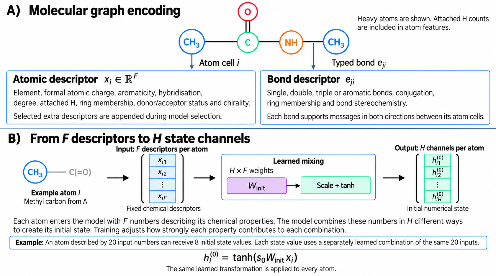

*Chemical descriptors initialise atom states, and bonds define local communication. Channel counts in this explanatory figure are illustrative; the submitted CYP3A4 GP model uses 24.*

### Repeated local interactions

At each generation, an atom receives messages from bonded neighbours. The model combines those messages with its current state, original chemical descriptors and CYP context, then applies the selected cellular automaton transition rule. Repeating this process for **128 generations** creates the GP model's molecular space-time trajectory.

The molecular graph remains fixed. Computational time counts numerical updates, and the channels represent learned information. This is a computational representation rather than a simulation of molecular motion or chemical reaction kinetics.

## 4. Converting the trajectory into a prediction

Molecules have different numbers of atoms, so we summarise their trajectories into fingerprints of a common length. The GP configuration retains final atom-state means and variances, average states through time, temporal variation and the magnitude of state changes. Multiscale pooling also records molecular mean states at 12.5%, 25%, 50%, 75% and 100% of the trajectory.

Additional enabled summaries describe the change from initial to final molecular mean, correlation between successive generations and squared changes between those multiscale sampling points. These features allow the predictor to use information about the path followed by the numerical states.

**Ridge regression** fits coefficients that combine the fingerprint values into a pIC50 prediction, with a penalty discouraging excessively large coefficients. During training, molecules in a batch are divided into a **support subset**, which fits those coefficients, and a **query subset**, which measures prediction error.

We obtain the coefficients by solving a regularised linear system. The calculation is differentiable, allowing backpropagation to follow query error through the ridge fit, trajectory summaries and every cellular automaton generation. Adam adjusts numerical weights that initialise atom states and transform chemical and neighbour information. After training, the ridge readout is refitted using the observations permitted for fitting that checkpoint.

## 5. Four approaches to learning molecular space-time

All four compared approaches use fitted ridge regression.

| Method | What is searched or adjusted? | Training of numerical weights |
|---|---|---|
| **BP-Graph-CA** | Predefined transition-rule families and model settings are compared. | Backpropagation through the trajectory and ridge fit. |
| **ES-Graph-CA** | Small paired perturbations produce candidate weight sets, whose prediction errors guide further updates. | Evolutionary strategy, without backpropagation. |
| **GA-Graph-CA** | A genetic algorithm chooses settings such as rule family, channel count, generation count and trajectory summaries. | Backpropagation inside each candidate design. |
| **GP-Graph-CA** | Genetic programming changes the mathematical expression defining the local transition rule. | Backpropagation inside each candidate rule. |

The BP campaign screened ten transition-rule families for each target. Across its final four-target combination, the retained families were FitzHugh–Nagumo, Gray–Scott, conservative graph flux, damped symplectic and delayed memory. The ES, GA and GP searches focused on CYP3A4. Submitted GA and GP combinations retained the existing BP predictions for the other three targets.

The GA search selected a CYP3A4 design with 128 generations, 24 channels, comprehensive chemical features and multiscale trajectory summaries. GP retained this design while searching the form of its transition rule.

## 6. How genetic programming works here

### Candidate rules

An **expression tree** is a branching description of a mathematical calculation. The ends of the branches hold inputs, while the joining points hold operations. A rule that averages two inputs has two input leaves connected by one averaging operation.

The search could use four inputs:

| Input | Meaning |
|---|---|
| Local-input vector | A learned combination of the atom's current state, chemical descriptors, bonded-neighbour information and CYP context. |
| Current state | The atom's 24 numerical channels at the current generation. |
| Bonded-neighbour difference | Mean state of bonded neighbours minus the atom's own state. |
| Delayed-state difference | An earlier retained atom state minus its current state. |

Permitted operations were addition, subtraction, multiplication, averaging, negation, hyperbolic tangent, sine and multiplication by a fixed scale. Available scales were −1, −0.5, 0.25, 0.5 and 1. Expression-tree depth was limited to four.

### Training and selecting rules

The campaign evaluated **four successive populations of 24 distinct candidate rules**. One population is a genetic generation, meaning a round of rule search. Cellular automaton generations are the repeated atom-state updates within each molecular trajectory.

For each candidate, backpropagation trained its numerical model weights and separate scaffold-validation molecules measured prediction error. Lower validation error favoured selection. A penalty of 0.0005 per expression-tree node discouraged unnecessary complexity. The archived search records label the error MA-ST-RAE; this CYP3A4-only search reports a single-target quantity, which we call **CYP3A4 ST-RAE** here.

Parent selection compared groups of three candidates. Crossover exchanged branches between parental expressions. Mutation, with probability 0.35, replaced a chosen branch with a newly generated expression. These operations proposed rules for subsequent training and evaluation.

**Each candidate rule remained fixed throughout its training run and each molecular trajectory.** Backpropagation trained its numerical weights. Genetic changes to the rule occurred between candidate evaluations.

### Search budget

The 96 candidates each underwent two-fold screening for up to 35 training epochs, giving 192 runs. Five finalists underwent confirmation using five scaffold folds and two random seeds for up to 80 epochs, giving 50 more runs. The campaign completed **242 training runs**.

### The selected transition rule

Candidate `g00_c02`, introduced in the initial population, was the confirmed winner. It averages the learned local-input vector and the bonded-neighbour difference:

```math
u_i^{(t)} = \frac{1}{2}\left(r_i^{(t)} + \bar h_i^{(t)} - h_i^{(t)}\right),
\qquad h_i^{(t+1)} = \tanh\left(h_i^{(t)} + 0.08u_i^{(t)}\right).
```

Here, $h_i^{(t)}$ is atom $i$'s state at generation $t$, $r_i^{(t)}$ is its learned local-input vector and $\bar h_i^{(t)}$ is the mean state of its bonded neighbours. The factor 0.08 controls update size, and the hyperbolic tangent bounds the next state. The selected tree contains three nodes: two inputs and their averaging operation.

### Fixed CYP3A4 GP configuration

These settings apply to the evolved CYP3A4 component. The other three targets retain their existing BP configurations.

| Setting | Value |
|---|---|
| Cellular automaton generations / channels per atom | 128 / 24 |
| Chemical feature profile / trajectory pooling | Comprehensive / multiscale |
| Neighbour degree-normalisation exponent | 1.0 |
| Initial-to-final change and successive-state correlation summaries | Enabled |
| Squared changes between multiscale sampling points | Enabled |
| Chemical-feature gating / initial-state anchoring / channel-specific timescales | Disabled |
| Multi-lag correlations / temporal extrema / separate increase-decrease summaries | Disabled |
| Graph-CA learning rate / ridge penalty | 0.003 / 0.01 |
| Update scale / initial-state scale / initial noise | 0.08 / 0.5 / 0.005 |
| Molecules per batch / support fraction | 64 / 0.75 |
| Gradient clipping / Graph-CA L2 penalty | 0.5 / 0.0001 |
| Confirmation seeds | 1701 and 4211 |

The [saved search design](genetic_programming_design.json) records the full configuration.

## 7. Three distinct evaluation stages

We grouped compounds by Bemis–Murcko scaffold, the structural skeleton formed by rings and connecting chains. Reserving 20% of scaffold groups left 5,216 observed compound–CYP pairs for fitting and selection and 1,309 for reserved-holdout evaluation. Scaffold groups were exclusive to the two partitions.

| Stage | Data used | Purpose |
|---|---|---|
| **Scaffold validation** | Folds within the fitting pool, with scoring molecules separated from each run's fitting molecules. | Select settings, candidate designs, rules and stopping points. |
| **Reserved holdout** | The 1,309 observations set aside before model selection. | Test the selected frozen prediction system locally. |
| **Competition blind evaluation** | Organisers' concealed measurements for 750 challenge molecules. | Measure external predictive performance after submission. |

Two-fold screening identifies promising candidates. Five-fold confirmation rotates the scoring fold through five groups, and two seeds produce ten training runs per candidate. Confirmation standard deviations describe variation across these ten runs, using a sample-standard-deviation denominator of nine. Bootstrap intervals for the reserved holdout quantify a different source of uncertainty.

**ST-RAE** is soft-threshold relative absolute error for one CYP target. It accounts for experimental uncertainty, assigning zero error to predictions within the reported uncertainty interval. **MA-ST-RAE** averages ST-RAE equally across the four targets. Lower values indicate smaller error. RMSE and MAE describe error magnitude in pIC50 units; R-squared and rank correlations provide complementary measures of agreement.

The reserved holdout was excluded from candidate selection, early stopping and fitting ensemble weights. Concealed challenge labels were unavailable during training and local evaluation. Frozen models generated the submitted predictions.

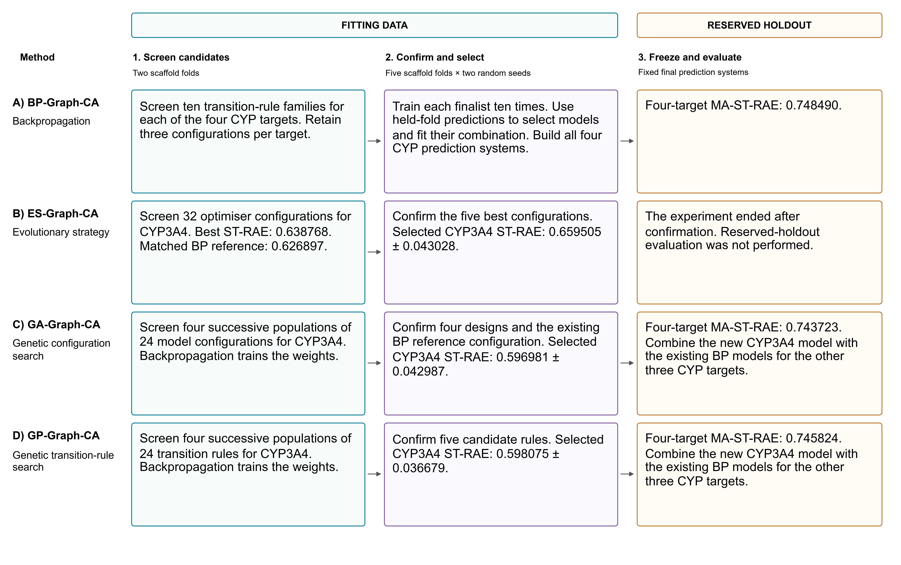

*The workflow separates model selection from reserved-holdout evaluation. GA and GP combine the selected CYP3A4 component with retained BP systems for the other three targets.*

## 8. Predictive results

These tables reproduce the manuscript's recorded evaluation results for the studied submissions. They are an archived record rather than a live leaderboard feed.

### CYP3A4 scaffold validation

| Method and stage | CYP3A4 ST-RAE | RMSE, pIC50 |
|---|---:|---:|
| ES best two-fold screen | 0.638768 | 0.803659 |
| ES five-fold, two-seed confirmation | 0.659505 ± 0.043028 | 0.817975 ± 0.042879 |
| GA five-fold, two-seed confirmation | 0.596981 ± 0.042987 | 0.781116 ± 0.035890 |
| GP five-fold, two-seed confirmation | 0.598075 ± 0.036679 | 0.772706 ± 0.032415 |

In the matched two-fold comparison, BP achieved CYP3A4 ST-RAE 0.626897 and ES achieved 0.638768. This favoured backpropagation, and ES concluded after scaffold validation. During confirmation, GA had the lower ST-RAE and GP the lower RMSE. The [GP confirmation ranking](confirmation_ranking.csv) preserves its candidate-level record.

### Reserved-holdout evaluation

After selection and freezing, the submitted combinations gave:

| Method | Four-target MA-ST-RAE | RMSE, pIC50 | CYP3A4 ST-RAE |
|---|---:|---:|---:|
| BP-Graph-CA | 0.748490 | 0.847738 | 0.528032 |
| ES-Graph-CA | Not evaluated | Not evaluated | Not evaluated |
| GA-Graph-CA | **0.743723** | **0.841572** | **0.508964** |
| GP-Graph-CA | 0.745824 | 0.848265 | 0.517368 |

The other three target scores were unchanged: CYP1A2 ST-RAE was 0.816136, CYP2C9 was 0.713018 and CYP2D6 was 0.936774. GP's confirmation score of 0.598075 and holdout score of 0.517368 concern different molecule sets at separate evaluation stages.

For GP, 1,000 bootstrap resamples gave mean MA-ST-RAE **0.746602**, with a **95% interval of 0.708890–0.788464**. The directly calculated point score is **0.745824**. Bootstrap macro MAE was 0.614381 pIC50, R-squared 0.292879, Spearman correlation 0.542557 and Kendall correlation 0.390626. The [study summary](study_summary.json) contains the full metrics and intervals.

### Recorded competition blind results

| Official blind metric | BP-Graph-CA | GA-Graph-CA | GP-Graph-CA |
|---|---:|---:|---:|
| MA-ST-RAE | 1.0092 | 1.0020 | **0.9946** |
| Macro MAE, pIC50 | 1.0789 | 1.0745 | **1.0688** |
| Macro R-squared | -0.0744 | -0.0724 | **-0.0656** |
| Macro Spearman correlation | 0.5345 | 0.5444 | **0.5498** |
| Macro Kendall correlation | 0.3762 | 0.3840 | **0.3878** |

GP produced the strongest recorded blind result across all five measures, with MA-ST-RAE 0.0146 lower than BP. GA had the lowest reserved-holdout MA-ST-RAE, illustrating why local holdout and external blind evaluation are reported separately.

The blind rank correlations indicate useful ordering information. Absolute accuracy remains limited: MA-ST-RAE is close to the mean-prediction baseline and macro R-squared is negative. The improvement is modest, and its statistical reliability has not been established by these point estimates. Our primary scientific aim is to use this task to investigate information propagation and emergent dynamics on molecular graphs.

## 9. Frozen submission composition

| Target | Prediction component |
|---|---|
| CYP1A2 | Retained CIA-EA-CV-CYP-GCA backpropagation system. |
| CYP2C9 | Retained CIA-EA-CV-CYP-GCA backpropagation system. |
| CYP2D6 | Retained CIA-EA-CV-CYP-GCA backpropagation system. |
| CYP3A4 | Mean prediction from ten frozen `g00_c02` checkpoints, covering five folds and two seeds. |

The [submitted CSV](GP-CIA-EA-CV-CYP-GCA_OpenADMET_submission.csv) contains 750 unique molecule rows and 3,000 finite predictions, with these columns:

```text
SMILES
Molecule_Name
CYP1A2_pIC50_direct_inhibition
CYP2C9_pIC50_direct_inhibition
CYP2D6_pIC50_direct_inhibition
CYP3A4_pIC50_direct_inhibition
```

The [inference manifest](inference_manifest.json) records successful schema validation and `labels_loaded: false`. Historical long method names remain in filenames and saved records so that the exact submitted artefacts remain traceable.

## 10. Molecular space-time and dynamical behaviour

Retained atom states also allow us to study how information changes after training. With molecular graph, transition rule and weights fixed, we follow successive numerical states. One complete set of atom-state values represents a point in computational state space; successive sets form a trajectory.

The manuscript reports a separate investigation across ten predefined rule families. Short-horizon screening covered 13,090 trajectories, followed by longer analyses of selected examples. Tests measured continued change, returns to earlier states, frequency content and growth of small initial perturbations. Lyapunov exponents estimate average expansion or contraction of small displacements; several positive exponents indicate expansion along several independent directions.

Two Kuramoto–Sakaguchi systems showed bounded hyperchaotic behaviour over the measured intervals. Their complete finite-time spectra contained 29 and 30 positive exponents and negative total sums, consistent with expansion in several directions alongside average local-volume contraction. Their fractal dimensions remained unresolved. A discontinuity where the numerical phase interval wraps complicates interpretation as smooth chaotic motion, leaving classification as strange attractors provisional.

These examples come from separate fixed-rule analyses. They do not establish that the submitted evolved CYP3A4 rule is a strange attractor. The [extended dynamical-analysis archive](../strange_attractor_audit_20260929/README.md) documents the retained trajectories and diagnostic arrays.

### Existing trajectory videos

**Fixed-rule and genetically programmed trajectories.** This illustrates a fixed inertial reaction-diffusion rule and the selected GP expression. Colour represents numerical atom state and downward progression represents generations. It is an illustrative comparison; the submitted checkpoint provenance is recorded separately.

https://github.com/user-attachments/assets/c0ad14b7-4cd1-471e-92d6-8e78310d4b5e

[Open the comparison video](../../output/videos/molecular_spacetime_trajectory_cascade_gp_vs_backprop_linkedin.mp4).

**Four recorded 1,000-generation trajectories.** Each column follows a separate molecule-rule trajectory, retaining earlier colour-coded states as the molecule moves down the display.

[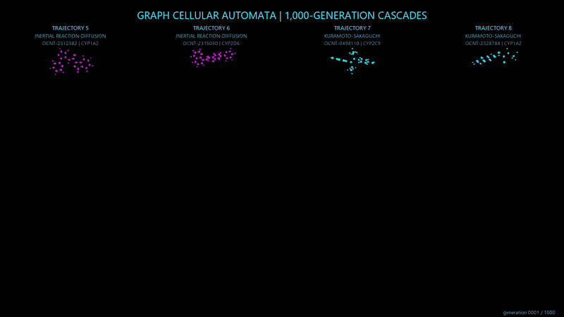](../ds_gcae_1000_generation_pymol/trajectories_05_06_07_08_four_column_atom_cascade.mp4)

[Open the four-trajectory video](../ds_gcae_1000_generation_pymol/trajectories_05_06_07_08_four_column_atom_cascade.mp4).

**Four dynamical examples.** This comparison shows convergence, a hyperchaotic candidate, persistent complex variation and a candidate period-two oscillator. The manuscript's later analysis provides the qualifications concerning phase discontinuity and unresolved fractal geometry.

https://github.com/user-attachments/assets/e30b0641-6eca-4ded-a3a2-dd6f9d149b2c

[Open the four-example dynamics video](../long_horizon_attractor_campaign_v1/videos/four_graph_ca_dynamical_regimes_2x2.mp4).

## 11. Reproducibility and limitations

The [manuscript PDF](../../output/pdf/SUBMISSION_publication_high_resolution_20261024.pdf) provides the full account and bibliography. Supporting records include:

- [Search design and training settings](genetic_programming_design.json).
- [Candidate confirmation ranking](confirmation_ranking.csv).
- [Selected rule, submission composition and holdout metrics](study_summary.json).
- [Inference checks](inference_manifest.json) and [submitted predictions](GP-CIA-EA-CV-CYP-GCA_OpenADMET_submission.csv).
- [GP campaign runner](../../scripts/run_genetic_programming_graph_ca_campaign.py) and [submission finalisation script](../../scripts/finalize_genetic_programming_graph_ca_submission.py).
- [Gallery rendering script](../../scripts/render_appendix_gallery.py) and [gallery images](../../publication/figures/appendix_e_gallery).

The repository contains the linked code and compact records. The saved configuration documents the training procedure; this report does not imply that every training checkpoint is publicly included. Original challenge-data access remains subject to the organisers' conditions.

The predictive findings concern these datasets, partitions and submitted combinations. A matched descriptor-only comparison could quantify the additional value of repeated local interactions. The dynamical conclusions concern the measured trajectories and numerical settings. The gallery provides qualitative illustrations, with quantitative claims supported by the separate tests in the manuscript.

## Appendix. A gallery of molecular space-time

This ten-page gallery illustrates the aesthetic beauty and visual variety of information passing across molecular graphs. Each family has three paired examples, giving 30 recorded trajectories. **Every example comes from a fixed-rule Graph-CA trained by backpropagation, labelled BP-Graph-CA on its page.** The preceding sections describe the distinct GP submission.

In each row, the **left panel** shows atoms in stored graph order horizontally and generations downwards. The **right panel** places the same recorded colours on traces derived from a three-dimensional molecular conformer. Rotation changes the viewing angle as generations descend. Coloured curves connect successive displayed positions of each atom, and bonds appear at the beginning, midpoint and end. Bonds determine communication during calculation; column order in the flat view is a display choice.

Both views use identical state values and colour scales. Colour shows the first state channel, except for Kuramoto–Sakaguchi, where it shows the first wrapped phase divided by pi on a cyclic scale. These are dimensionless numerical quantities. A common scale applies to all three examples on each page, with a wider range for conservative graph flux.

E1–E9 show generations 0–1,000, while E10 shows the available interval of 0–256. Molecule identifiers and CYP contexts appear on each page. Independently trained models and different molecules contribute to the visual differences, so the gallery supports qualitative exploration rather than matched comparisons of rule performance.

### E1. Gated residual

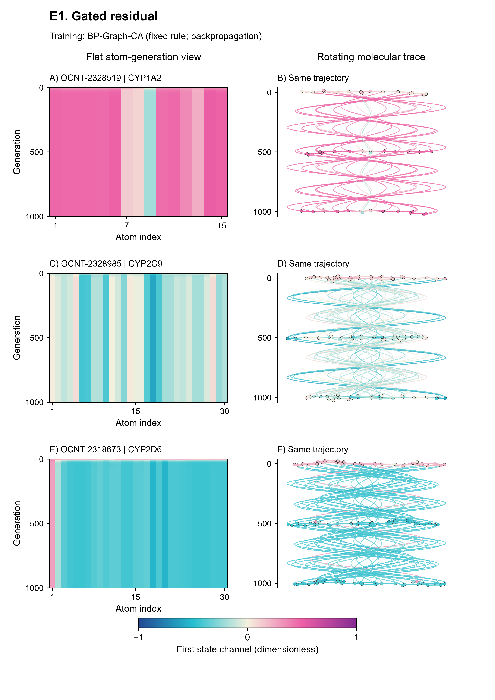

### E2. Inertial reaction-diffusion

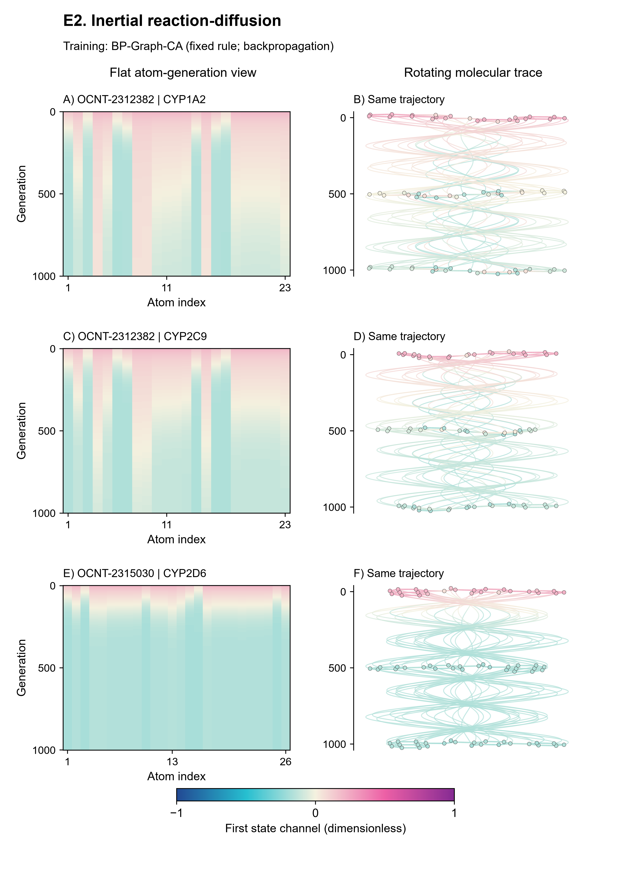

### E3. FitzHugh–Nagumo

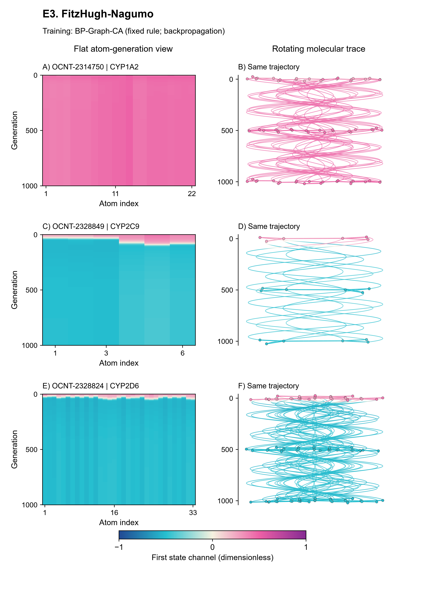

### E4. Kuramoto–Sakaguchi

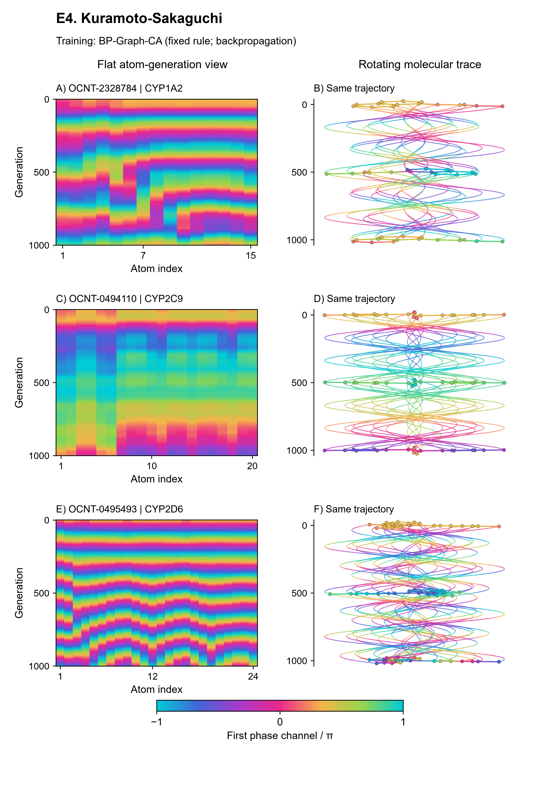

### E5. Delayed memory

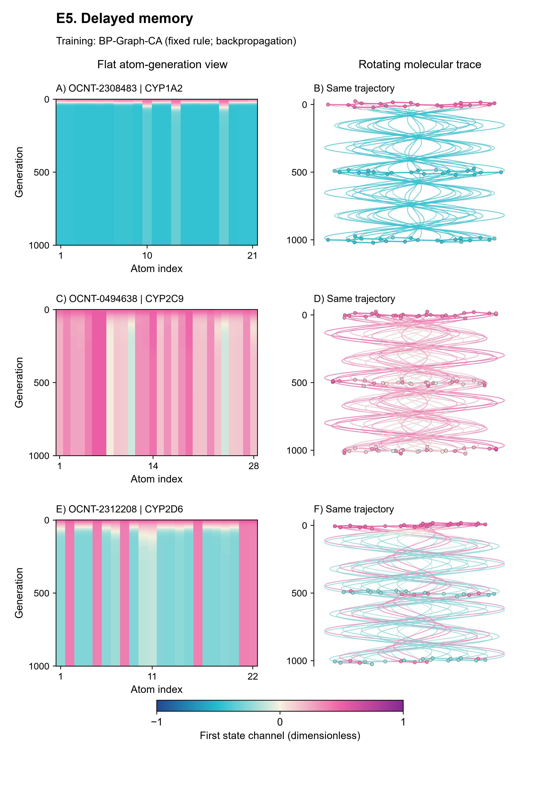

### E6. Gray–Scott

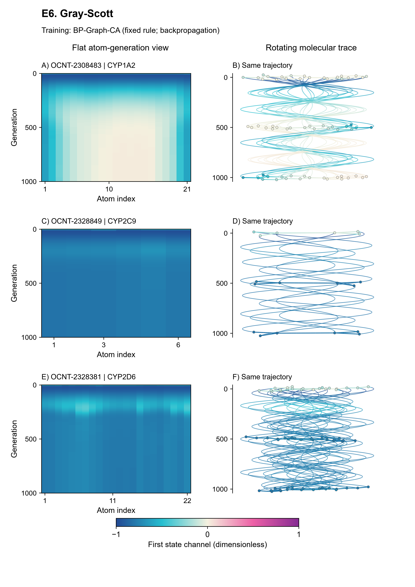

### E7. Coupled map

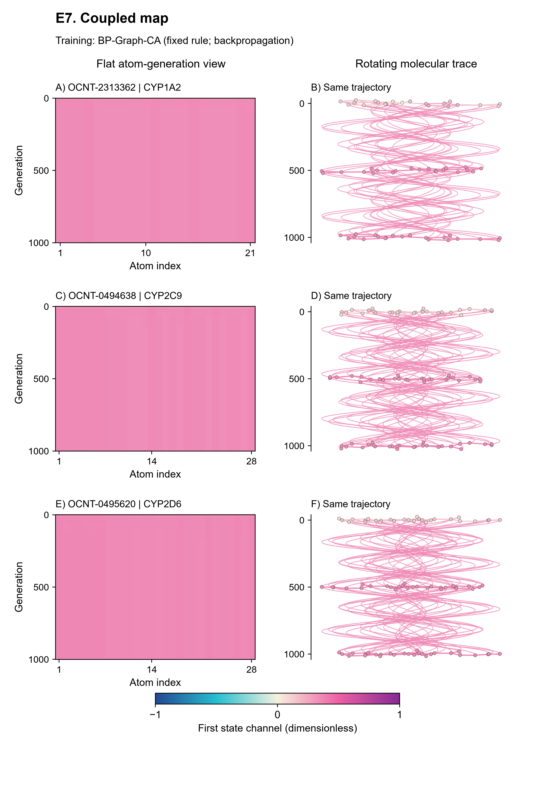

### E8. Activator–inhibitor

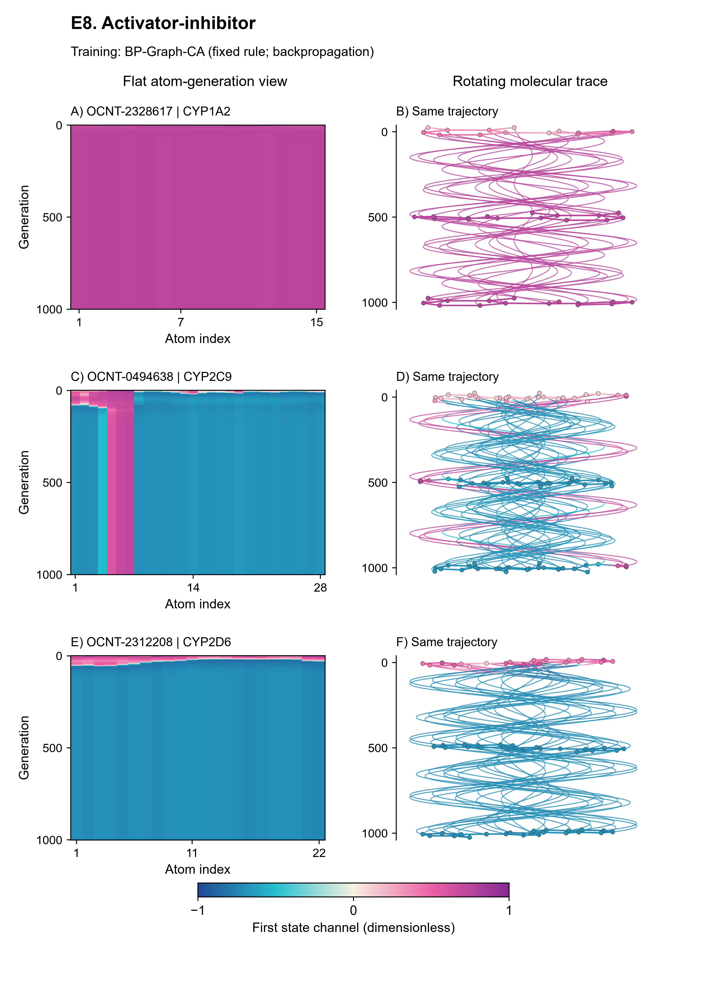

### E9. Damped symplectic

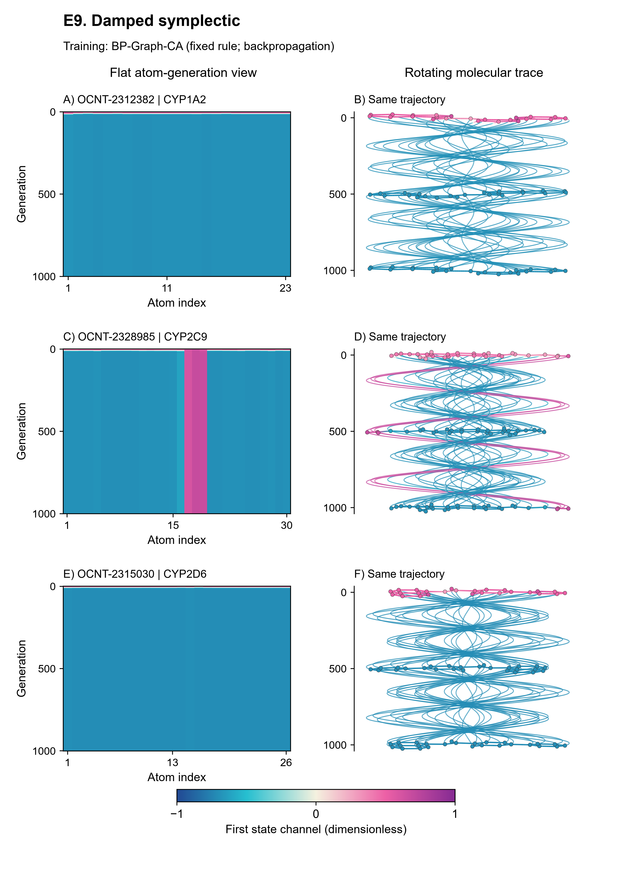

### E10. Conservative graph flux

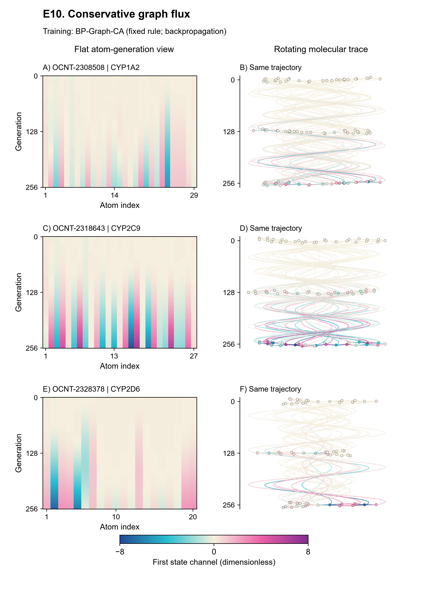
